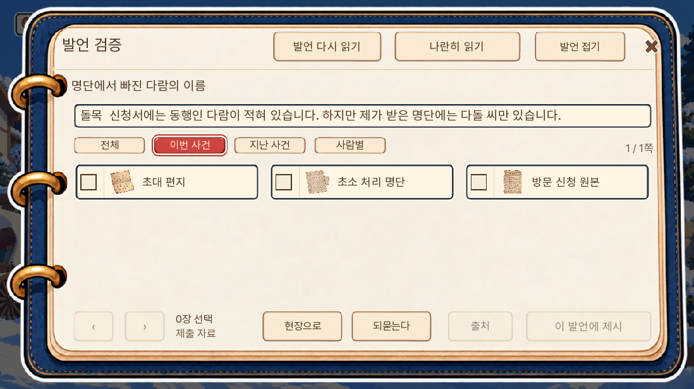
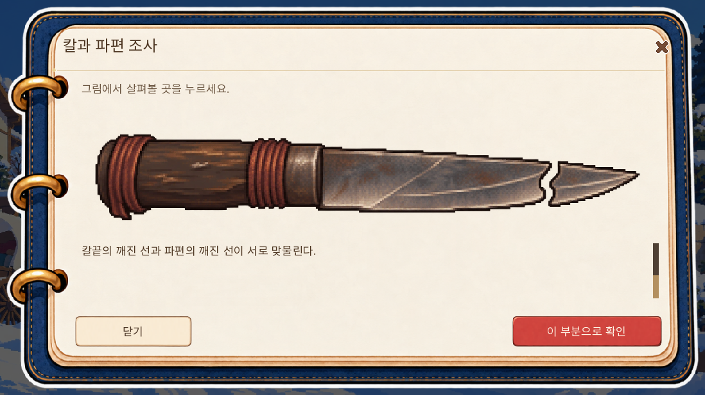
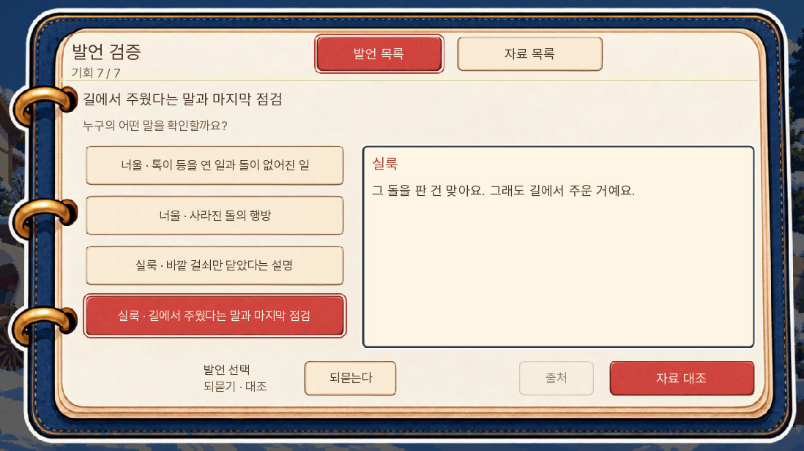
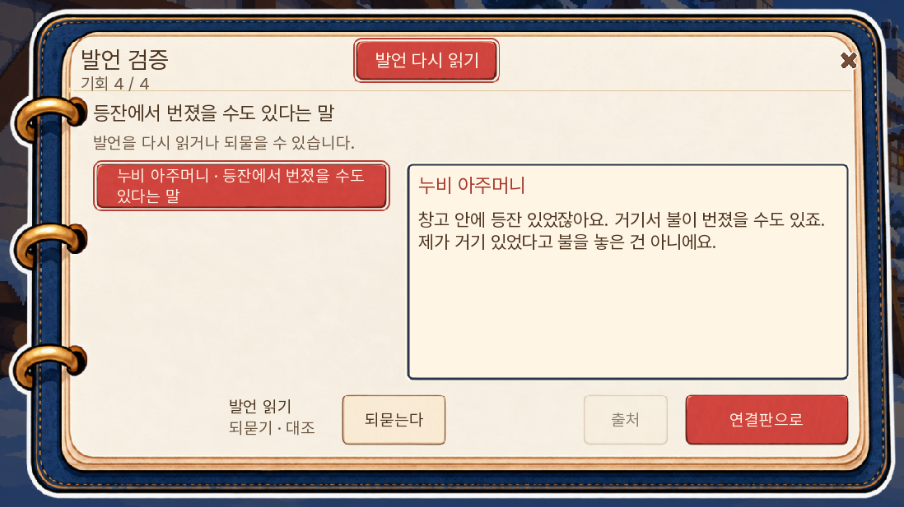
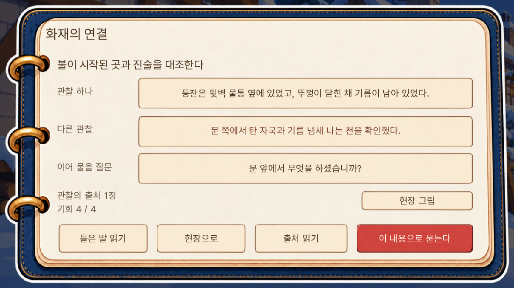
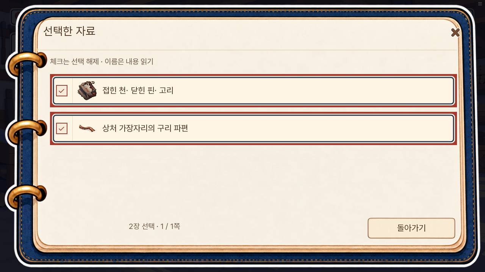
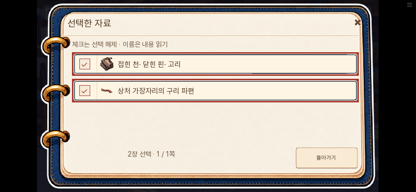
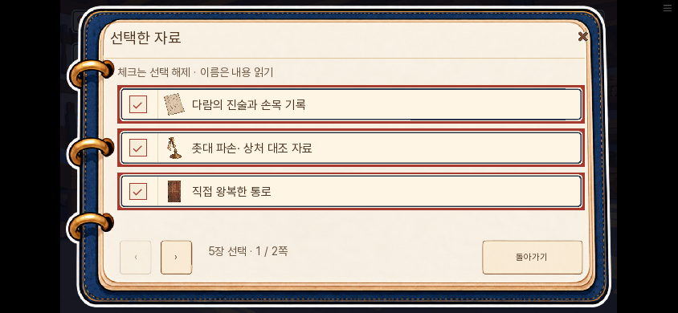

# 0.20.142 병렬 리뷰 후 수정 검수

2026-11-09. 0.20.141의 6개 파트 리뷰에서 확인한 항목을 수정했다. 정답·대체 조합·기회·획득·생사·결말·공개 1부 7일 경계는 유지한다. 새로운 그림이나 소리는 추가하지 않았다.

## 수정 결과

| 리뷰 항목 | 적용 |
|---|---|
| 작성자 미확정인데 아내가 보냈다고 단정 | 2일 쪽지에서 ‘당신이 보낸’을 제거하고 도착·재회 요청 유지 |
| 첫 방의 같은 비교 지시 반복 | 아빠 제안 뒤 다람이 ‘응. 나도 같이 읽을래.’로 응답 |
| 칼의 맞물림을 NPC가 먼저 설명 | 칼 요청 두 줄→플레이어 실물 접점 확인→톡의 일치 설명으로 이동. 기존 라벨·호출 identity 유지 |
| 이미 확인한 돌 판매를 다시 부정하는 마지막 쟁점 | 판매는 인정하고 길에서 주웠다는 취득 경위에 집중. 실제 발언·재인용·제목 동기화 |
| 화재 근거별 질문 뒤 같은 등유 질문 반복 | 선택 질문 다음 누비의 기존 답으로 연결. 근거 없는 구 저장 fallback 유지 |
| 보리 잔여 하오체 | 목격 발화와 두 재인용을 ‘봤어요’로 통일 |
| 자료 제시 전 11일 해설 | 사전 문장은 비교할 질문으로, 결론은 정답 제출 뒤로 이동. 조건·메뉴·판정 유지 |
| 한 발언인데 별도 선택 절차 | 처음 여는 단일 발언은 인용이 펼쳐진 자료 목록. 재독·되묻기·명시적으로 저장한 화면·두 문서 비교는 유지 |
| 선택 자료 이름이 현재 쪽에 없음 | ‘N장 선택 / 모아보기’에서 선택 이름을 함께 확인하고 읽기·해제·복귀. 원래 자료의 페이지 수 유지 |
| 긴 발언 행의 여백 부족 | PC 행 높이56→72, 터치88 유지. PC4행·터치3행 유지 |
| 화재 복귀 중복 | 상단 복귀 제거, 하단 주행동과 X 유지 |
| 획득 알림이 화재 관찰을 덮음 | 화재 읽기 판을 닫을 때까지 알림 표시·만료 보류 |

앞선 리뷰의 화재 중복 질문 화자는 잘못 적혀 있었다. 정확히는 아빠의 근거별 질문 뒤에 보리가 공통 등유 질문을 다시 하는 구조였고, 이번 수정은 선택 질문→누비 답변으로 잇는다.

## 검사 범위

전체 단위 1,637개 통과, lint 통과, 대사 논리 A/B/C 각각0. 보리 말투 변경에 따라 literal 목록·자료 자리표를 재생성했고, 구 문장을 기대하던 쪽지 검사를 갱신한 뒤 전체 단위를 재실행했다.

SDK 장면10개가 통과했다([결과](SDK결과.json)). 새 게임부터 입구 원본 제시·발언 갱신·등록 성공은 실제 입력 경로다. 3일 전체 회의에서는 칼 실물 조사 전 일치 설명 미출력과 확인 뒤 출력을 검사했다. 미수 분기 저장/터치, 화재 실제 질문·자백 및 두 책임 분기, 후반 발언·자료와 11일 대체 두 자료 제출, 첫 방 비교도 확인했다. 후반의 과거 QA 한 개는 폐기된 r13_crisis_proof를 기대하여 현재 자료판 입력으로 갱신한 뒤 통과했다.

입구 외의 대부분은 시작 상태를 준비한 장면 검사다. 이번 수정 후 1~7일 연속 자연 완주나 14일 전체 완주를 반복하지 않았다. 일반 사용자 기기의 렉 해소나 전체 화풍 통일도 이번 검사로 확정하지 않는다.

기존 논증 호출·정답 인자, JSON의 text 외 ID·조건·표정·연결 구조가 보존됐음을 원본과 대조했다. 웹 빌드의 첫 로딩 자료는36,761,640바이트로 직전보다6,251바이트 늘었다([빌드 요약](빌드요약.json)).

웹에서 0.20.141 준비 상태 저장을 실제로 불러오고, 0.20.142에서 저장→새로고침→불러오기를 검사했다. 청취 발언과 선택 자료가 일치했다. 모아보기 이름 읽기·닫기는 선택을 보존하고 체크 해제는 해당 자료만 뺐다. 다섯 자료의 2쪽 이동도 선택을 유지했다. PC·휴대폰에서 확인했고 브라우저 예외0이다([웹 결과](웹결과.json)).

별도 담당자가 새 SDK·웹 캡처13장을 직접 보고 원지적의 해결과 새 가림·잘림 없음을 확인했다([독립 검수](독립검수.json)). 추가 다섯 자료 쪽 넘김은 루트가 실행·확인했다. 이는 서로 다른 두 사람이 같은 입력을 독립 실행했다는 뜻은 아니다.

## 실제 화면

새 게임의 원본을 제시한 뒤: 인용을 펼친 자료 화면에서 바로 시작한다. 선택 전 제출은 비활성이다.

준비한 3일 회의: 칼의 접점을 직접 확인한 뒤 설명을 듣는다.

판매가 아닌 취득 경위를 다투는 마지막 발언이다.

화재의 두 줄 제목에 여백을 확보하고 복귀 조작을 정리했다.

알림이 첫 관찰 문장을 덮지 않는다.

## 남긴 기획 범위

5일 반론에 새 증거 판정을 추가하는 확장, 11일 기존 이유 선택 전체를 없애는 구조 변경은 이번에 하지 않았다. 실무 의견으로는 실제 연속 플레이에서 반복의 길이를 다시 확인한 뒤 조정할 항목이다. 이번 수정은 사전 해설·표시·문답 중복을 줄이는 범위다.

## 웹 선택 자료

현재 쪽 밖에 있는 두 자료도 한 화면에서 이름과 그림을 확인한다.

다섯 자료는 세 개씩 두 쪽으로 읽고, 쪽 넘김은 선택을 바꾸지 않는다.

웹 화면 검사는 배포와 같은 묶음을 로컬 서버에서 연 결과다. 공개 주소의 직접 시각 검사는 네트워크 정책상 실행하지 않았으며, 공개 반영은 저장소 전송 해시와 Pages 완료 상태를 별도로 대조한다.
