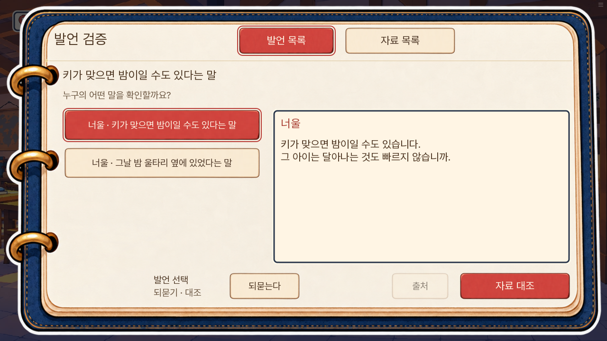
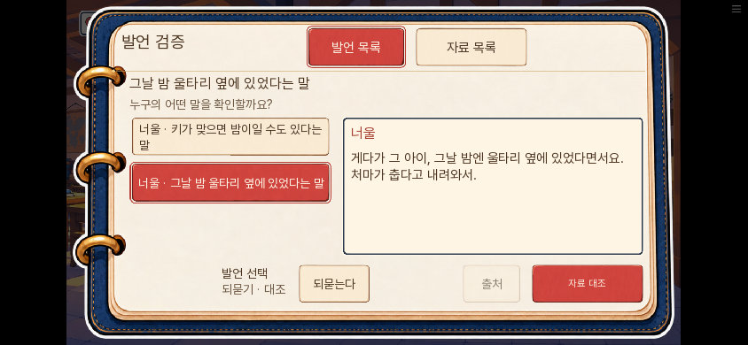

# 1부 연속 완주 후 추가 수정 검수 — 0.20.143

2026-11-09. 0.20.142에서 새 게임부터 7일차 화재 결말까지 연속 진행해 찾은 문제를 수정했다.

| 발견한 문제 | 반영 |
|---|---|
| 5일차 서로 다른 두 발언의 제목이 같음 | 발언별 제목 메타데이터를 추가해 키 추정과 울타리 목격담을 구분 |
| 떠난 초롱이 다시 답하는 연결이 없음 | 아빠가 부르고 초롱이 돌아오는 지문 추가 |
| 2일차 초상의 원래 목적이 선물로 바뀜 | 엄마를 찾는 데 그림을 쓰고, 엄마를 찾은 뒤 그 그림을 선물하는 순서로 수정 |
| 3일차 수령 직후 코 누락을 자동으로 두 번 설명 | 이어지는 묘사에서는 표정과 목도리만 서술 |
| 바둑이·무쇠 근접 그림의 매끈한 질감 | 미교체. 표정·소품·손바닥 글씨까지 맞는 납품본 확인 요청 2건 등록 |

발언 제목은 저장 캐시를 바꾸지 않고 실제로 들은 대사에만 적용한다. 초상 대사 3줄과 초롱 지문 1줄의 문장만 바꿨다. 대사 ID·자료 획득·조건·정답·기회·생사·결말·7일 공개 경계는 유지한다.

검증: 전체 단위 1,639개 통과, lint 통과, 대사 검사 A/B/C 0. SDK `hearing141_early`, `hearing140_lamp_complete`, `room_letter_reading_without_spot_quiz`, `review143_dialogue_connections`, `review143_hearing_titles` 모두 통과. 수정 대사 표시, 실제 들은 두 발언의 분리, 발언 선택, 저장·복원 후 대상 유지 확인. SDK 장면은 조건을 준비한 검사이며 자연 플레이 재완주가 아니다. SDK touch 변형 사진은 물리적 휴대폰 화면 검증으로 세지 않는다.

그림 후보는 현행 원본·dialogue-dot-v2·canonical48을 대조했다. 기존 픽셀 후보 중에는 무쇠의 불안 표정에서 손바닥 글씨가 없거나, 바둑이 소품이 달랐고, 거친 잔여 테두리가 있었다. 연결된 Drive에서도 정확한 인물명과 이미지·압축파일 조건으로 검색했으나 적합한 납품본을 찾지 못했다. 검색한 범위 밖에 파일이 없다고 단정하지 않는다. 요청은 `CLOSEUP-DOT-BADOOK-143`, `CLOSEUP-DOT-MUSOE-143`이며 외부 전송은 하지 않았다.

SDK 초롱 캡처의 초상 획득 알림은 준비 상태의 잔류이므로 제품 오류로 판정하지 않고 대표 캡처에서 제외한다. 바뀐 화면 6장은 독립 검토에서 텍스트·버튼 잘림이 없었다.

웹에서는 0.20.143의 실제 빌드를 로컬 서버에서 열어 0.20.142의 실제 7일 완주 저장을 화면 메뉴로 불러왔다. 피코 사망·화재 대피 상태를 확인했다. 과거 5일차 발언 화면은 표시용 오버레이를 준비했다. 아래 두 캡처는 그 화면에서 실제 발언을 선택한 결과다. 전체 7일을 웹에서 다시 진행한 검사가 아니다.

두 번째 수동 슬롯에 화면 메뉴로 저장한 뒤 페이지를 새로고침하고 불러왔다. 발언 기록과 선택 자료가 일치했고, 이 실행에서 pageerror 0건·게임 예외 화면 0건이었다. 자동화 중 API로 직접 load를 실행한 시도는 검사 브리지가 중단되어 판정에서 제외하고, 화면 메뉴 입력으로 다시 확인했다. 전체 분기·모든 모바일 기기·일반 GPU의 성능 검사는 이번 범위가 아니다.

웹 빌드: 묶음 SHA-256 `4d50914f8d3cd9c1d08a55f01d3bb3ea8ac956a92d54a133588a5c0419151b7b`, 첫 게임 데이터 36,762,305바이트(엔진 제외). 이번 수정은 성능 개선 검증이 아니며 지연이 해결됐다고 판단하지 않는다. 정확한 빌드는 로컬에서 검증했고, 공개 서버는 Pages 작업과 원격 해시로 별도 확인한다.
