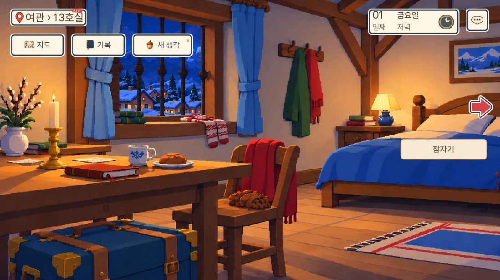
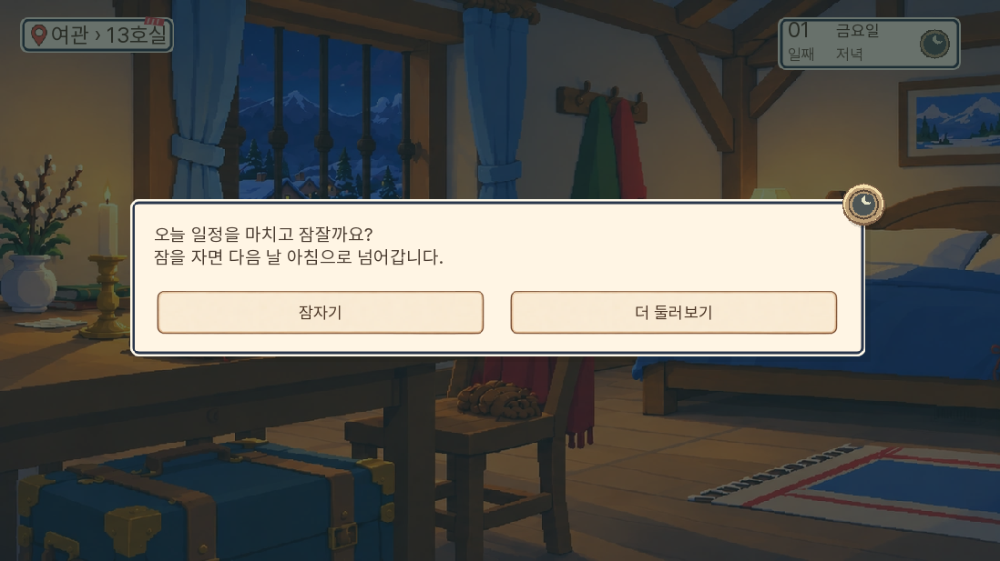
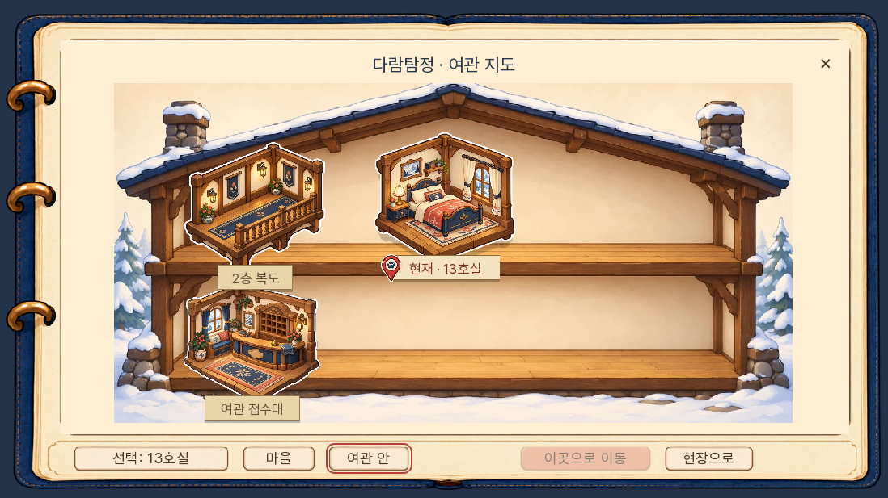
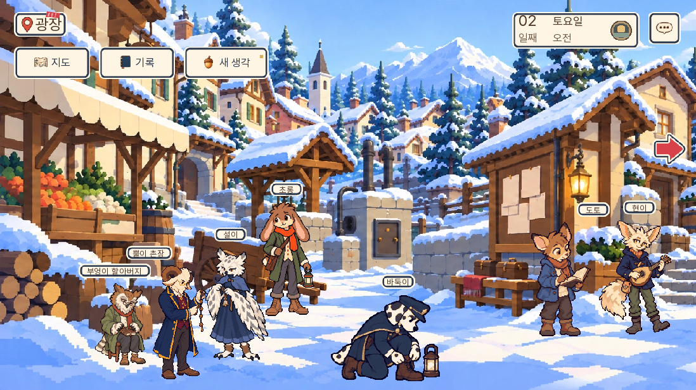
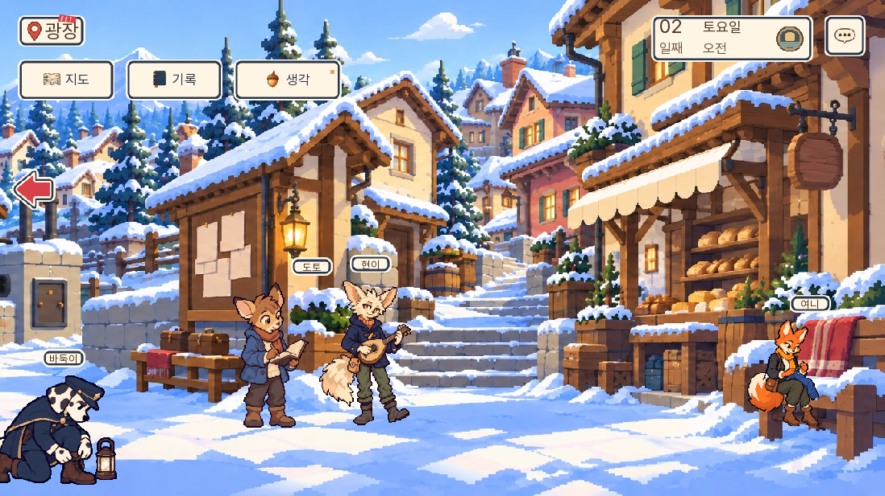
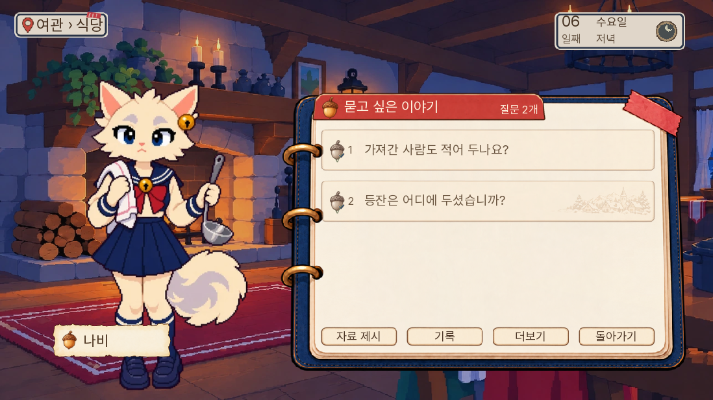
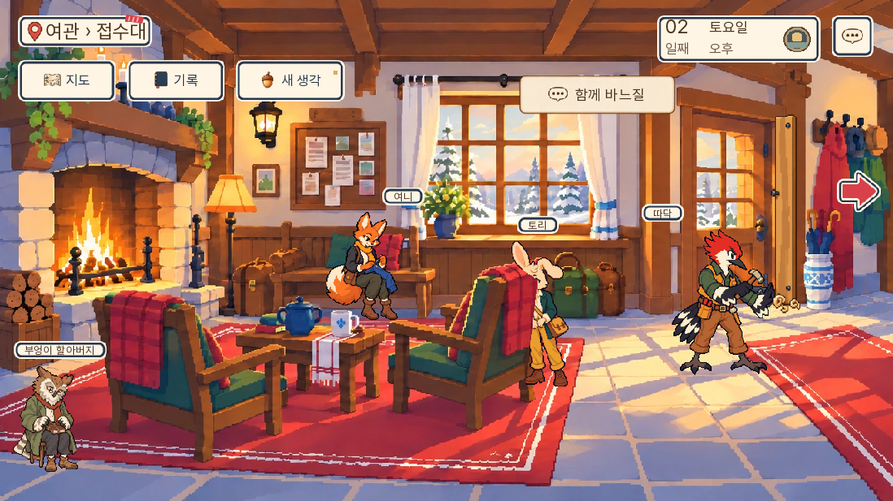
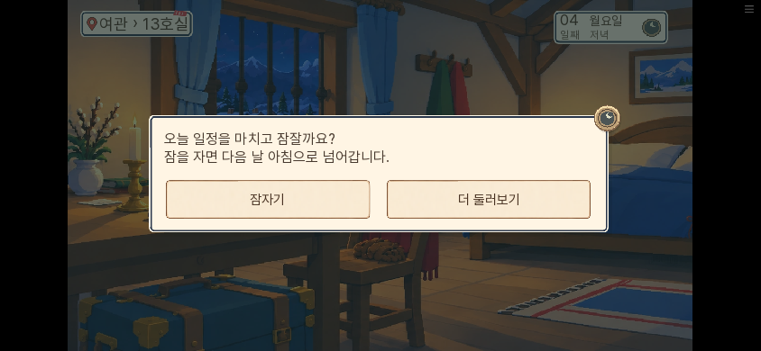

# 수면·재탐색·주민 접근 수정 검수 — 0.20.144

2026-11-09. 사용자의 침대 동작·여관 이동·광장 인물 위치·선형 탐색 지적에 따라 수정했다.

이전 완주 검수는 정해진 사건이 끝까지 진행되는지에 치우쳤다. 주민을 다시 만나고 다른 장소를 둘러보는 경험까지 충분히 검증했다고 볼 수 없었다. 이번 검수는 잠자기 취소, 여관 왕복, 사건 도중 선택 방문 후 원래 질문으로 복귀, 읽은 질문 재선택, 생활 대화, 광장 좌우 이동을 별도 항목으로 삼았다.

| 문제 | 원인과 수정 |
|---|---|
| 침대를 누르면 즉시 날짜가 넘어감 | 본편의 단일 물건 선택은 확인 없이 시나리오 index를 반환했다. 수면 확인과 현장 잠자기 버튼을 추가하고, 취소 시 반환·시간 소비를 하지 않음 |
| 아빠가 ‘(침대)’라고만 말함 | 1일 외의 기본 관찰에서 물건 이름만 반환했다. 침대의 비수면 클릭은 남은 일이 있다는 안내로 처리 |
| 여관에 13호실만 남음 | 현재 대기 선택지만 이동 가능 장소로 삼았다. 여관 내부 재방문과 실제 방문한 공개 마을 장소 재탐색 추가 |
| 현장 길목을 눌러도 이동하지 않음 | 본편 대기에서 travel 반환을 처리하지 않았다. 인접 목적지를 검증해 이동하고, 실제 동행만 함께 이동 |
| 다른 곳에 들른 뒤 사건 진행이 흐트러질 우려 | 이동과 임무 완료를 분리. 이야기 이동 옵션은 원래 분기로 보내고 일반 재방문은 원래 대기 단계 유지 |
| 읽었던 질문을 다시 고를 수 없음 | 안 읽은 후속 질문만 ‘할 말 있음’으로 처리했다. 읽은 질문도 질문창에서 고를 수 있도록 복구 |
| 생활 협업 장면이 본편에서 열리지 않음 | 구 캠페인에서만 켜던 표시와 반환 처리를 본편에 연결. 승인된 두 장면·실제 재실·현재 상황을 검사 |
| 광장 양쪽에 같은 인물이 다시 나타남 | 겹침 회피가 카메라 위치를 자리 점수에 사용해 팬할 때 인물 월드 좌표가 변했다. 네 회피 단계의 기준을 장면 고정 구도로 통일 |

방문 기록은 새 판부터 실제 위치 변경을 기록한다. 기존 저장은 13호실 도착·특정 장면 완료 기록처럼 방문이 확실한 근거만 복구한다. 지도에 보인다는 이유로 방문한 것으로 처리하지 않는다. 미방문 공개 장소·공동 창고·비밀 장소를 일괄 개방하지 않는다.

기존 17개 후속 질문의 접근과 두 생활 장면을 복구한 것으로, 모든 주민에게 충분한 자유 대화나 새 개인 사건을 만든 결과는 아니다. 기존 추가 질문이 없는 주민은 여전히 콘텐츠가 부족하다. ‘자유 RPG 완성’으로 보고하지 않는다.

단위 검사 1,669개, lint, 대사 검사 A/B/C 0을 통과했다. 이후 잠자기 버튼 위치를 옮기고 관련 단위 검사 21개와 수면 화면 시험을 다시 통과했다. 마지막 통합 관련 단위 검사 48개도 통과했다.

SDK 화면 시험 7개가 통과했다. 수면 취소 후 상태 일치·동의 뒤 2일 진입, 2일차 네로 일손 뒤 약속 준비와 수면의 연쇄, 여관 내부 왕복, 광장→여관 선택 방문→광장 복귀와 동행 위치·원래 질문 유지, 광장 좌우 팬의 인물 월드 좌표 불변, 읽은 두 질문 재선택, 바느질 대화 뒤 사건 상태 불변을 확인했다. 시험별 이름은 `화면시험결과.json`에 있다.

첫 수면 시험에서는 확인창의 입력 준비 전에 버튼을 눌러 타임아웃이 났다. 시험을 입력 준비 뒤 누르도록 고쳐 재검사했다. 주민 시험의 초기 준비도 나비의 실제 일과와 다른 접수대로 잡아 대상을 찾지 못했다. 실제 일과인 식당에서 재검사했다. 두 실패는 준비 상태 오류로 구분했다. 첫 전체 단위 검사의 출처 줄번호 오류 17건은 원문을 바꾸지 않고 5줄 이동한 출처 위치를 갱신한 뒤 전체 검사를 다시 통과했다.

독립 화면 검토에서 발견한 잠자기 버튼과 팬 화살표의 겹침은 버튼을 아래로 옮기고 같은 영역을 이름표 회피 대상으로 등록해 해결했다. 캡처 10장을 검토한 범위에서 새 확정 표시 문제는 남지 않았다.

정확한 0.20.144 웹 빌드를 로컬 서버에서 실행했다. 이전 0.20.142의 실제 4일차 수동 저장을 화면 메뉴로 불러오고, 지도에서 여관 접수대와 13호실을 선택해 이동했다. 원래 `portrait_show4` 조사 단계·날짜·보유 자료·선택 근거가 유지됐다. 다음 수면 표시는 4일 밤 대기를 준비한 검사다. PC 1280×720과 휴대폰 크기 844×390에서 확인창을 열고 취소한 뒤 전체 게임 상태가 일치했다. 두 번째 수동 슬롯에 메뉴로 저장하고 새로고침·불러온 뒤에도 전체 상태가 일치했다. 웹 예외 화면과 확인한 실행의 pageerror는 0건이었다.

기존 자동화의 중첩 화면 widget id 조회가 확인 버튼을 찾지 못해, 실제 표시된 버튼 문구를 눌러 검사를 이어갔다. 이 조회 실패를 제품 클릭 불능으로 판정하지 않았다.

웹 묶음 SHA-256은 `9651e4b4fd4030761dceb917f52aa37099e96a27f007063ca75e6e22efeba320`, 첫 게임 데이터는 36,770,891바이트(엔진 제외)다. 성능 벤치마크나 일반 GPU·모든 휴대폰의 지연 개선을 검증한 수정은 아니다. 정확한 빌드는 로컬 브라우저에서 확인하고 공개 서버는 원격 묶음 해시·Pages 작업 결과로 확인한다. 준비한 상태의 SDK 검사와 자연 플레이를 구분한다. 이번 버전에서 새 게임부터 7일 전체를 재완주하지 않는다.
