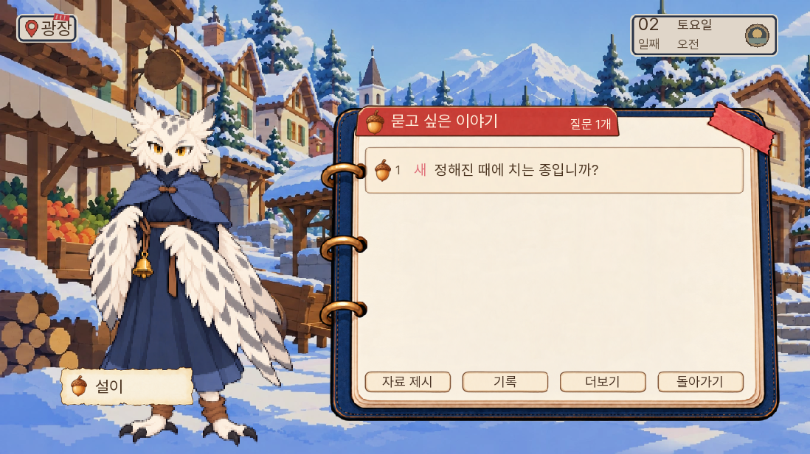
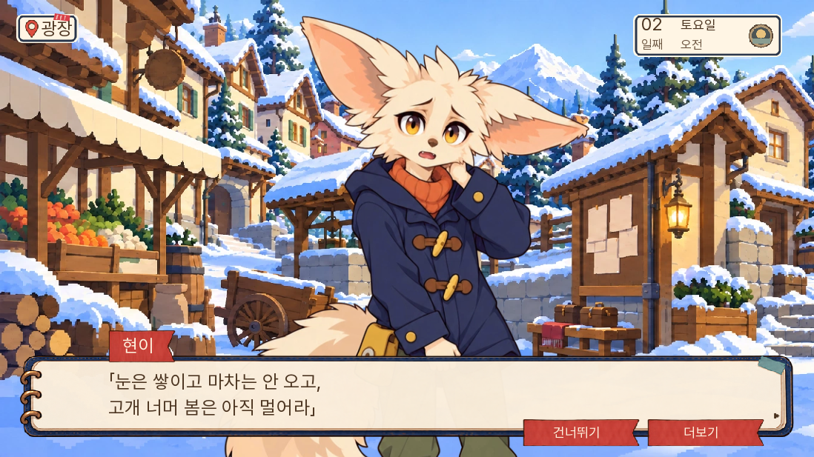
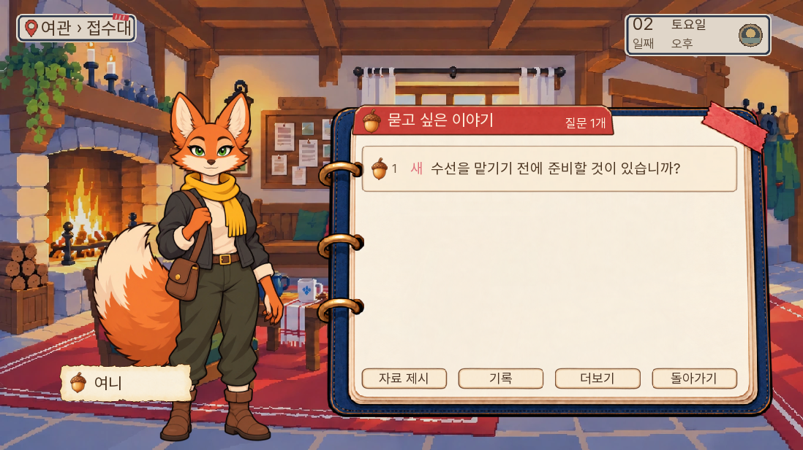
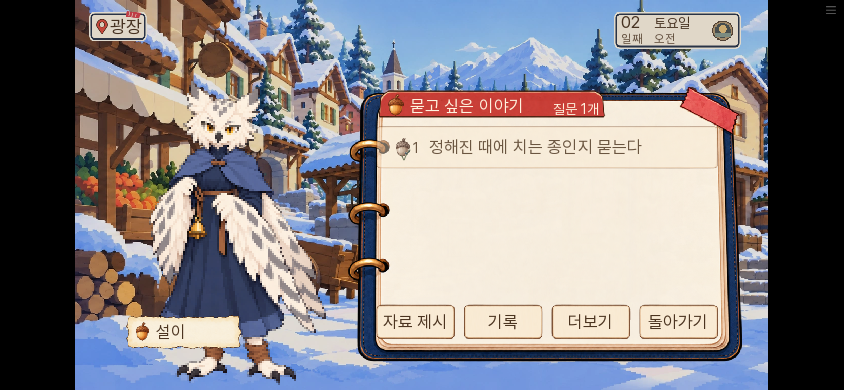

# 일반 주민 다섯 명의 대화 연결 추가 검수 — 0.20.145

2026-11-09. 0.20.144 공개 작업 중, ‘다른 주민은 왜 존재하느냐’는 사용자 지적을 정적으로 다시 대조해 설이·현이·여니의 연결 누락을 확인했다. 세 명은 기본 인사·후속 질문 자료에 없었고 본편의 화자 이름 매핑에도 없었다. 구 캠페인의 일상 주제는 있었지만 본편 질문창이 그 목록을 읽지 않았다. 0.20.144의 후속 질문 재독 복구만으로는 이 세 명이 해결되지 않았다.

기존 콘텐츠에서 시점과 장소에 맞는 대화만 선별해 연결한다. 구 캠페인의 이벤트를 통째로 켜거나 다른 사건의 정보를 노래에 섞지 않는다. 설이·여니·현이의 연결 누락에 더해, 바둑이·부엉이의 초반 일상 대화도 연결했다. 기존 자료 원문과 날짜 조건을 유지한다.

| 주민 | 연결한 기존 내용 | 범위 |
|---|---|---|
| 설이 | 종을 치는 뜻과 종소리 구분 | 1~4일 / 5~7일 |
| 여니 | 수선 전 옷 준비, 토리의 왕복 동행 걱정 | 1~4일 / 5~7일 |
| 현이 | ‘한 곡 들려주시겠어요?’로 기존 겨울 노래 청하기 | 2~7일 |
| 바둑이 | 둘씩 다니는 밤 순찰과 복귀 인원 확인 | 1~4일 |
| 부엉이 | 직접 본 일과 전해 들은 일을 기록으로 구별 | 1~4일 |

일곱 주제만 명시해서 연결했다. 부엉이의 후반 일상 원문에는 ‘살려 줬으니’라는 전제가 있어 해당 주제는 활성화하지 않았다. 표의 날짜와 실제 재실·생사·부재·바쁜 상태·긴장 장면·주된 사건 질문 우선을 함께 확인한다. 주제의 옛 보상·플래그·조건·활동 비용이 들어 있으면 활성화하지 않는다. 원문 배열을 복사해 읽어 원래 데이터를 바꾸지 않고, 대화가 끝나면 읽음 기록만 추가한다. 대사 표시가 남기는 일반 만남 기록은 기존 동작을 따른다.

현이의 노래는 구 캠페인의 사건 플래그를 가져오지 않고 기존 겨울 구절만 본편에서 사용한다. 본편 행동에 따라 노래가 달라지는 반응까지 구현한 것은 아니다. 기존 캠페인에서는 원래 노래 함수를 유지한다.

SDK에서 다섯 주민을 실제로 눌러 질문을 선택하고 원문을 재생한 뒤 질문 목록으로 돌아오는 경로가 통과했다. 설이는 질문창을 닫고 다시 말 걸어 읽은 질문을 고르는 것까지 확인했다. 현이는 기존 겨울 구절만 나오며, 여니는 실제 오후 일과인 접수대에서 수선 대화가 열린다. 바둑이·부엉이는 2일차 광장에서 초반 대화가 재생되고 읽음 표시가 남는다. 별도 보상이나 자료 획득을 실행하지 않는다. 준비한 상태의 SDK 검사이며 모든 날짜·모든 주민을 직접 누른 검사는 아니다.

독립 코드·화면 검토에서 추가 토픽 두 개의 제목이 행동 서술로 표시되는 것을 찾아, 본편에서는 실제 첫 발화 형태인 ‘밤 순찰도 혼자 다닙니까?’와 ‘지금도 직접 기록을 하십니까?’로 표시했다. 현이의 부탁도 ‘한 곡 들려주시겠어요?’로 표시한다. 해당 화면 시험을 다시 통과했다. 대화 본문은 기존 원문 그대로다.

최종 전체 단위 검사 1,678개, lint, 대사 검사 A/B/C 0을 통과했다. 다섯 주민의 SDK 화면 시험 5개도 통과했다. 실제 입력으로 재생·복귀·읽음·재독 경로를 검사했고, 2일차 이후의 모든 날짜를 자연 진행한 검사는 아니다.

정확한 0.20.145 빌드를 로컬 웹에서 열어 0.20.144의 수면 대기 QA 저장을 화면 메뉴로 불러왔다. 이후 2일차 광장을 준비해 설이의 실제 질문·원문 재생·질문창 복귀를 확인했다. PC 1280×720과 휴대폰 크기 844×390에서 읽음 표시를 확인하고, UI로 저장·새로고침·불러온 뒤 전체 게임 상태가 일치했다. 다시 설이를 눌러 읽은 질문을 고를 수 있었다. 확인한 실행에서 pageerror와 게임 예외 화면은 0건이었다.

웹의 첫 준비 화면은 장소 값만 바꾸어 질문창 뒤에 이전 방 그림이 남았다. 제품 이동 결함으로 판정하지 않고, 준비 화면의 배경도 광장으로 맞춰 대표 사진을 다시 찍었다. 실제 이동 경로와 배경 갱신은 144의 SDK·웹 검증을 따른다.

웹 묶음 SHA-256 `2c54b923d4964a21b3d68ab47dc326ec8ad1bbe152f7ff472e09bfb5caacdcb9`, 첫 게임 데이터 36,776,166바이트(엔진 제외). 정확한 빌드의 로컬 검증이며 Pages의 공개 작업과 원격 해시는 별도 확인한다. 성능 벤치마크나 모든 기기의 지연 개선 검사가 아니다.

수면·여관·공개 장소 재탐색·광장 좌우 인물 위치의 직전 검증은 `../review144/검수.md`에 있다. 이번 다섯 명의 연결 보완과 별개이며, 두 작업 모두 새 게임부터 7일 전체를 다시 완주했다는 뜻은 아니다. 다른 주민의 콘텐츠 부족까지 모두 해결했다고 보고하지 않는다.
