# 주민 대화·의뢰·일과 통합 검수 — 0.20.146

사용자가 요청한 범위는 공개 중인 1부 1~7일이다. 모든 버튼 연결을 목록으로 만들고, 주민의 선택 대화와 실제 상황·분기 조건, 작은 부탁의 수락부터 회상까지, 혼잡한 현장 배치를 나누어 검수했다. 주 사건의 정답·증거 ID·생사·결말·7일 종료 경계는 변경하지 않았다.

## 바뀐 플레이

주민을 누르면 본편 질문, 선택 의뢰, 개인 이야기를 같은 질문 수첩에서 고른다. 기존의 ‘필수 질문이 있으면 일상 대화 전체를 숨기는’ 조건을 풀었다. 개인 이야기는 본업과 사적인 관심사로 나누고, 초반과 후반의 내용을 구분한다. 신규 정의는 55명·230항목이며 한 화면에 55명이 등장한다는 뜻이 아니다. 실제로 그곳에 있고 살아 있으며 떠나지 않은 인물만 응답한다. 바쁜 돌봄·이송 담당자는 맡은 일을 중단하지 않는 짧은 답을 한다.

피코의 사망 소식은 직접 전달한 나비·부리만 기억한다. 사망 상태·E09 보유·개별 청취 표식을 함께 요구한다. 화재는 나비·보리·누비·선생님의 실제 결과 대화가 있으며, 사전 대피 표식만으로 화재가 이미 났다고 말하지 않는다. 실제 빈 창고 화재 완료·학교 네 명 인계·꼬미 생존과, 본 화재 완료·세 명 구조·꼬미 사망을 나누어 검사한다. 위기 대화와 그 질문창은 기존 불안 표정을 사용한다.

여니의 바느질, 설이의 종소리 공고, 부리의 예비 부품을 선택 의뢰로 연결했다. 2~5일에 수락·거절·보류할 수 있고, 이미 받은 일은 7일까지 작업·보고한다. 작업 방식마다 답이 다르고, 마친 뒤 다시 물으면 그 일을 기억한다. 늦게 돌아오면 맡겼던 일을 주민이 직접 마친 경우도 구분한다. 들은 부탁과 다음 행동은 현장의 ‘부탁’ 수첩 두 쪽에서 확인한다. 실제 마친 도움만 현이의 겨울 노랫말에 추가된다. 돈·수사 자료·시간을 보상으로 지급하지 않는다.

아홉 주민은 우체국·접수대·식당·입구·학교·공방으로 일과를 분산했다. 평상시 한 장소는 다섯 명까지 보이되 현재 사건 배우와 수락한 의뢰 담당자는 남긴다. 꽥순·슬링·뭉치·구슬은 평상시 군중에서 뺐다. 인물 ID·원화·옛 저장 경로는 지우지 않는다. 과거 선택 대화의 위치가 남아 있는 구 저장에서도 재배치된 도토·부엉이의 현재 대화가 열린다.

## 찾아서 고친 연결 문제

| 문제 | 수정 |
|---|---|
| 일상 질문이 생기자 나비의 놓친 피코 소식 전달이 업무로 판정되어 차단됨 | 현재 필수 업무와 선택 생활 대화를 구분 |
| 선택 의뢰가 생활 질문 뒤 둘째 쪽에만 숨어 있음 | 본편 질문 다음, 생활 대화 앞에 의뢰 표시 |
| 구 저장의 지난 광장 대화 위치가 새 우체국 일과의 질문을 차단 | 실제 일과 재실과 대화 허용을 함께 연결 |
| 다중 물건 선택창의 취소가 첫 선택으로 해석될 수 있음 | 명시적인 back 반환과 bool 거부, 원래 index 보존 |
| 숨겨진 동행 다람에게 임의 대화를 걸 수 없음 | 실제 곁에 있을 때만 현장 ‘다람’ 버튼 표시 |
| 보호 중인 다른 장소의 다람이 환경 농담에 참여할 수 있음 | 실제 동행 검사, 확인된 사망 당일·화재 직후·긴급 상황의 가벼운 농담 억제 |
| 옛 특수 물건의 이름만 아빠 생각으로 나올 수 있는 fallback | 중립 관찰을 명시하거나 보상/비밀 이벤트 fallback 비활성화 |

마지막 항목의 책장·찬장·손잡이는 일반 1부에서 비밀 경로 조건으로 보통 숨겨진다. 이를 일반 플레이에서 확인된 노출 오류라고 보고하지 않는다. 실제 증거가 있는 물건과 현재 본편 선택이 항상 먼저다.

## 검증 방법의 구분

[버튼·대사 목록 JSON](버튼대사목록.json)과 [TSV](버튼대사목록.tsv)는 정적 연결표다. 본편 선택 132개·72개 대기 문맥, 공통 화면 조작 244개·78개 화면, 후속 질문 17개, 자료 제시 반응 37개, 물건 정의 125개, 선택 의뢰 조작 36개, 주민 질문 정의 230개를 담았다. 서로 겹치는 수이므로 합쳐 고유 버튼 수라고 쓰지 않는다. 각 행의 query_evaluated=false는 그 조건을 정적 목록에서 실행하지 않았다는 뜻이다. 후속 질문·사건 반응의 실제 조건 함수 원문도 연결했다.

SDK 상태 조회는 1~7일 × 오전/오후/저녁 × 공개 장소 아홉 곳의 189개와 분기 경계 10개, 별도의 부재 차단 12개를 준비하여 실제 초기화 함수를 실행했다. 이 행렬의 미방문 장소는 직접 준비한 것이므로 실제 이동 해금이나 자연 도달의 증거가 아니다. 총 199개 상태에서 493회 주민 조회, 질문 1,048개, 물건 1,525개를 검사했고 중복 ID·빈 대화·부재 발화·잘못된 원본 선택 번호·조회 중 이야기 상태 변경이 0건이었다. 35명의 현장 주민이 이 행렬에 포함된다. 다람 동행과 사건 전용 인물은 별도의 화면 검사로 구분한다.

독립 문안 검토는 한국어 slop-rewrite의 가이드 없음 bundle과 직접 독서를 함께 했다. 자동 탐지 0을 재미의 증거로 쓰지 않았다. 세련의 직업 혼동, 부리 조부의 생사 시제, 아이들의 같은 교훈 반복, 질문과 응답의 연결, 한 사람 안의 아빠 말높임 차이를 수정했다. 55명 전체와 수정된 관심사·아이 대화·사후 열 항목을 재독했다.

## 실제 실행 결과

단위 검사 1,725개를 통과했다. 최종 관련 검사 47개와 별도 주민 관련 100개도 통과했다(이 수는 전체 검사와 겹치므로 더하지 않는다). 대사 논리 A/B/C는 0건, lint의 문법·초기화 오류는 없고 기존 미도달 문장 경고는 남는다. 필수 행 인벤토리·오버라이드 지도·대사 바인딩·자료 분류를 갱신했다.

SDK 사례 12개가 모두 통과했다. 세 의뢰의 실제 수락→물건 작업→보고, 숨긴 동행 다람에게 실제 질문→재독 목록 복귀, 부탁 수첩 PC/터치 큰 글씨 두 쪽의 이전·다음·닫기, 다중 물건 선택 취소 후 진행 보존과 두 번째 원본 번호 100 반환, 나비의 놓친 사망 소식 전달 후 후속 질문 해금, 광장 좌우 이동의 인물 좌표 보존, 수면 취소·확인을 포함한다. [SDK 결과](SDK결과.json)와 [상태 조회 원문](engine-sweep.json)을 함께 둔다. 장면 시작은 직접 준비했으므로 이 사례들을 자연 진행으로 세지 않는다.

첫 바느질 화면 시험의 물건은 반대편 화면에 있어 실패했다. 실제 오른쪽 구역 이동을 넣고 재통과했다. 늦은 피코 소식 시험도 나비의 실제 일과인 식당으로 준비 장소를 맞췄다. 접수대에 과거 인물 배열과 위치 값만 적어서는 실제 출현을 보장하지 못한 검수 준비 오류였다. 제품의 이동·대화 차단 오류로 세지 않는다. 다중 선택 취소의 첫 선택 오인은 제품 오류였고 명시적 취소·bool 거부 수정 후 실제 검사를 통과했다. 중앙 인물 하체처럼 보이던 부분은 원본 식당 배경의 수건·담요였으며 인물 중복으로 판단하지 않는다.

별도 구형 `dev/check_dialogue_bindings.py` 상태행렬 도구는 `r13_meeting_murmurs` 변수의 검수 fixture 누락으로 중단했다. 그 별도 도구의 전 행렬을 통과했다고 세지 않는다. 필수 바인딩 생성과 현재 전체 단위·SDK 결과와 구분한다.

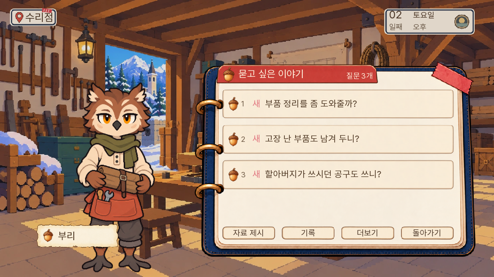

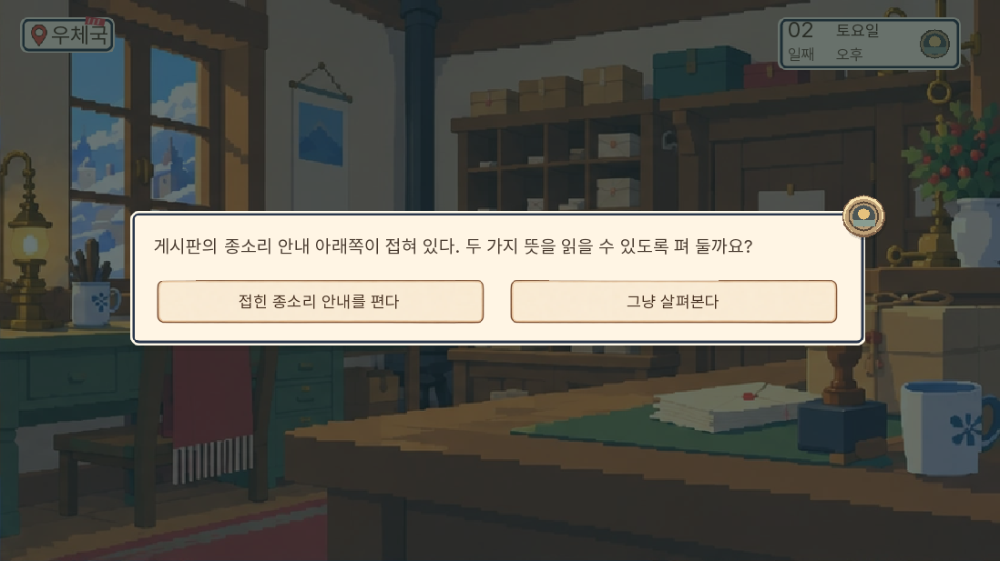

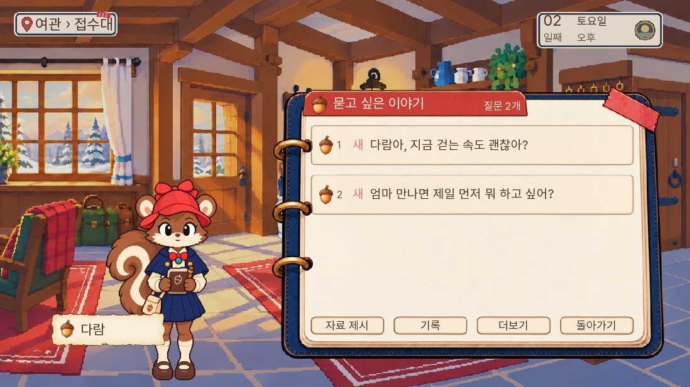

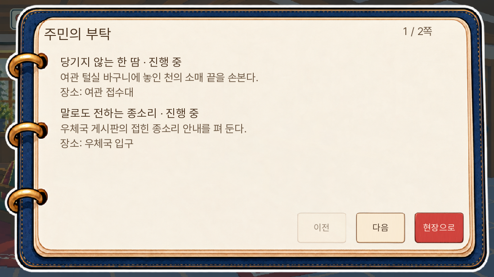

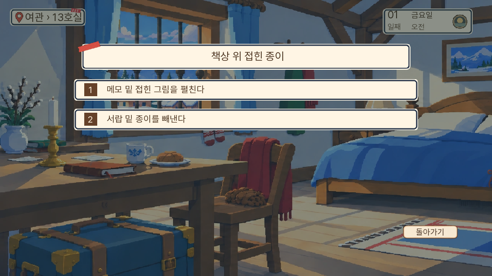

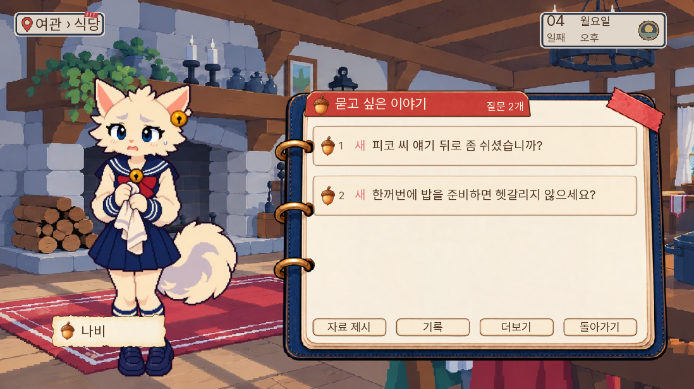

웹 묶음은 `9a4b772e5bf61c5c1e2eb359639a9539a1fe093597e479045321947b80484777`, 첫 게임 데이터는 36,828,687바이트(엔진 제외)다. 145보다 52,521바이트 증가했으며 새 원화·배경·음원은 추가하지 않았다. 성능 벤치마크나 모든 기기의 지연 개선 검사를 뜻하지 않는다.

정확한146 웹 묶음으로 145의2일 광장 QA 저장을 실제 불러오기 메뉴에서 열었다. 설이의 기존 읽음 질문을 다시 고르고 새 종소리 의뢰를 수락했다. PC1280×720과 휴대폰 크기844×390에서 부탁 수첩과 현장 버튼을 확인했다. 새3번 칸에 저장하고 새로고침·실제 불러오기 메뉴를 거친 뒤 전체 room13 상태와 수락 상태가 같았다. 과거1/2번 저장은 보존했다. [웹 구저장 결과](웹-구저장결과.json). 이는 이전 QA 시작 상태의 복원과 새 선택 기능 검증이며, 자연 진행의 의뢰 완료와 구분한다.

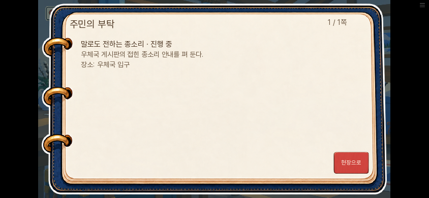

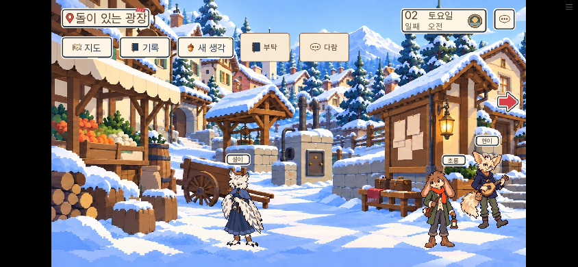

[주민 대사·선택 의뢰 원문 열람](주민대사-열람.html)에서 이름과 대사를 찾아 볼 수 있다. 원문을 모두 펼친 정적 문서이며 게임의 조건 필터를 실행하지 않는다.

새 게임부터 1~7일 본편을 실제 화면 입력으로 연속 진행했다. 2,286개 진행 기록·1,941개 대사 표시 기록과 대표 화면39장을 남겼으며, 4일에 실제 저장 메뉴→새로고침→불러오기로 날짜·장소·자료·근거·분기 값을 비교했다. 입구에서 편지만 제출한 오답 뒤 정상 제출, 피코 시신·그림·다람 문답, 칼의 직접 관찰, 회의 되묻기와 증거 제출, 빈 창고 화재·학교 네 명 인계·7일 방화 회의 승리·1부 종료까지 이어졌다. 피코 사망, 꼬미 생존 경로 한 번이며 모든 생사·승패 경로를 자연 완주한 것은 아니다. 정답은 기존 검증 드라이버와 소스를 참고했으므로 초견 난도·재미 실험으로 세지 않는다. 표시 속도0 설정 외에 서사 상태·자료·날짜·라벨은 주입하지 않았다.

이 연속 검수의 후보 묶음은 `c63f7bd6a73db3d42953efe8ac023563cf160f1ce734da69e3baab3b72a07b7d`였다. 이후 발견된 늦은 소식 예외만 최종 묶음에서 더 보완했다. 실제 선택 자료반응 P036과 반복 질문이 여전히 ‘필수 업무’에 포함되어 소식을 막던 문제를, 현재 장소의 실제 필수 인물 옵션만 검사하도록 고쳤다. 위기·부재·현재 업무 가드는 유지한다. 7일차 화재 후속이 피코의 실제 청취 기억을 가리지 않도록 두 질문을 함께 둔다. 마지막 보완 뒤 전체 단위1,725개, 관련47개, 실제 7일 준비 장면의 신고·두 기억·자료함 열기/취소와 상태 조회를 재검사했다. 준비7일은 화재를 지운 가짜 시간대가 아니라 실제 빈 창고 화재 완료·학교4인 인계·꼬미 생존 경로를 사용한다.

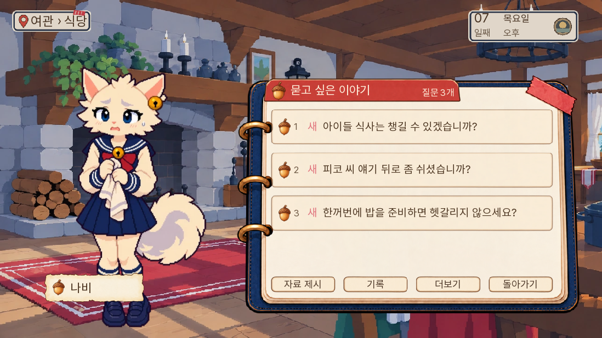

실제 연속 완주 저장을 불러와 ‘탐색 계속’을 누르자 준비 상태 검사에서 놓친 완료 경계를 발견했다. 자연 저장의 장면 번호는 `MS14_D07_S02`이며, `free_day7`에서 인계·쪽지 전달을 마쳐도 장면 번호는 그대로 남는 것이 정본이다. 이를 아직 진행 중인 긴급 장면으로 계속 세어 일반 대화·의뢰 마무리가 막혔다. 재방문 허용 목록에서도 `free_day7`이 빠져 있었다.

장면 번호와 기록을 미래의 `S03`으로 바꾸지 않고, 실제 화재 결과·인계·쪽지 전달 완료와 자유 탐색 문맥을 함께 검사하는 예외로 고쳤다. 성공·부분 성공·실패 모두 완료 뒤에는 탐색할 수 있고, 진행 중 인계·메시지 미완료·구금·부엉이 사망·후속 살인 사건에서는 제한을 유지한다. 독립 경계 검사는 실제 S02 완료 상태와 여섯 결과 조합, 미완료·후속 사건 경계를 대조했다. 새 준비 GUI도 이 실제 S02 완료 경계를 사용하도록 교정했다. 2일에 수락한 바느질을 7일에 작업·보고해 마치는 화면 검사까지 통과했다.

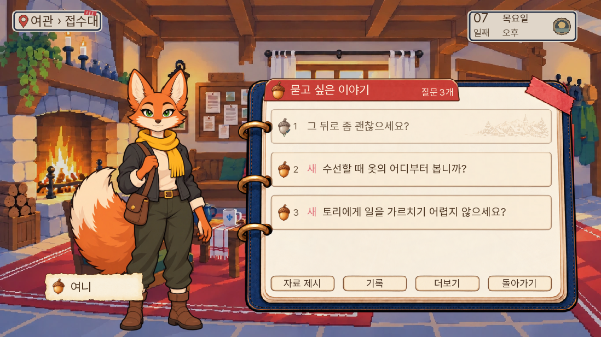

최종 웹 묶음에서 자연 연속 완주 저장을 실제 불러오기 메뉴로 복원했다. 전체 room13 상태가 같고, 완료 저장의 작성 시각도 바뀌지 않았다. ‘탐색 계속’ 뒤 실제 학교에 남아 있던 나비에게 말을 걸어 피코의 늦은 소식을 전달했다. 화재 후속·피코 청취 기억·본업 질문 세 가지가 함께 표시됐고, 피코 기억을 다시 읽고 자료함을 열어 취소할 수 있었다. PC와 휴대폰 크기에서 확인했으며, 선택 소식·질문·자료함 취소 전후의 날짜·시간대·경과분·증거·근거·화재 판정·꼬미 생존은 같았다. 서사 상태를 준비하거나 주입하지 않은 실제 완주 상태의 후속 대면이다. [최종 웹 결과](웹-최종완주저장.json).

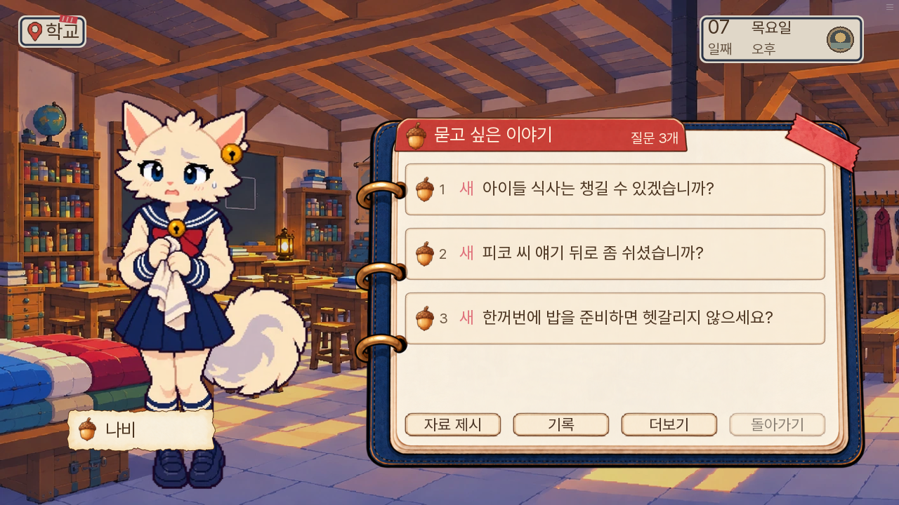

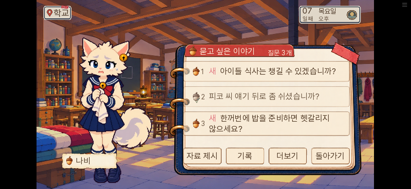

최종 실제 완주 상태에서 지도 클릭으로 학교→여관 접수대→학교를 왕복했다. 7일·free_day7·S02 장면과 화재 승리·전달한 피코 소식은 유지됐고, 두 장소의 보이는 주민 모두 살아 있으며 선택 질문이 비어 있지 않았다. 여관은 할머니·부엉이·토리·여니·현이 다섯 명, 학교는 선생님·나비·다람이었다. [실제 왕복 결과](웹-7일실제왕복.json). 모든 다른 장소의 자연 왕복을 검사한 것으로 세지 않는다.

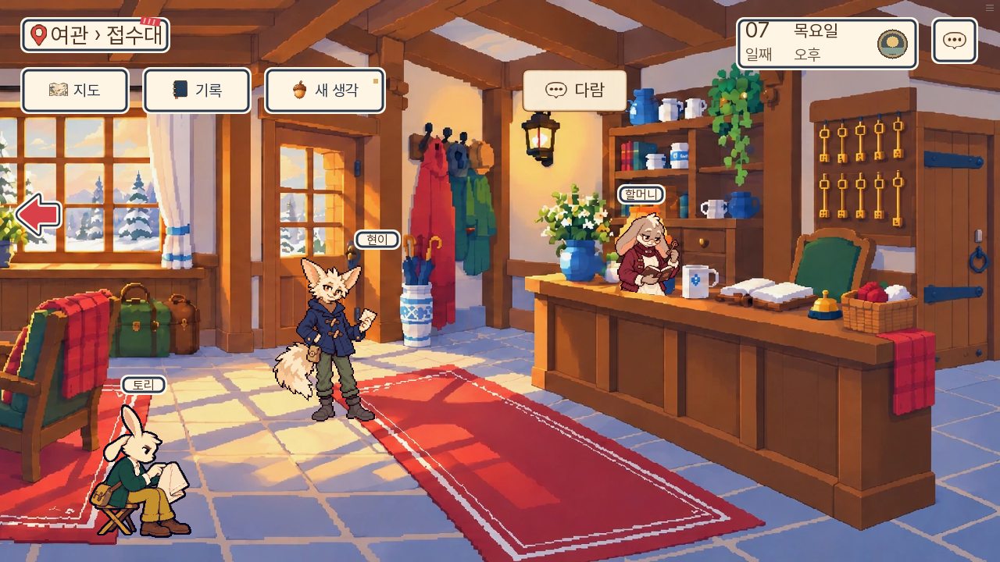

Pages의 직접 화면 확인과 원격 공개 해시는 구분한다. 이 환경에서 공개 도메인 접근은 네트워크 정책으로 막히므로, 동일 묶음의 로컬 웹 검증·원격 저장소 해시·배포 작업 성공으로 공개 상태를 확인한다.

## 남는 범위

모든 날짜·모든 주민·모든 서브퀘스트 결과를 하나의 판에서 자연 진행할 수는 없고, 그렇게 검사했다고 보고하지 않는다. 상황에 맞는 선택 대화를 추가했지만 모든 주민에게 독립 장편 사건을 만든 것은 아니다. 기존 배경 관찰 원문 전체의 모든 상황별 재작성도 이번 범위가 아니다. 실무 의견으로는 추가 사건 수보다 실제 플레이에서 주민에게 다시 돌아갈 이유가 생기는지를 후속 사용자 반응으로 보는 편이 좋다.
