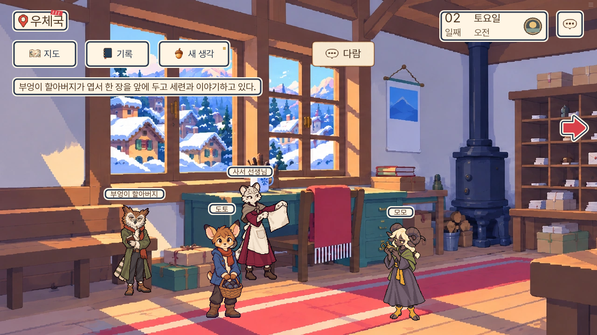
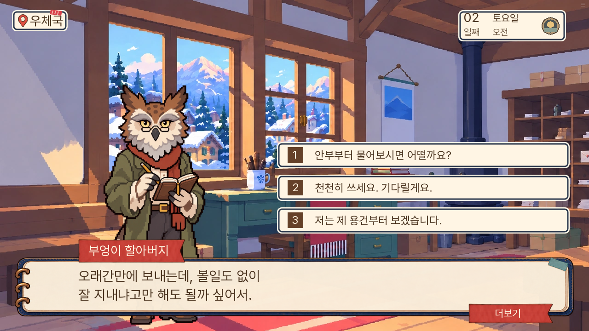
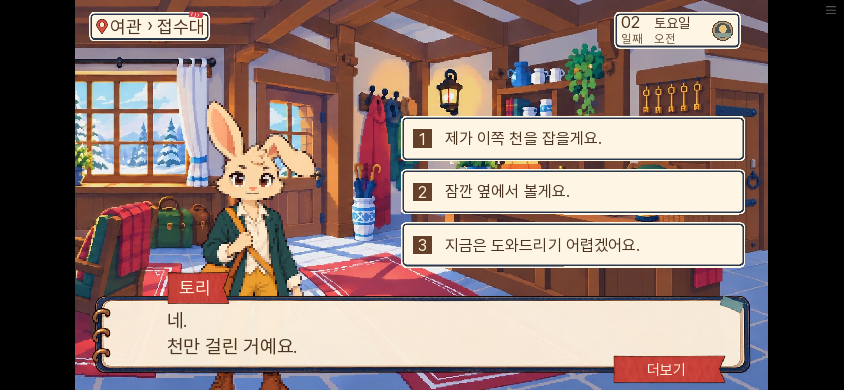
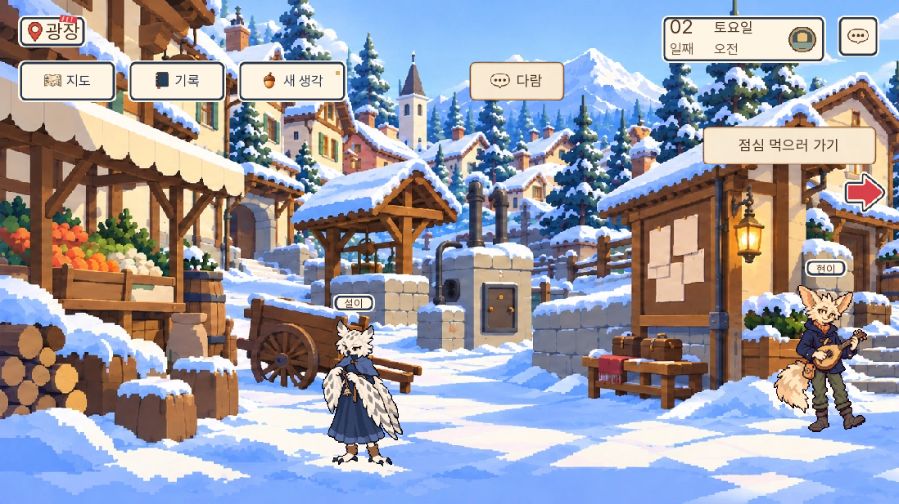

# 0.20.147 자유 방문·2일 생활 검수

2026-11-10. 이번 범위는 공공 장소 개방과 2일 생활 장면 두 개·재회다. 3~7일 신규 생활 장면 열 개와 반복 식사·가족 휴식을 모두 구현한 판은 아니다.

## 확인한 동작

| 항목 | 확인 범위 |
|---|---|
| 공개 공간 | 2일 `lamp_rope / morning_finish2 / afternoon2` 각각 열한 곳, 총 33개 SDK 준비 상태. 방문 이력이 비어 있어도 공공 공간을 열고 조회가 상태를 쓰지 않음 |
| 제한 유지 | 첫날, 피코 현장, 화재 대응, 실제 7일 S02 인계·쪽지 완료 전후를 별도 준비해 확인. 비밀 장소·화재 창고를 일반 공개 장소로 추가하지 않음 |
| 점심 | 조사 결과를 받은 뒤 오전을 더 둘러보고 점심 버튼으로 넘어감. 실제 확인창 취소 시 전체 상태·오전·본편 반환값 불변 |
| 오후 마감 | 실제 지도에서 네로의 숲과 피코 인계의 식당을 선택하고 마감 안내 확인. 취소 뒤 위치·시간·준비·인계 값 불변 |
| 엽서 | 실제 주민·질문·도움 선택을 누르고 같은 본편 대기로 복귀. 저녁 재회에서 도움을 기억함 |
| 소매 | 실제 구경 선택 후 여니에게 기존 수선 의뢰를 따로 물어보고 거절 가능. 손을 빼는 도움과 재봉 작업의 완료를 혼동하지 않음 |
| 거절·미방문 | 소매 거절 뒤의 재회와 처음 방문한 엽서 인물의 대화를 구별. 미방문을 도움 완료로 쓰지 않음 |
| 신규 주민·자료 | 이른 방문에서 볼 수 있는 아홉 주민의 초기 질문 열여덟 항목을 독립 독서 검토. 미래 범인·밤이 사건·화재 피해를 미리 아는 확정 대사 없음 |
| 실제 치환 대사 | 원본뿐 아니라 실행 중인 `d02.json`을 대조. 빠져 있던 피코 인계 마감을 복구하고 공용 식당과 새 취침자 접수를 구분 |

## 실행 결과

- 전체 단위 검사: **1,746개 통과**. 신규 방문 검사 13개와 접근·자료·시간·배치 검사 8개를 포함한다.
- SDK 화면 검사: **7개 통과**. 준비 상태 조회, 점심 취소, 네로 이동 취소, 피코 인계 이동 취소, 엽서 도움·재회, 소매 구경·기존 의뢰, 거절·미방문이다.
- lint: 신규 구문 오류·없는 라벨 오류 없음. 이전부터 있던 도달 불가 문장 안내는 남아 있다.
- 정적 대사 검사: 이름 소개 전 사용 A 0건, 사망 가능 인물 무조건 발화 B 0건, 중복 결과 지문 C 0건.
- 신규 대사는 별도 담당이 slop-rewrite 가이드 없음으로 검토했다. 자동 탐지와 문맥 검토를 나누고, 앞말·아동 말투·부분 청취 기억의 수정 사항을 반영했다.
- 웹 검사: **통과**. 새 게임 후 2일 첫 대기를 준비하고 우체국→여관→진료소→학교를 실제 지도에서 이동했다. 엽서 도움·소매 구경·수선 의뢰 거절, 844×390 화면의 터치 선택, 실제 저장 메뉴와 브라우저 재시작 후 전체 상태 복원을 확인했다. 페이지 오류 0건. [웹 결과](웹-결과.json) 참조. 최종 전송 묶음에서는 앞서 만든 수동 저장을 설정의 불러오기 슬롯으로 직접 열어 전체 상태가 같은지 다시 확인했다. Android 모바일 설정에서 세 선택지의 터치 높이는 각각 47.67 CSS 픽셀이며 실제 거절 선택도 통과했다. [최종 모바일 결과](최종묶음-모바일-결과.json) 참조.

SDK 준비 상태를 자연 플레이나 모든 분기의 완주로 계산하지 않았다. 방문 두 순서와 도움·구경·거절 조합은 단위 상태 검사이며, 실제 화면 클릭한 경로는 위 표와 웹 기록의 범위다. 1~7일 연속 완주와 모든 기존 저장의 실제 호환·FPS 측정·처음 접한 사람의 재미 평가는 이번에 다시 수행하지 않았다.

## 검수 도중 발견한 것

실제 제품에서는 미소유 진료 기록·물자 장부의 미래 제목 노출, 이른 학교 방문의 피난처 관점, 초롱의 본편 위치와 평상 일과 위치 중복을 찾아 고쳤다. 2일 밤 야간 배식 중인 나비도 일반 식당 배치에서 제외했다. 현재 수사에 필요한 배우와 이미 얻은 기록은 보존한다.

검수 코드에서는 아침 자동저장의 `morning_ids` 기록 전에 기준 상태를 잡거나, 파노라마의 다른 쪽에 있는 주민을 잘못된 방향으로 찾는 문제가 있었다. 입력 준비 뒤 기준을 잡고 실제 이름표 좌표·카메라 방향으로 클릭하도록 고쳤으며, 전체 상태 불변 검사는 유지했다. 웹 자동화의 대사 시작 직전 질문 화면 잔류와 디버그 모듈의 함수 경로 오류도 실행 도구의 문제로 구분했다. 실패를 통과 결과로 계산하지 않았다.

## 화면

아래 이미지는 실제 실행 화면이다. 인게임 원화나 UI를 새로 제작한 시안이 아니다.

## 무게와 잔여 범위

새 그림·음악을 추가하지 않고 기존 에셋·공통 화면을 재사용했다. 첫 로딩 게임 자료는 **36,847,308바이트**로 146보다 **18,621바이트** 늘었다. 엔진 파일을 제외한 수치이며 FPS가 개선됐다는 뜻은 아니다.

3~7일 신규 생활 이벤트와 반복 식사·가족 휴식, 보호 중인 다람을 맡겨 두고 안전하게 혼자 방문하는 확장은 후속 범위다. 기존 사건의 생사·증거 정답·인계 판정과 7일 1부 경계는 바꾸지 않았다.

최종 묶음 SHA-256: `954f2467910034910592de361d5c5f47f92149df620370bc14c644c472337add`. 공개 전송은 기존과 같은 10MiB 단위 두 부분이며, [빌드 결과](빌드-결과.json)를 기준으로 확인한다.
