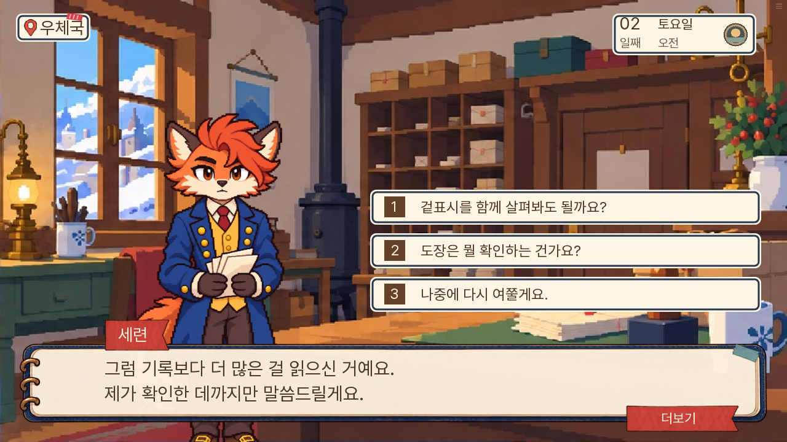
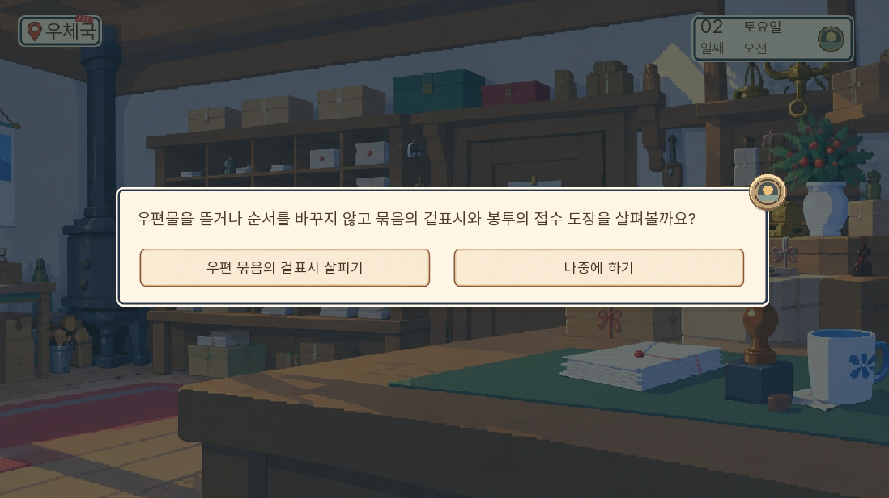
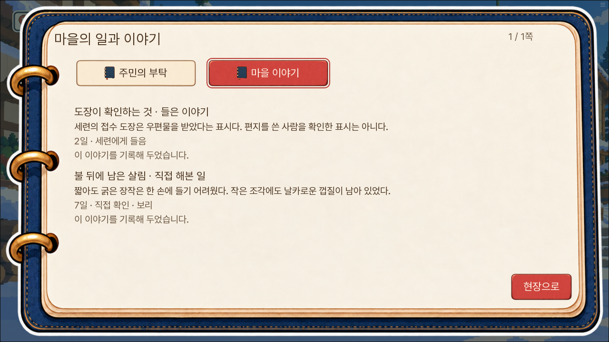
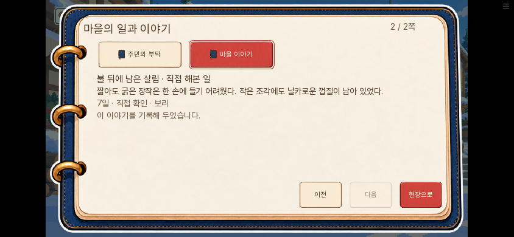
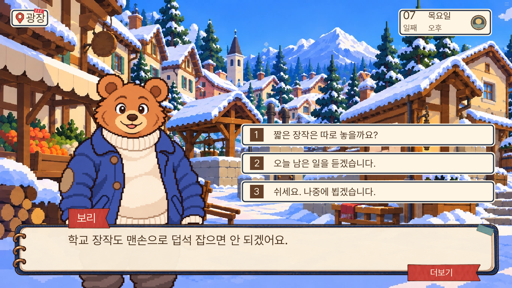
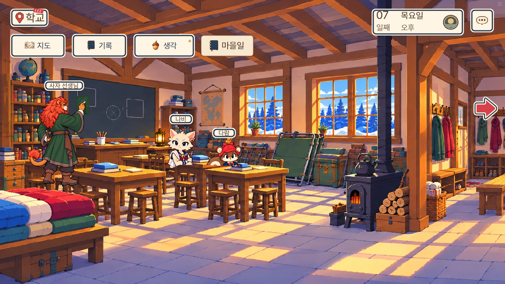

# 0.20.148 소설 세계·선택 조사 검수

2026-11-10. 기존 정본과 주민 별편을 실제 조사·선택·행동·재회로 연결한 여섯 연쇄의 검수다. 모든 주민·모든 날짜별 별편을 완성한 범위나 1~7일 연속 자연 완주로 보고하지 않는다.

## 실제 적용

광장 등받침→초롱, 우편 묶음→세련, 식탁→나비, 공구판→부리, 학교 담요→선생님, 화재 후 장작→보리의 연쇄를 추가했다. 관찰 후 질문이 생기고, 듣기·도움 수락·나중에 묻기가 갈린다. 도움은 현장 물건을 다시 눌러 실제 행동해야 완료된다. 취소로 완료하지 않는다. 직접 해본 일은 같은 시간에도 주민에게 돌아가 보고할 수 있고, 듣기 이후에는 다음 시간대 기억 대화가 나온다.

일과와 실제 재실을 따르므로 질문이 생겼다고 주민을 옮기지 않는다. 보리는 7일 오후 광장에 있고 작업은 학교에 있어 실제 지도 왕복이 필요하다. 본편이 요구하는 같은 물건은 기존 조사로 먼저 처리한다. 기존 증거·정답·인수·생사·시간·7일 경계를 변경하지 않는다.

## 문안과 인지 범위

[독립 검토](독립검토.md)에서 소설 정본·주민 별편과 직접 대조했다. E09는 엄마의 초상이며 사망 기록이 아니고, E10은 빈 받침이고 대여는 E12다. 피코 사망 대화는 나비의 실제 소식 청취, 공구 질문은 대여 기록을 추가 확인한다. 회의 결과·피코 생존은 아빠가 상대에게 먼저 전한다. 화재 실패를 곧바로 보리 손 화상으로 묘사하지 않는다.

현장 지문에 개발 계약을 설명하던 문장을 구체적 관찰로 고쳤다. 다시 만난 날을 알 수 없는 ‘아까/오늘’은 날짜 중립 표현으로 고쳤다. 도움 수락만으로 듣기 전용 정보를 기록하지 않으며, 변형 대사가 바뀌어도 기록에는 실제 공통으로 들은 사실만 남긴다. slop-rewrite의 자동 발견 0건을 자연스러움·재미의 보증으로 사용하지 않았다.

## 검사 범위

전체 단위 검사 **1,773개 통과**. SDK 준비 경로·화면 조작과 웹 실제 조작 결과를 아래 결과 파일로 남긴다. SDK와 웹의 시작 날짜·사건 상태는 직접 준비했으며 그 부분을 자연 도달이나 완주로 계산하지 않는다.

- 신규 독립 단위 검사 27개: 조회 무변이, 실제 주민·필수 조사 우선, 소유 자료·사건 인지, 선택 변경 방지, 작업과 청취 기록 분리, 동일 오후 완료 보고, 구 저장·깨진 그룹 방어.
- SDK 준비 경로 18개: 여섯 연쇄의 듣기/도움, 피코 생존/사망과 실제 화재 안전/상실 결과, 현행 일과 재실과 작업 장소 왕복. [실제 결과](SDK-준비경로.json).
- SDK 실제 화면: 우편 물건 클릭→세련 질문→도움 수락→작업 확인 취소→직접 실행→PC 기록→터치·큰 글씨 기록. 자동화의 첫 화면 접근 실패는 파노라마 다른 쪽 물건과 배우를 현재 화면 좌표로 누른 검수 코드 문제였으며, 카메라·실제 일과를 사용하도록 고쳤다.
- lint 신규 구문·라벨 오류 없음. 이전 도달 불가 문장 안내 유지. 정적 대사 A/B/C 각각 0건.

웹에서는 147의 실제 수동 저장을 불러와 전체 상태 동일을 확인한 뒤 2일 우편 묶음→세련→듣기→기록과 7일 학교 장작→광장 보리→학교 왕복→작업 취소·실행→광장 완료 보고를 실제 조작했다. 새 기억을 수동 저장하고 브라우저를 재시작해 전체 상태 동일을 다시 확인했다. 페이지 오류 0건. [웹 결과](웹-결과.json).

웹 검수 코드의 카메라 완료 대기, 학교로 향하는 지도의 세로 스크롤, 확인창의 실제 버튼 찾기를 보완했다. 7일 준비 상태에는 본편 진입 조건인 누비의 실제 인정 값을 추가했다. 이 준비를 자연 플레이의 증거로 삼지 않는다. 아직 묻지 못하는 관찰에는 질문 가능 안내를 하지 않도록 제품 알림·기록도 고쳤다.

Android 844×390 설정에서도 같은 수동 저장의 전체 상태를 복원했다. 마을 이야기 두 쪽, 부탁/이야기 탭 전환, 돌아가기를 실제 터치했고 기록·탭·쪽 넘김의 네 조작 높이는 각각 47.67 CSS 픽셀이다. 조작 전후 이야기 상태가 같고 페이지 오류는 0건이다. [모바일 결과](모바일-결과.json). 큰 글씨 표시는 앞선 SDK 화면 검사에서 별도로 확인했다.

## 실제 화면

## 무게와 잔여 범위

새 그림·음악을 추가하지 않았다. 첫 로딩 게임 자료는 36,871,668바이트로 147보다 24,360바이트 늘었다. 엔진 파일 제외이며 FPS 개선을 측정한 수치는 아니다. 코어 묶음은 17,738,250바이트, 10MiB 전송 두 부분이다. 최종 묶음 SHA-256은 `cd76d005ceade827afc740467fe879ab2d6c255db21705bd64e7435d98974da5`다.

전체 주민의 모든 날짜별 분기, 모든 기존 저장의 실제 복원, 1~7일 연속 완주, 처음 접하는 외부 독자의 재미 평가는 이번에 수행하지 않았다. 이번 첫 구현의 초점은 여섯 주민의 생활과 사건 결과를 메인 밖의 조사로 읽을 수 있게 만드는 데 있다.
