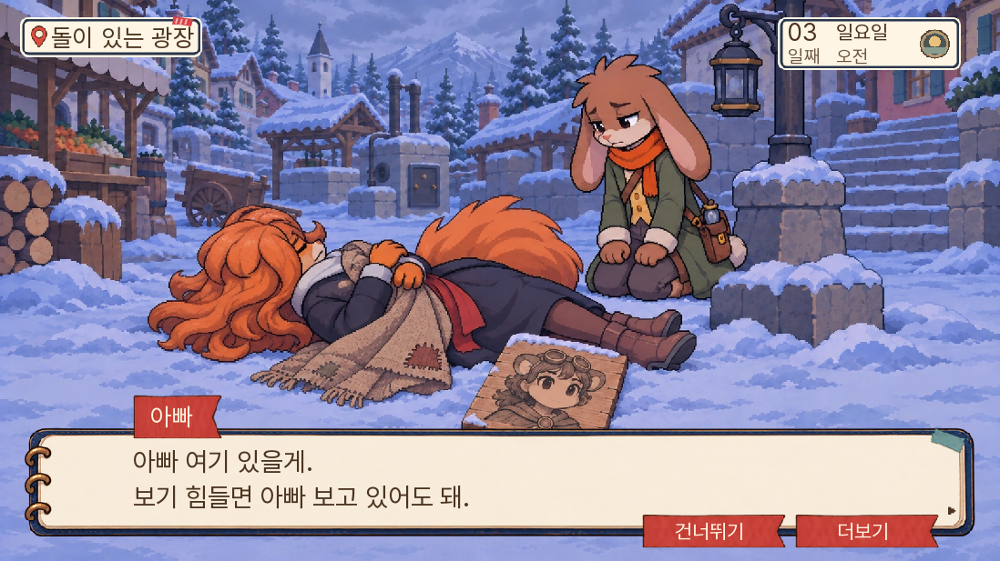
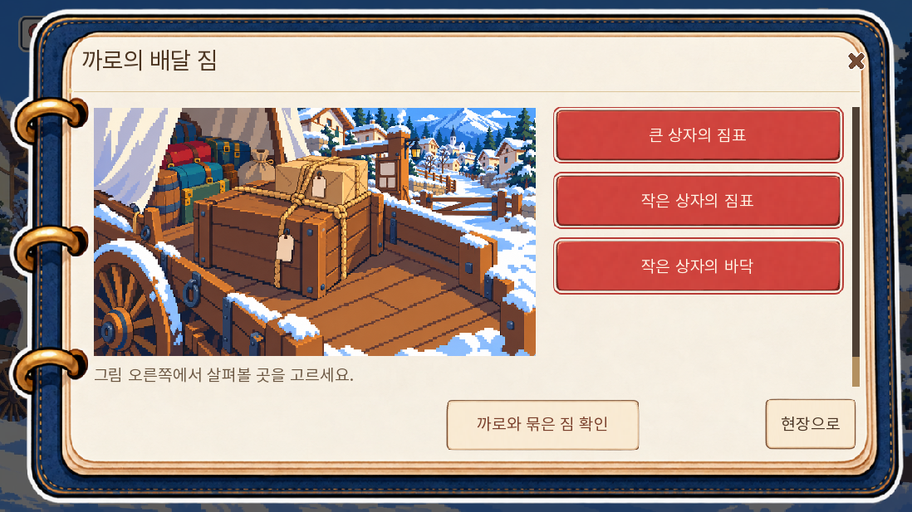
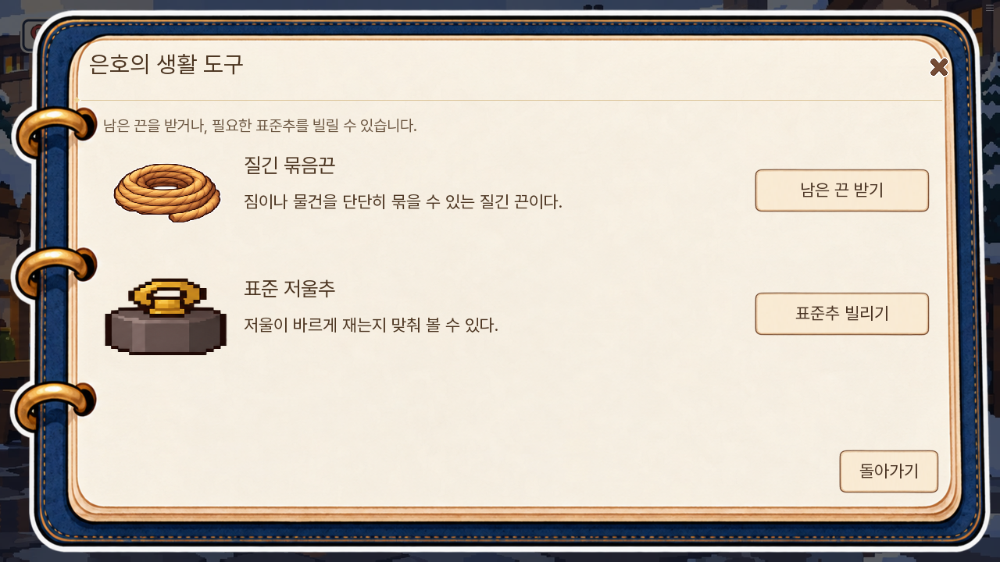
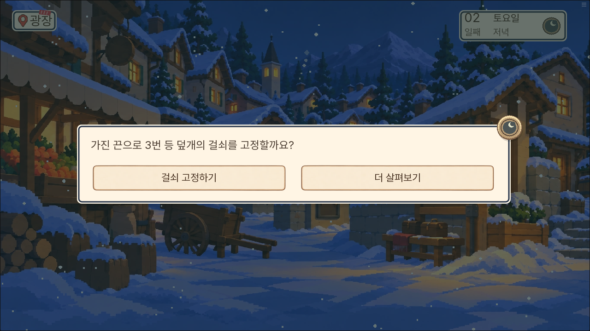
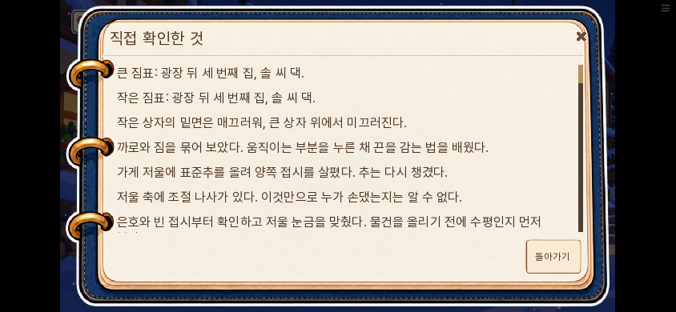

# 149 탐색 복원·돈 재화 제거·1부 대사 검수

2026-11-10. 현재 공개 범위인 1~7일 낮의 1부를 대상으로 했다. 14일 전체 구현 완료나 1~7일 연속 자연 완주 보고가 아니다.

## 반영 내용

원안의 P1~P13·O1~O5·상점 네 물건·K1~K14, 총 36항목을 현행 실행과 대조했다. 이미 연결된 피코·학교 인수·판돌 수리·7일 준비는 보존하고, 현행 이야기와 충돌하는 옛 일꾼 입장·증거 번호·후반 진상은 복사하지 않았다. [항목별 복원 대조](../../design/기존기획_복원대조_20261110.md)와 [현재 실행·다음 순서](../../design/탐색연계_복원149.md)를 함께 남긴다.

사용자 최신 결정에 따라 플레이어의 돈 재화를 없앴다. 가격·노잣돈 지급·수고비·사례금·감사 할인을 사용하지 않는다. 은호가 실제 있는 곳에서 남은 끈을 받고, 표준추를 빌려 쓴 뒤 실제 반납한다. 과거 저장 잔액은 보존하지만 사용하거나 증감하지 않는다. 사건의 사실인 매입 가격·미지급 품삯 같은 이야기 속 거래는 삭제하지 않는다. 새 스킬 시스템을 구현한 작업은 아니다.

까로의 큰 짐표·작은 짐표·상자 밑면을 관찰하고, 두 손으로 큰 상자를 들어 집 문 앞까지 옮길 방법을 직접 시험한다. 수레에 나란히 실을 수 있는 두 상자를 억지로 한 묶음만 정답이라고 하지는 않는다. 짐에 쓴 끈은 남기고, 까로가 실제 건넨 여분 짧은 끈을 챙긴다. 까로와 들어 확인해야 방법이 기록된다. 소유 끈과 배운 방법, 실제 걸쇠 관찰을 함께 갖춘 2일 저녁에 원래 등 고정 본문으로 이어진다. 취소는 소모하지 않고, 실행한 끈은 소모한다. 기존 초롱의 무료 조달도 유지한다.

표준추는 사용 뒤 회수한다. 서로 다른 추를 올린 접시가 기울었다고 곧바로 저울 조작이나 범인을 단정하지 않는다. 은호와 빈 접시부터 확인하고 영점을 맞춘 뒤 같은 추를 양쪽에 번갈아 올려 본다. 실제 대여 기록이 있는 추만 은호에게 반납하며, 옛 저장의 개인 추를 소급해서 대여품이라고 하지 않는다. 대조·교정·반납은 실제 행동 뒤에만 기록한다.

## 메인 대사

본편 1~7일의 457행과 전용 등 미수 경로 9행, 총 **466행**을 수정했다. 사실·생사·범인·회의 정답·획득 효과·조건은 보존했다. 7일 밤 이후는 이번 수정 범위에서 제외했다.

- 마차의 재회 기대가 여관의 부재 불안으로 이어지고, 다람의 질문에 아빠가 실제 대답하게 했다.
- 엄마를 찾던 가족이 피코·톡·밤이·창고 아이들을 돕는 이유와 그 대가를 장면 안에서 말하게 했다.
- 피코 사망 확인의 조사 질문 네 줄을 아이의 죽음 확인과 아빠의 위로 뒤로 옮겼다. 생존·미수 경로에는 죽음을 소급하지 않는다.
- 학교에 인수된 뒤 ‘아이들이 듣고 있다’고 말하던 문장과 구금 직후 웃는 표정을 고쳤다.
- 이미 넣은 쪽지를 앞으로 넣겠다고 말하던 시제를 바로잡고, 자료 대조 인용문을 실제 새 대사와 맞췄다.
- 3일의 ‘본 것은 왼쪽, 들은 말은 오른쪽’ 조언을 두 경로 모두에 보존해 다람의 세로줄과 7일의 회수가 이어지게 했다.

요청한 slop-rewrite를 가이드 없음으로 사용했다. 업무 보고서 말투나 명사형 종결을 등장인물에게 적용하지 않았다. 작성과 독립 검토를 나눴으며, 자동 검사의 통과를 재미 판정으로 세지 않았다. 1~2일·3~5일 작업본과 전용 미수판은 자동 검사를 통과했다. 6~7일 작업본에는 기존 누비의 ‘내 애들한테 제가—’라는 중단 대사에 줄표 경고가 한 건 남아 자동 FAIL이다. 사람 판단으로 말이 끊기는 의도를 보존했다. [독립 검토 기록](독립문안검토.md).

## 실행 검사

전체 단위 검사 **1,809개 통과**. 신규 모델·통합·돈 정책 36개를 포함한다. 물품 수령·대여·반납·재사용·중복·취소·실제 주민 재실·기존 본편 우선·구 저장 무변이·돈 재활성화 차단을 확인한다. 수정 과정에서는 자료 대조 인용문 불일치와 기존 대사 계약의 시제·위로 순서를 함께 보정했다.

SDK에서는 준비 상태 행렬과 무상 조달·물품 선택, 짐 운반 선택·취소·실행·보고, 추 사용·실제 판매자 재확인, 기존 등 고정의 취소·실행, 마차와 사망 장면의 감정 순서를 확인했다. 시작 날짜와 사건 상태를 직접 준비한 부분은 자연 플레이 도달성으로 세지 않는다. [SDK 결과](SDK-결과.json).

실제 Ren'Py에서 기본 Python 목록과 저장용 목록이 섞이면 새 물품 기능이 비활성화되는 문제가 나왔다. Ren'Py의 전역 `list` 치환을 확인하고 두 목록을 모두 인식하도록 수정했으며 혼합 목록 회귀 검사를 추가했다. 새 화면 네 개도 건너뛰기 중단 목록에 넣었다. 후속 행동 버튼은 스크롤 아래에 숨지 않도록 공통 하단에 배치했다.

lint의 새 구문·라벨 오류는 없다. 기존 도달 불가 문장 안내는 유지된다. 정적 대사 A 이름 소개 전 사용, B 사망 가능 인물의 무조건 발화, C 같은 결과 지문의 중복은 각각 0건이다.

웹에서는 148의 실제 수동 저장 전체 상태 동일을 확인한 뒤, 시장 조달→입구 짐 확인·묶기·방법 습득→가게 저울 사용·회수·오후 재계량·반납→밤 광장 걸쇠의 실제 관찰·물품 사용 취소·기존 본문 실행을 조작했다. 돈 키가 새로 생기지 않고, 추는 반납되고, 끈은 등 고정 후 소모됨을 확인했다. PC 덮어쓰기 저장 뒤 새 Android 브라우저 세션에서 전체 상태 동일을 확인했다. 물품·배운 방법·복귀는 실제 터치했고 두 하단 조작 높이는 각각 47.67 CSS 픽셀이다. 큰 글씨도 확인했다. [웹 결과](웹-결과.json), [모바일 결과](모바일-결과.json). 검수 코드의 첫 지도 접근은 세로 스크롤을 누락했고, 첫 밤 준비는 오후 결정값을 누락했다. 둘을 제품의 진행 불능으로 보고하지 않고 준비·조작을 보완했다. 저장 검사에서도 덮어쓰기 확인과 메뉴의 실제 ‘닫기’ 명칭을 누락했다. 실제 덮어쓰기는 완료됐고 새 Android 세션에서 저장 파일 전체 복원을 확인했으며 두 검사 코드를 보완했다. 전체 스크립트가 첫 시도부터 무오류였다고 보고하지 않는다.

## 실제 화면

## 무게와 한계

새 그림·음악은 추가하지 않았다. 기존 납품 그림·아이콘·수첩·버튼을 재사용한다. 첫 로딩 게임 자료는 36,900,576바이트로 148보다 28,908바이트 늘었다. 엔진 제외 수치이며 FPS 개선 측정은 아니다. 코어는 17,767,158바이트, 10MiB 전송 두 부분이다. 최종 묶음 SHA-256은 `8310b5e026aa0a440ca697cf17360ee0dba1a38286ab4a483080e2ca3bb589a9`다.

전체 주민의 모든 날짜별 분기, 8~14일 대사 재작성, 모든 옛 저장의 실제 복원, 외부 첫 독자의 재미 평가는 수행하지 않았다. 원안 36항목의 미연결·후속 항목은 대조표에 남긴다.
