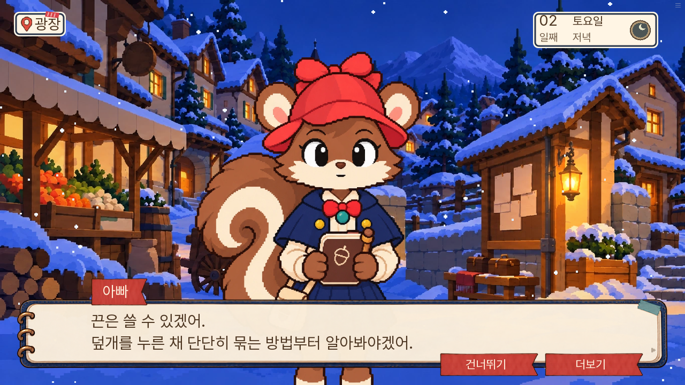
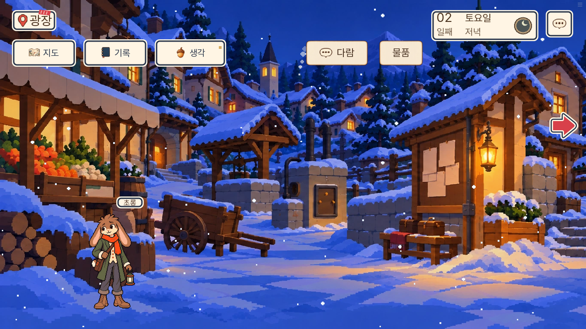
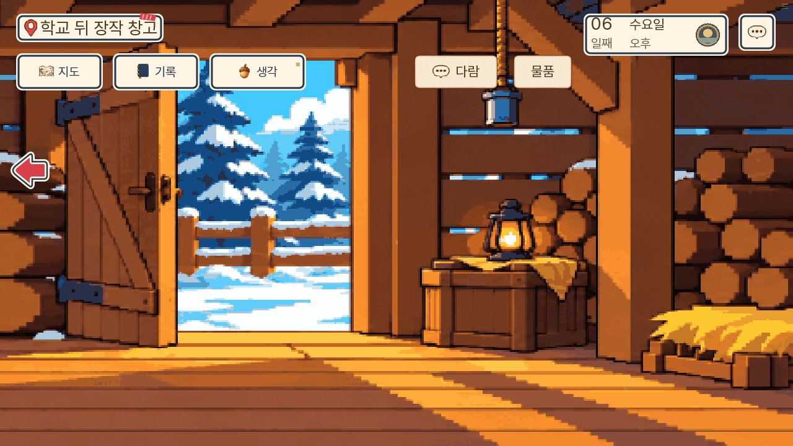
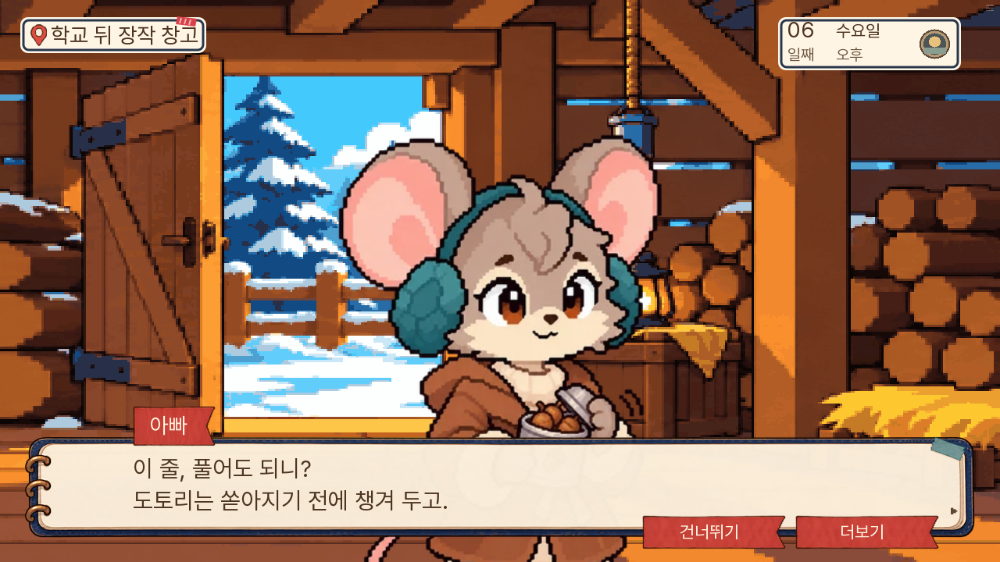
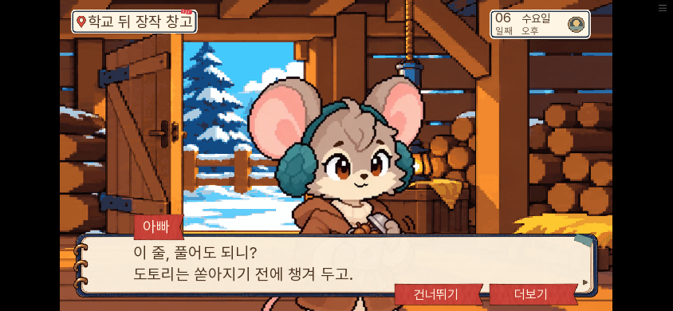

# 150 마을 퍼즐 수정 검수

2026-11-10. 시장 끈의 잘못된 피드백과 창고 깡통의 클릭 위치 두 건을 고쳤다. 생사·회의 정답·서사 사실·까로의 방법 습득 조건·초롱의 무료 끈 경로는 유지했다.

## 끈 안내

기존에는 걸쇠 관찰을 마치고 시장 끈을 사용해도, 까로에게 묶는 방법을 배우지 않았다면 잘못된 도구라고 말했다. 이제 재료가 맞다는 사실과 방법이 부족하다는 상태를 구분한다. 다른 물건·장소·날짜, 관찰 전, 끈 없음, 이미 고정하거나 초롱의 끈을 받은 상태에는 이 전용 안내가 나오지 않는다.

149 실제 auto-day2 저장을 150에서 불러온 뒤 저녁 식사, 걸쇠 관찰, 시장 끈 사용, 초롱의 끈 수령, 본편 고정까지 화면 버튼으로 진행했다. 날짜·물품·방법 상태를 주입하지 않았다. 새 안내만 읽은 전후 전체 room13가 같았고, 시장 끈도 남았다. 이어서 초롱의 짧은 끈을 받아 기존 등 고정에 성공했다. [실제 결과](끈-실제결과.json).

## 깡통 클릭 위치

기존 천장 쪽 영역 [1878,20,110,150]을 그림 속 몸통 [1890,150,90,70]으로 옮겼다. 관찰·풀기 index80/81과 조건은 그대로다. 최대 카메라에서 몸통 중앙 (815,185)을 누를 수 있다. PC 기본 글씨 HUD와는 겹치지 않는다. 큰 글씨·터치 설정은 영역 위쪽 일부가 HUD와 겹칠 수 있으므로 전체 영역이 모든 설정에서 가리지 않는다고 보장하지 않는다.

PC에서는 실제 149 auto-day6 저장을 150에서 불러와 식당 대화·지도·문과 뒤창 선행 조사·깡통 관찰·회수를 진행했고 acorn_recovered=True가 됐다. 대화 뒤에는 카메라가 왼쪽으로 돌아가므로 오른쪽 이동 화살표로 깡통을 다시 보인 뒤 몸통을 눌렀다. 준비 상태 주입은 쓰지 않았다.

휴대폰 844×390, touch=True·큰 글씨=True·버튼 높이88에서도 같은 실제 저장 경로를 반복했다. 몸통 중앙을 눌러 관찰·회수 대사가 열리고 acorn_recovered=True가 됐다. 물품 창이나 다람 창으로 잘못 들어가지 않았다. 상단 22px 일부 가림은 남지만 보이는 몸통 중앙은 누를 수 있다.

## 검사와 범위

- 전체 단위 검사 1,812개 통과, lint 통과.
- 관련 모델·연결 검사 34개 통과, 깡통 포함 기존 현장 검사 7개 통과.
- SDK 새 안내 시험, 기존 까로 방법·시장 끈 사용·취소·소모·본편 고정 시험 통과. 이 둘은 시작 상태를 준비한 회귀 시험이다.
- 대사 논리 정적 A/B/C 검사 후보 0건. 재미나 전체 이야기 무결성의 보장은 아니다.
- 독립 소스 검토에서 새 진행 오류와 기존 끈 경로 손상 없음. [검토 기록](독립변경검토.md).
- 웹 묶음의 options·탐색 모델·깡통 등록이 원본과 일치함을 확인했다.

이번에는 수정 지점과 기존 경로를 재검증했다. 1~7일 전체 새 게임 완주를 다시 한 결과가 아니다. 이전 마을 퍼즐 검수의 후속 수정이며, 다른 일반 QA 항목 전체 수정으로 보고하지 않는다.
