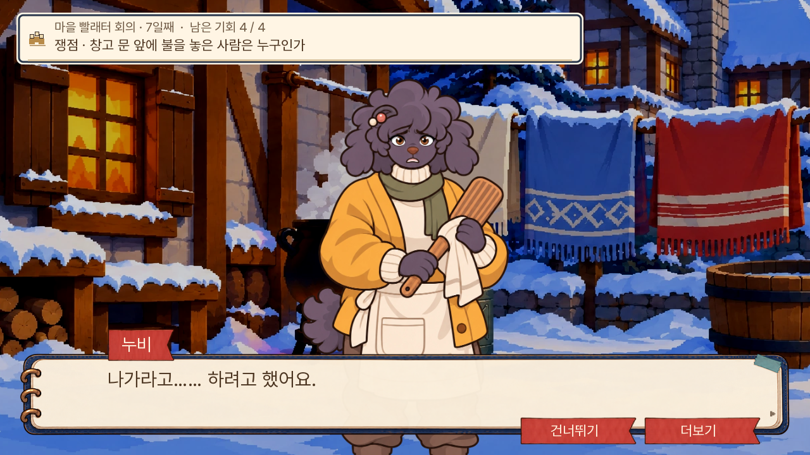
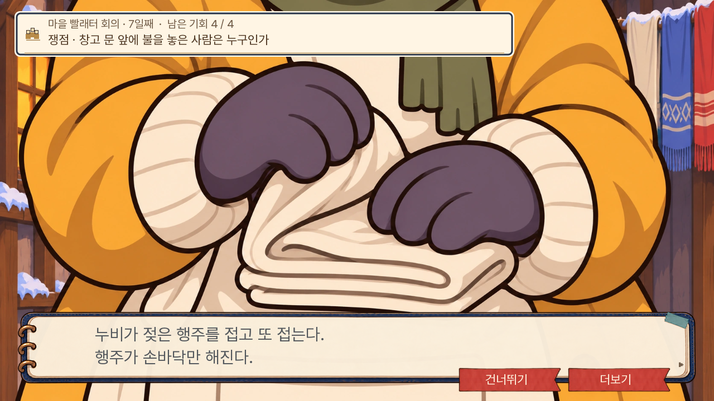

# 작화·행동 장면 개선 — 0.20.126

2026-11-08. 직전 주민 이미지·화질·비주얼노벨 검토에 대한 개선이다.

| 검토 항목 | 변경 | 범위 |
|---|---|---|
| 누비의 굵은 계단형 윤곽 | 일반6표정을 같은 정면 원화 기준으로 다시 제작. 선·명암·의상·도구·손자세를 맞춤 | 누비 일반대화·질문·회의 |
| 자백 직전의 행동이 글로만 나옴 | 행주를 접어 쥔 손의 짧은 근접 컷, 다음 발언에서 얼굴 복귀 | 실제 1부 D07 S01 L0031 |
| 회의 무대가 장면 그림을 덮음 | 새 행동 컷 두 개가 실제 표시되는 동안에만 무대를 생략. 회의 정보·대사·입력 유지 | 해당 두 컷에 한정 |
| 다람 강제 분리의 행동 연출 | 소매를 잡은 다람의 손과 상대 손목을 막는 아빠의 시점 손. 아빠 발언까지 두 쪽 후 다람 얼굴 복귀 | D07 S04 후속 경로. 현재 공개 1부 종료·잠금 유지 |
| 새 그림의 관리 | 독립 원본·SHA·전용 가져오기 명령·중앙 요청서·도구함 연결 보존 | 예전 전체 가져오기로 새 누비 작화를 되돌리지 않음 |

누비의 기존 원화 자체가 굵은 도트 윤곽이었고, 실행 시 낮은 파생본을 잘못 골라 생긴 문제는 아니었다. 원화 여섯 장을 교체했으며, 단순 해상도 확대나 전체 그림에 흐림 필터를 적용하지 않았다. 각 원본은 1024×1536 투명 이미지이고 기존 표시 키와 질문용 발선을 유지한다. 정면 등록표와 크기표에서 바뀐 인물은 누비 한 명뿐이다. 새 근접 컷 두 개만 부드럽게 축소하며 기존 CG의 샘플링 설정은 유지한다.

현재 현장 인물의 위치·키·도트·작업 자세와 대사 본문은 바꾸지 않았다. 장면 패치의 차이는 세 줄의 `cut` 메타데이터뿐이다. 진상·자료·정답·기회·생사·결말과 1부 종료 경계는 유지한다.

## 실제 화면

누비 — [교체 전](screenshots/nubi-before.png), [교체 후](screenshots/nubi-after.png), [여섯 표정 원화 합성 비교](screenshots/nubi-six-expression-preview.png). 마지막 그림은 게임 플레이 캡처가 아니라 같은 배경에서 원화를 비교한 진단 화면이다.

행주 — [기존 화면](screenshots/fold-before.png), [개선 PC](screenshots/fold-after.png), [휴대폰](screenshots/fold-mobile.png), [저장·새로고침 후 복원](screenshots/fold-restored.png).

질문 전신 — [PC](screenshots/question-pc.png), [휴대폰](screenshots/question-mobile.png). 대사·회의 화면을 내린 뒤 기존 질문 UI에 새 원화를 올린 별도 표시 검사이며 새로운 회화 경로의 통과로 세지 않는다.

후속 잠금 장면 — [손목 컷](screenshots/sleeve-followup.png), [다람 얼굴 복귀](screenshots/sleeve-daram-return.png). 이 두 화면은 S04의 상태를 준비해 확인한 것으로 현재 공개 1부에 새로 노출되는 장면이 아니다.

## 검증 범위

전체 단위 1,475개·lint·대사 논리 A/B/C 0건을 확인했다([기록](checks.txt)). 관련 엔진 경로 [7개 모두 통과](native-results.json)했고 1부 종료·저장 체크포인트·후속 경계도 유지됐다. [웹 결과](web-results.json)는 기본 글자 속도55·모션 켜짐에서 실제 행주 컷 표시, 저장→새로고침→이어하기→같은 컷 복원, 다음 발언에서 얼굴 복귀를 확인했다. JavaScript pageerror와 Ren’Py 예외 화면은 없었다.

웹 화면은 PC 1280×720·휴대폰 가로 844×390이다. S04 후속 컷은 엔진의 준비 장면 캡처(1099×618)다. 시작 상태를 준비한 뒤 실제 대사 재생기·회의·저장 UI를 사용한 부분 시험이며 새 게임부터 7일까지의 연속 완주, 모든 주민·모든 분기 검수 결과가 아니다.

[웹 빌드](build-result.json)·공개 묶음 판 번호 검사도 통과했다. 새 여섯 표정과 두 컷은 필요할 때 받는다. 첫 로딩은 기존 36,598,154바이트에서 36,610,590바이트로 12,436바이트 증가했고 사전 로딩 파일 수는 33개로 같다. 제작 원본을 첫 로딩에 추가하지 않았다.

이번 적용은 누비 여섯 표정과 행동 장면 두 곳이다. 전체 주민의 작화 통일 완료나 비주얼노벨의 재미 보증을 뜻하지 않는다. 실무 의견으로는, 표정과 중요한 행동이 같은 캐릭터의 그림으로 이어지는 데 초점을 맞춘 개선이다.

## 원본과 재현

- [누비 원본·납품 기록](../../../art/dialogue-consistency-20261108/resident_nubi/manifest.json)
- [행동 컷 납품 기록](../../../art/day7-action-cuts-20261108/delivery.json)
- 누비만 다시 가져오기: `python3 dev/import_nubi_consistency.py --apply`
- 기존 시선 교정 전체 가져오기는 새 누비 리비전을 보호한다. 예전 원본도 삭제하지 않았다.
