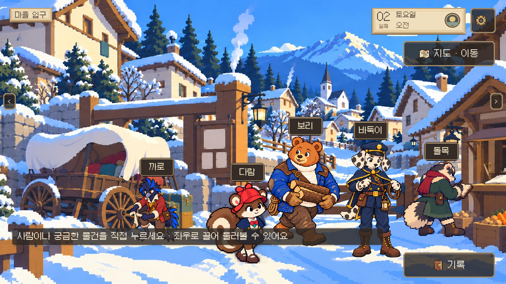
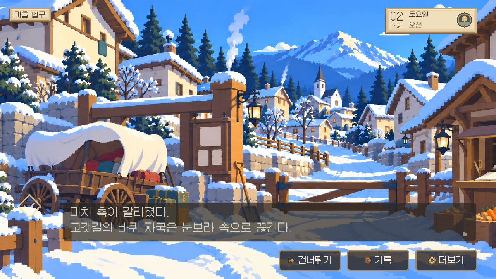
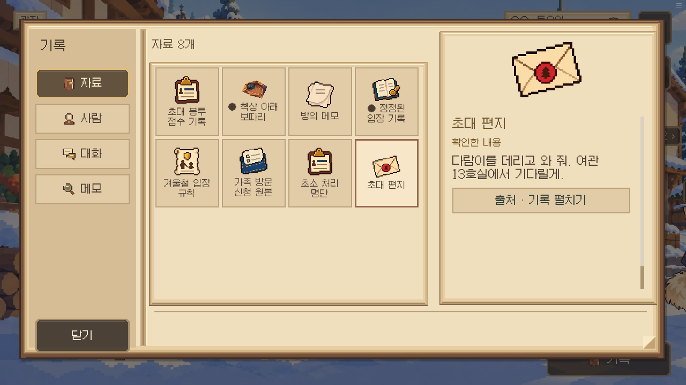
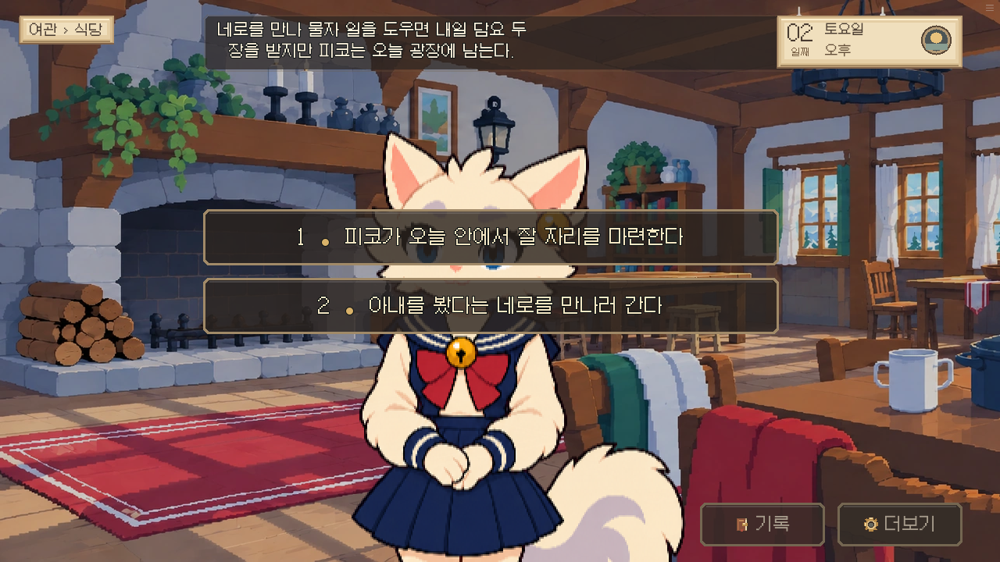
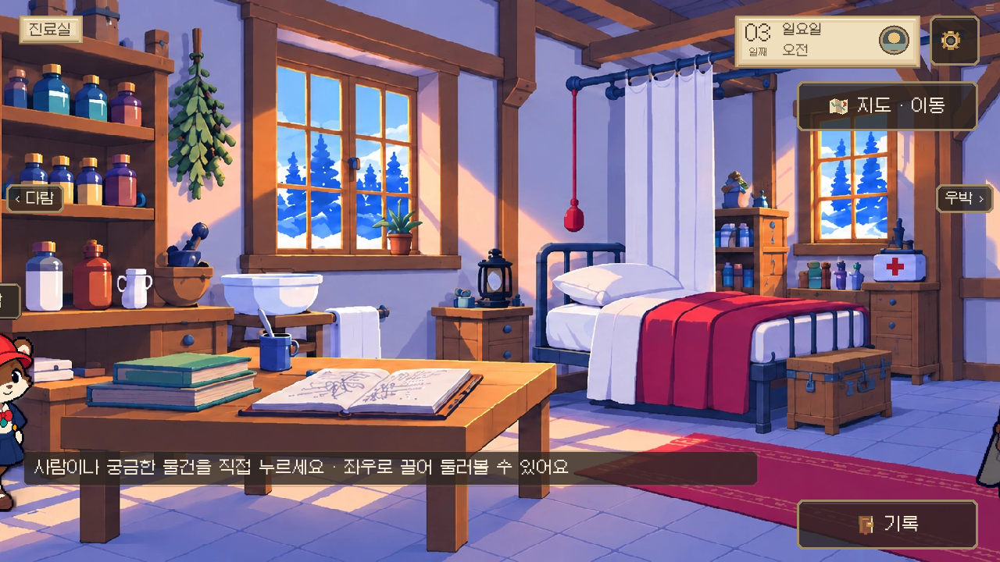
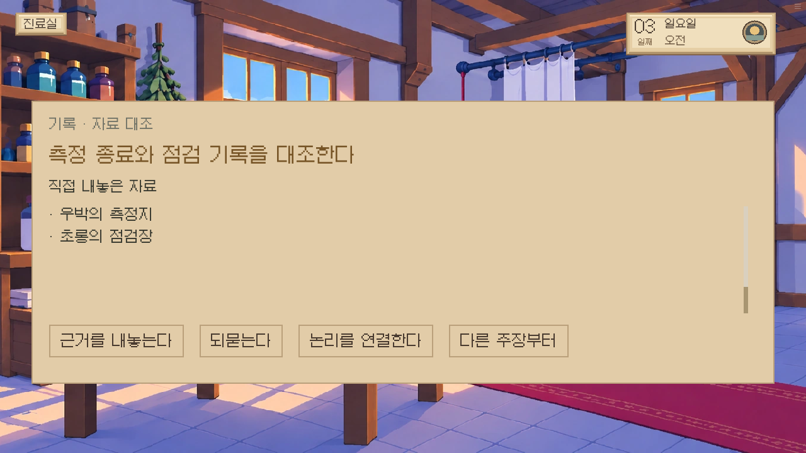
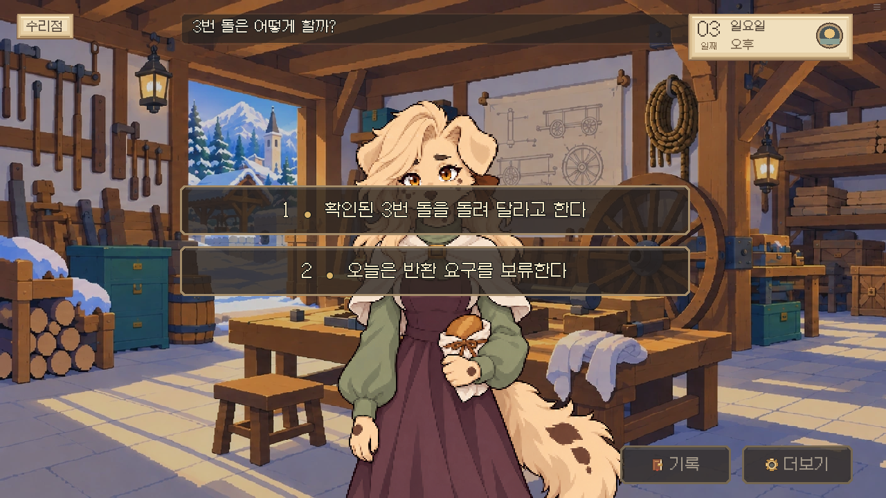
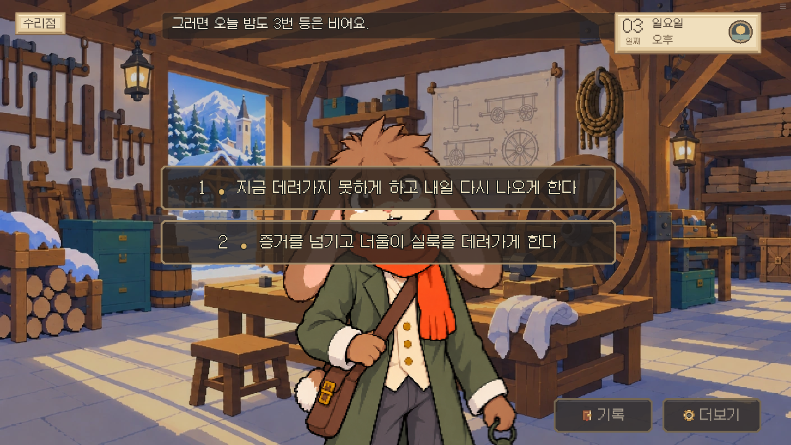
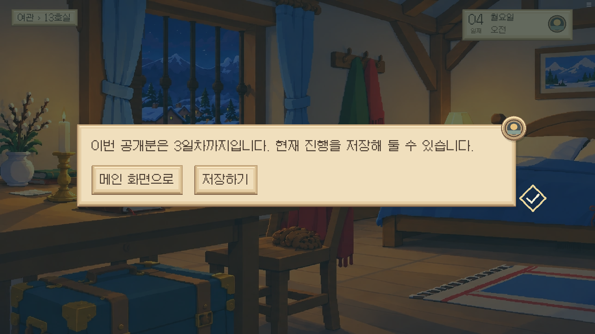
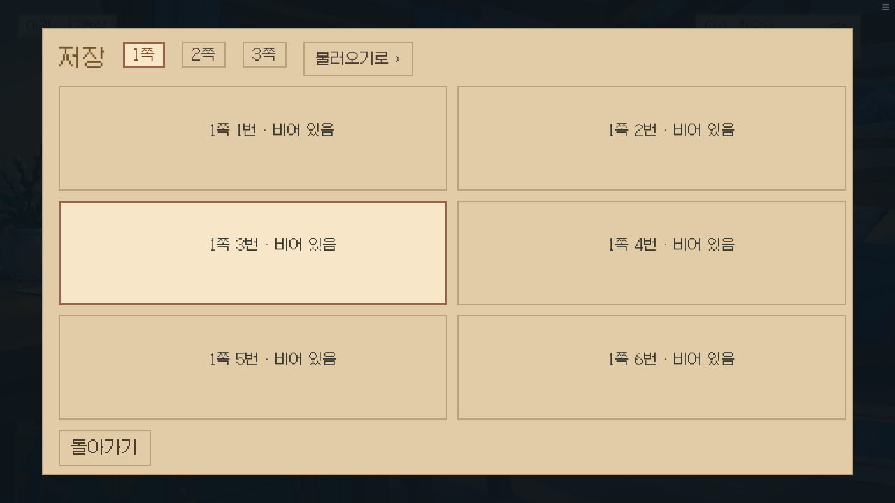

# V1.1.1 첫 3일 실제 진행 보고

## 0.19.77 복구 검수

0.19.76의 아래 검사는 필수 단서 경로에 치우쳐 입구 돌목의 직접 클릭과 일반 배경 설명 누락을 놓쳤다. 전체 조작이 정상이라는 판단을 철회하고, 필수 조사 외의 인물·배경 반응을 포함해 다시 검수한다. 4~14일 확대는 중단했다.

첫 입구 돌목은 명단 확인에 직접 연결하고, 질문이 없는 인물도 기존 질문 화면에서 반응하도록 수정했다. 필수 조사만 허용하던 필터를 풀어 일반 배경 설명을 복구했으며, 이전 사건의 증거·플래그는 실행하지 않는다. 편지 펼치기·하차·기록 재열람·작업 중간의 단순 진행 확인창은 제거했다. 실제 분기, 현장 행동과 공개 범위 끝의 저장/메인 화면 선택은 유지한다.

추가 요청에 따라 기존 주민의 일정·위치 배치도 복구했다. 새 대본의 인물을 더하고, 피코의 생존·진료소 이동과 실룩의 구금 결과를 우선 적용한다. 질문 없는 주민은 기존 질문 화면에서 반응하며 옛 사건 대사는 실행하지 않는다. 편지·명단·규칙·메모 등의 전용 기존 그림도 새 증거 ID에 의미별로 연결했다.

초기 게임 자료는 약56.3MB에서 약35.6MB로 줄였다. 엔진 다운로드와 기기 초기화는 별도다. 원본 그림/음원은 재압축하지 않았으며 시작에 필요 없는 자료는 기존 점진 다운로드를 사용한다.

첫날을 새 게임부터 취침까지 실제 클릭으로 진행했다. 이후 실제 플레이 저장에서 이어 식당 보호/네로 작업, 돌 반환/보관 유지, 출석 의무/구금 인계를 확인했다. 두 경로 모두 3일차 종료 안내까지 통과했다. 보호 경로는 피코 생존·침구 0장·직접 등 복구, 네로 경로는 피코 부재·다람이 잇는 초상·실제 침구 인계 후 2장을 확인했다. 첫 대조의 오답 후 재제시와 새 종료 안내의 저장 화면 연결만 별도 확인했다.

검사 도구의 가장자리 클릭·이동 화살표 오류로 중단한 구간은 도구를 고친 후 실제 저장에서 재개했다. 스토리 상태를 주입하지 않았다. [현재 검수 요약](verification77/SUMMARY.json), [첫날 로그](verification77/day1-play-log.txt), [둘째 날 로그](verification77/day2-play-log.txt), [보호 경로 후반](verification77/shelter-report.json), [네로 경로](verification77/nero-report.json)에 범위를 남겼다. 단위/lint 묶음, 변경 관련 12건, 로더 복구 3건을 통과했다. 중간 수정본의 네이티브 시작 입력은 7항목을 통과했으며, 마지막 인물 복구본의 입구는 실제 웹 진행으로 확인했다. 헤드리스 Chrome 검사이므로 실제 휴대전화에서 소리를 들었다거나 60fps를 측정했다는 뜻은 아니다.

**남은 항목:** 2일차 광장의 ‘남겨 둔 물건’은 주민과 겹쳐 표본 클릭으로 접근하지 못했다. 3일차에는 같은 대상의 설명을 실제로 확인했다. 기존 인물 우선 클릭 규칙과 배치는 유지하며 이 겹침은 완료로 세지 않는다. 구작 사건 전용 대상은 옛 증거·사건을 실행하지 않고 이름만 표시하는 경우가 있다. 나머지 주민의 새 등장 위치는 사용자 전달을 기다린다. 4~14일·주요 엔딩과 추가 동작 리소스도 미완료다.

### 복구한 실제 화면

기존 주민 배치:

배경 클릭 설명:

기존 자료별 그림 재사용:

[보호 경로 종료](verification77/shelter-complete.png) · [네로 경로 종료](verification77/nero-complete.png) · [2일차 겹침 기록](verification77/overlap-square-offerings.png) · [3일차 같은 대상의 반응](verification77/audit-reaction-square-offerings.png)

## 0.19.76 당시 기록 (복구 전)

첫 3일의 대사·조사·제시·선택 결과를 기존 Room13에서 연결했다. 새 엔진·독립 게임·새 그림/음원은 만들지 않았다. 원문 보존, 변경 파일과 범위는 [구현 현황](IMPLEMENTATION_STATUS.md), 부족한 토리 리소스는 [리소스 요청](RESOURCE_REQUESTS.md), 감사 21건 대조는 [CSV](AUDIT_21_STATUS.csv)에 있다.

## 실제 진행한 경로

| 선택 묶음 | 피코/초상 | 침구 | 돌 | 실룩 |
|---|---|---|---|---|
| 식당 보호 → 돌 반환 → 구금 반대 | 생존, 피코가 완성한 초상, 진료소 | 0장 | 실제 등 복구 조사 후 복구 | 출석 의무 |
| 네로 작업 → 돌 반환 보류 → 조사 인계 | 피코 부재, 처음 미완성 → 다람이 코를 이어 그림 | 예약 때 0장 → 실제 인계 후 2장 | 백 부인 보관 유지 | 공동작업 대기, 아이들은 부리와 작업장 |

첫날은 마차/편지 실제 입력, 초소 명단·신청 원본·규칙 조사, 세 자료 제시, 숙소 메모·꾸러미, 두 편지 대조와 취침을 진행했다. 둘째 날에는 밧줄·교환함, 우편소의 세련, 초상 의뢰와 등 네 부분 조사 후 양쪽 오후 행동을 확인했다. 셋째 날에는 등 파편, 점검장·공구 대여·측정지, 운반표·돌·매입 장부, 칼·걸쇠 진술의 실제 대조와 처우 선택을 확인했다.

통과한 구간을 다시 처음부터 반복하지 않았다. 실제 플레이 저장에서 분기 직전/공구 기록/마지막 취침을 이어서 확인했다. 게임 상태를 주입해 피코를 살리거나 담요를 지급하지 않았다. 기본 Ren’Py 저장·로드·스킵 행렬은 생략했다. 새 연결의 오답 제시 후 자료 정리/재제시, 공개 범위 끝에서 저장 화면 열기/복귀만 별도로 확인했다.

[최종 결과 JSON](verification/SUMMARY.json), [보호 경로 마지막 확인](verification/shelter-report.json), [네로 경로 후반 확인](verification/nero-report.json)에 실행 범위와 재개 지점을 기록했다. 헤드리스 Chrome이므로 실제 휴대전화에서 소리를 들은 검사와는 구분한다. 음악은 원본 파일과 기존 한 재생 채널에 연결했다.

## 실제 게임 화면

### 의미 있는 오후 선택

### 기존 현장의 직접 조사

진료실의 측정 기록은 실제 배경 조사 대상에 연결했다. 식당 실제 착석/작업 동작은 토리 리소스 확인이 남아 있다.

### 기존 수첩에서 실제 자료 제시

오답 뒤 선택 자료를 정리하고 다시 제시한 화면이다.

### 돌과 처우 결정

### 공개 범위 끝과 저장 연결

## 수정한 연결과 남은 일

- 교환함과 초롱의 클릭 영역 겹침 및 눈면 접지 위치를 수정했다.
- 오답 자료가 다음 대조에 계속 남아 진행을 막지 않게 정리했다.
- 원문 선택 효과, 피코 부재, 초상 완성 주체, 예약/실제 수령을 분리했다.
- 장소 이동 시 구작 음악을 잠깐 재생한 뒤 대본 음악으로 다시 전환하지 않게 했다. 구작 목표가 새 장면에 섞이는 표시도 막았다.
- 첫 로딩 약56.3MB와 8MB 단위 3분할, 기존 카메라 이동·마차 한 번 충격·대화/건너뛰기 디자인을 보존했다.
- `dev/check.sh` 단위/lint 통과, 신규 조건/효과 관련 10건과 네이티브 시작 입력 통과. 마지막 연결 순서 수정에는 지도 관련 검사만 다시 돌려 통과했다.

**4~14일과 주요 엔딩은 아직 연결·실행 검증 전이다.** 감사 21건 중 읽기본 조건 표시 정정은 이미 해결되어 재수정하지 않았다. 후반 연결 공백/위험은 현재 코드와 대조했지만 해결 완료로 세지 않았다. 추가 동작, 정확한 등 내부·돌 상태 오버레이와 초소 내부 등은 리소스 요청에 남겼다. 기존 40명 승인 표정/초상과 기존 교환함·초상화·꾸러미 자산을 사용하며 같은 자산을 중복 생성하지 않았다.
