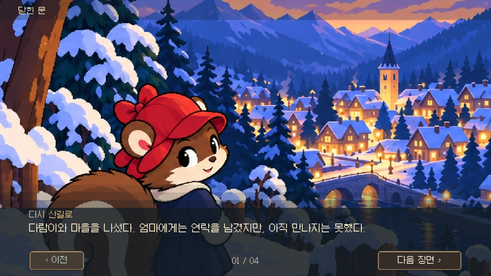
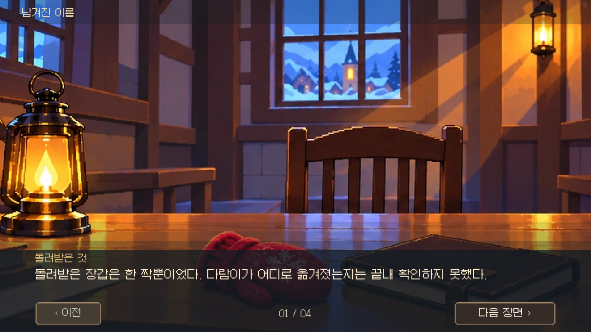
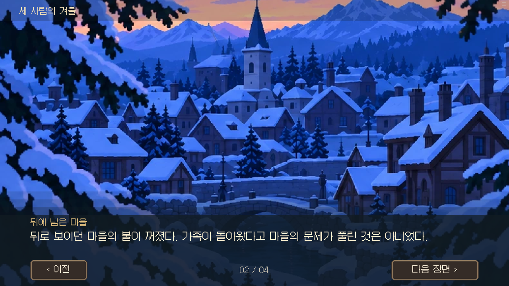
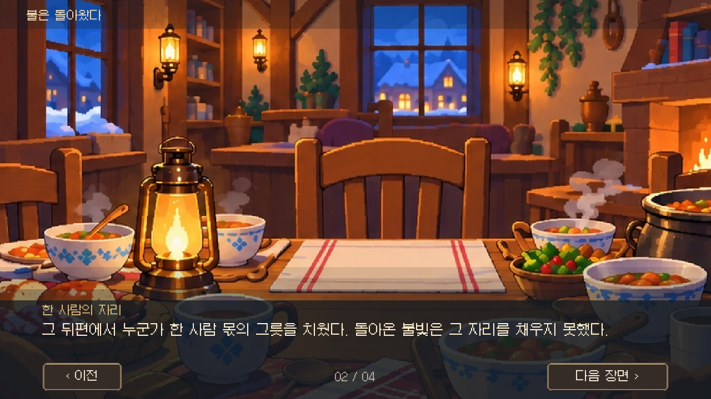
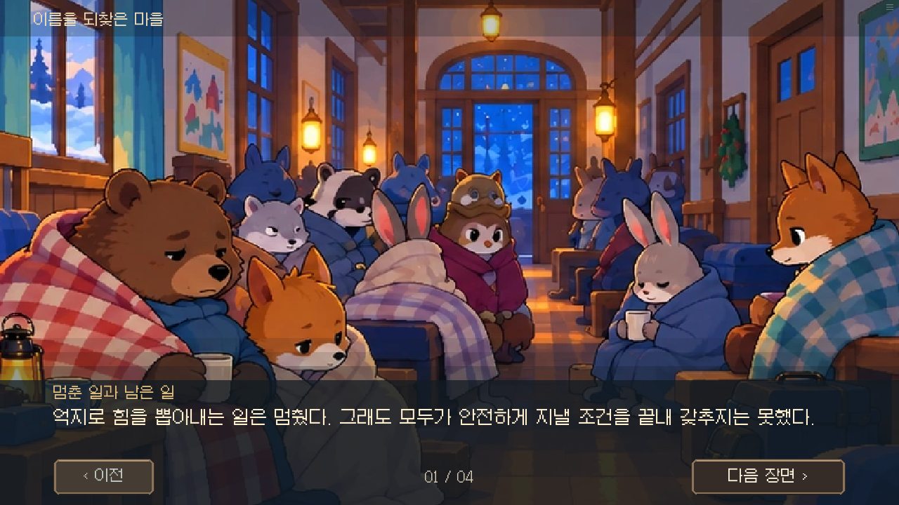
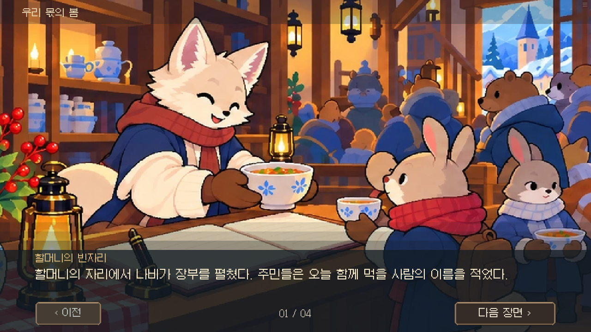
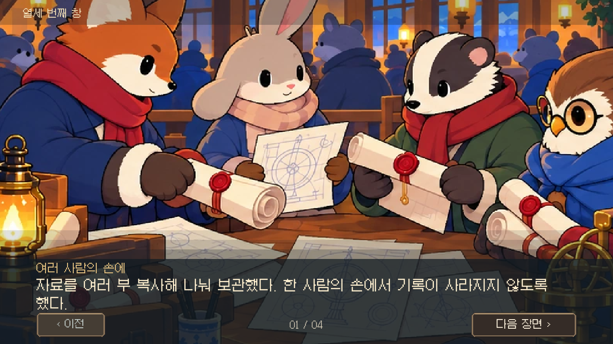
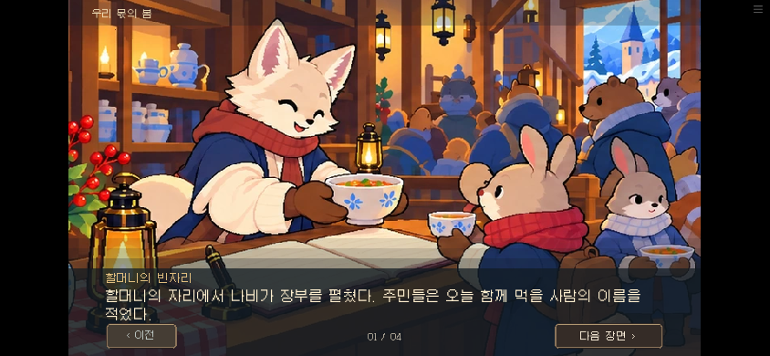

# 엔딩 그림 질감 정리 · 0.18.76

엔딩 28장면의 잔점·거친 나무결·흩어진 반사광을 줄이고 눈·하늘·벽·옷의 큰 색면을 정리했다. 기존 구도와 등장인물, 소품, 후일담은 유지한다. 아래는 실제 게임 화면이며 엔딩 스포일러를 포함한다.

## 가족의 일상

이전:

수정:

## 마을과 눈밭

이전:

수정:

## 다른 장면

[실제 브라우저 검수 결과](result.json). 명시적인 엔딩 상태에서 일곱 엔딩의 네 장면, 이전 이동, 중간 저장/불러오기, 후일담 다시 보기, 상태 보존, 연출 끄기와 모바일 화면을 확인했다. 전체 14일 플레이 검사는 아니다.
