# 네 장면의 엔딩 후일담 · 0.18.74

실제 게임 화면. 가족뿐 아니라 마을의 생활, 남겨진 사람과 기록까지 네 장면으로 이어진다. 아래에는 엔딩 스포일러가 포함된다.

[실제 재생 영상](ending-story.mp4) · [검수 결과](result.json) · [변경 내역](../../docs/releases/RELEASE_01874.md)

## 우리 몫의 봄

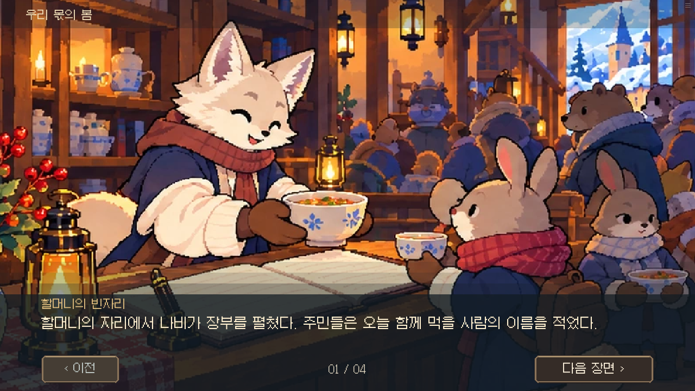

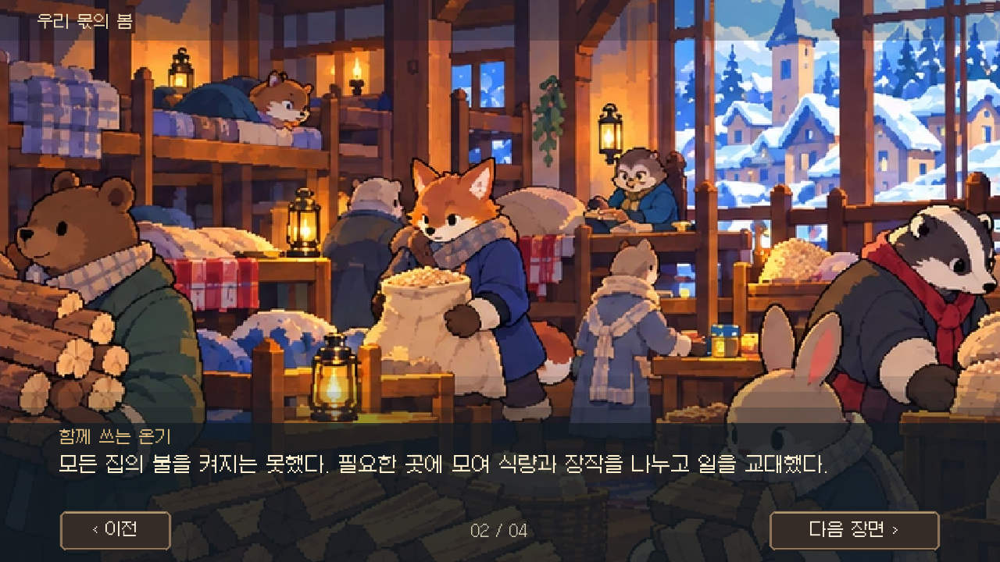

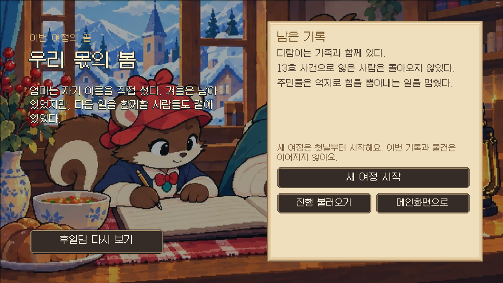

## 다른 결말의 후일담

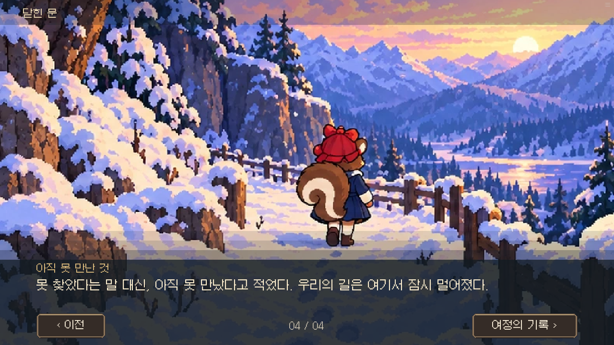

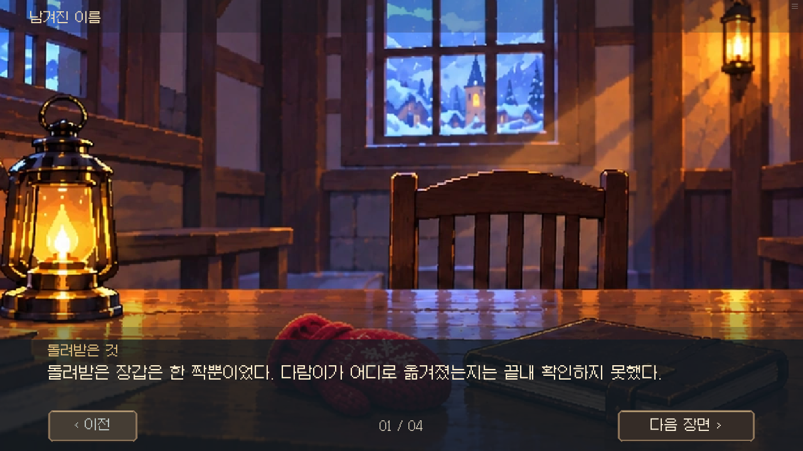

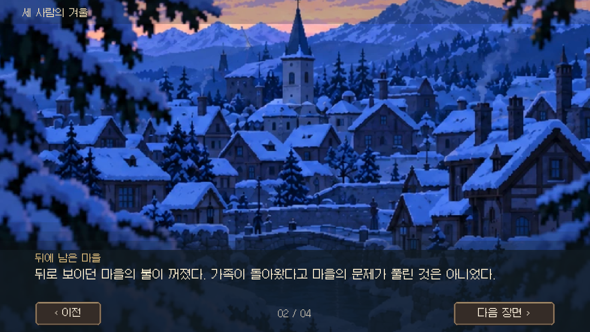

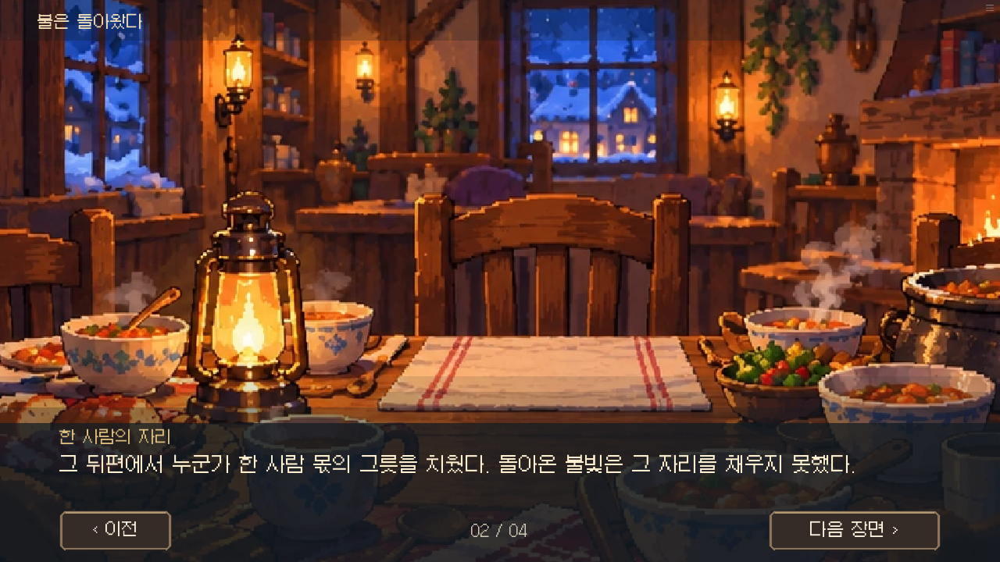

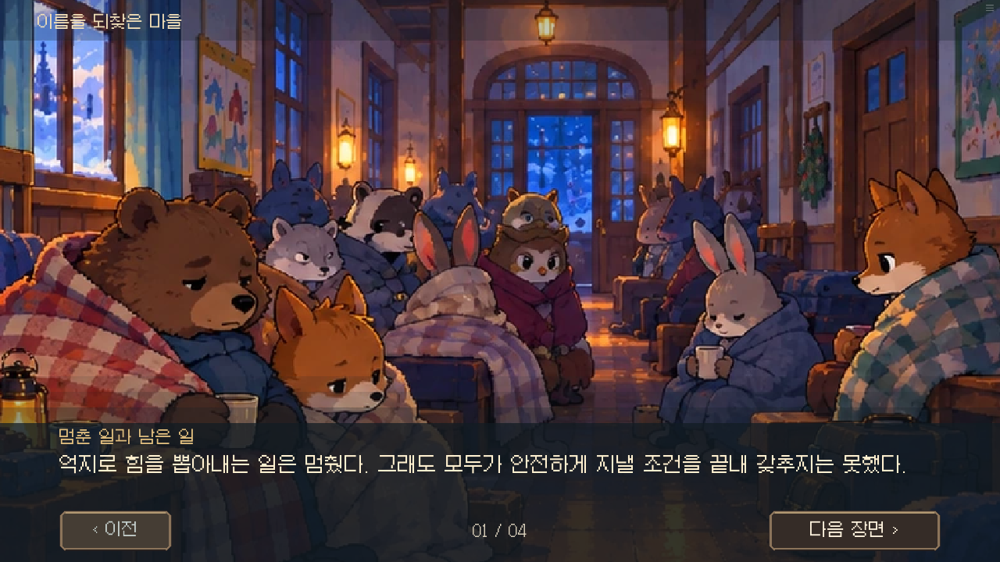

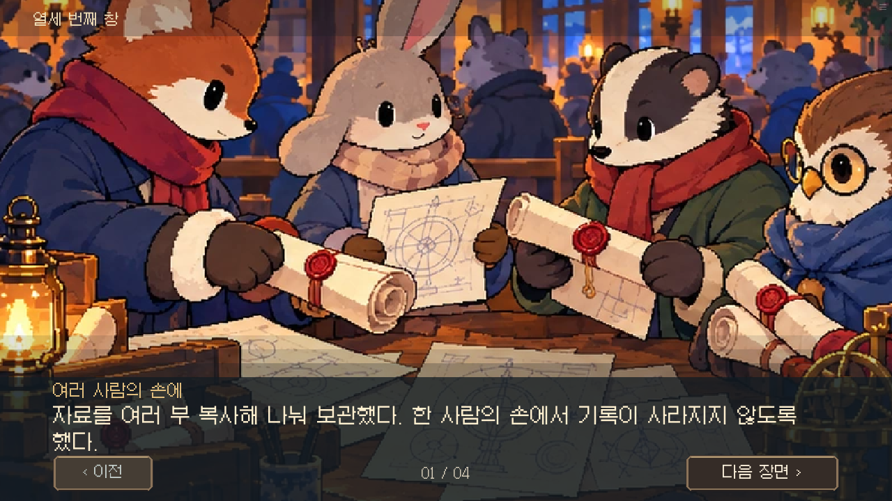

## 모바일 큰 글씨

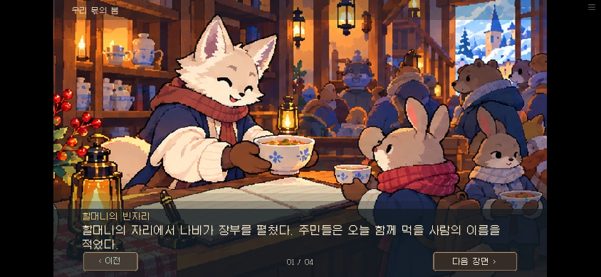

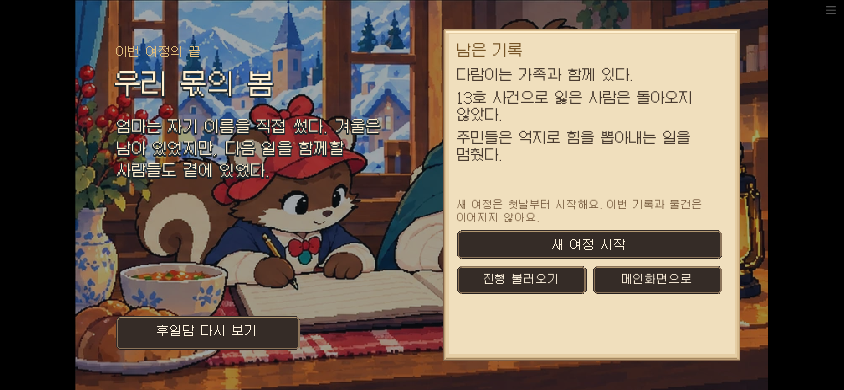

일곱 엔딩은 명시적 상태를 사용해 실제 대사와 화면을 재생했다. 전체 14일 경로를 플레이한 검사는 아니다. 각 네 장면, 중간 저장/불러오기, 이전 장면, 다시 보기, 여정 상태 보존과 연출 끄기를 검사했다.
