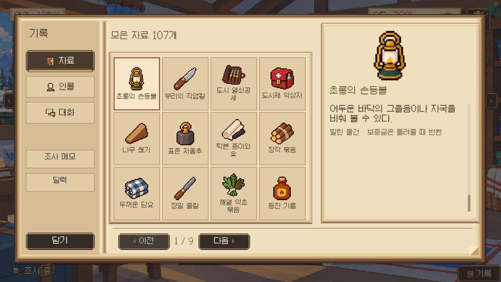
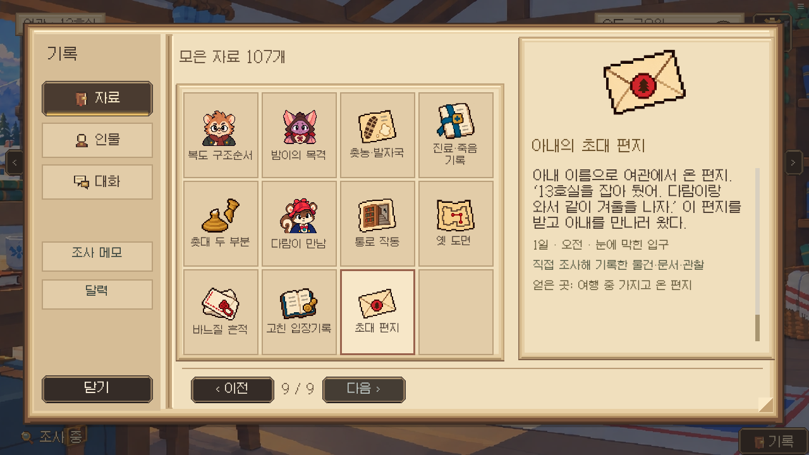
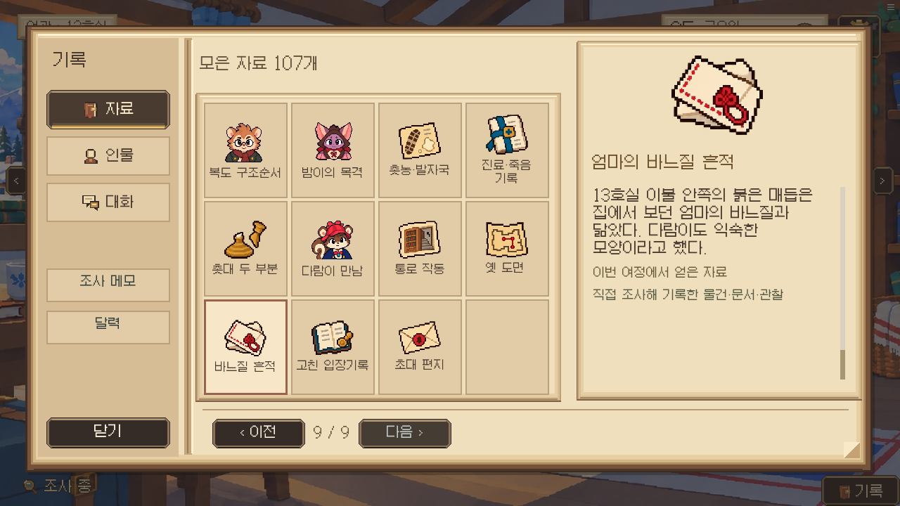
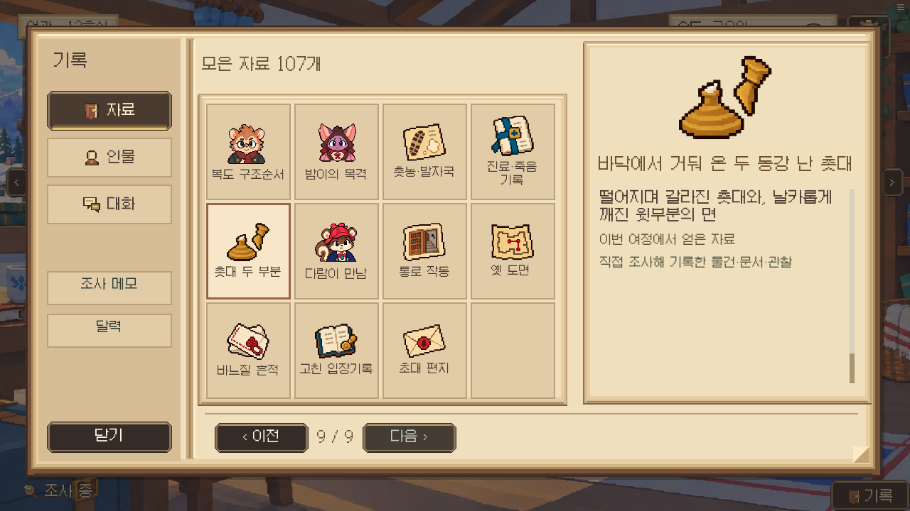
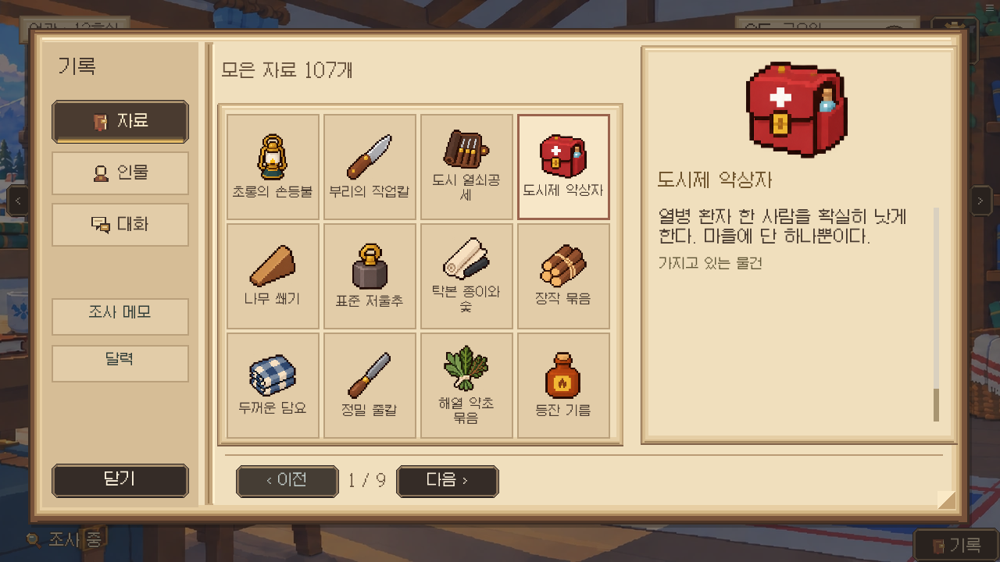
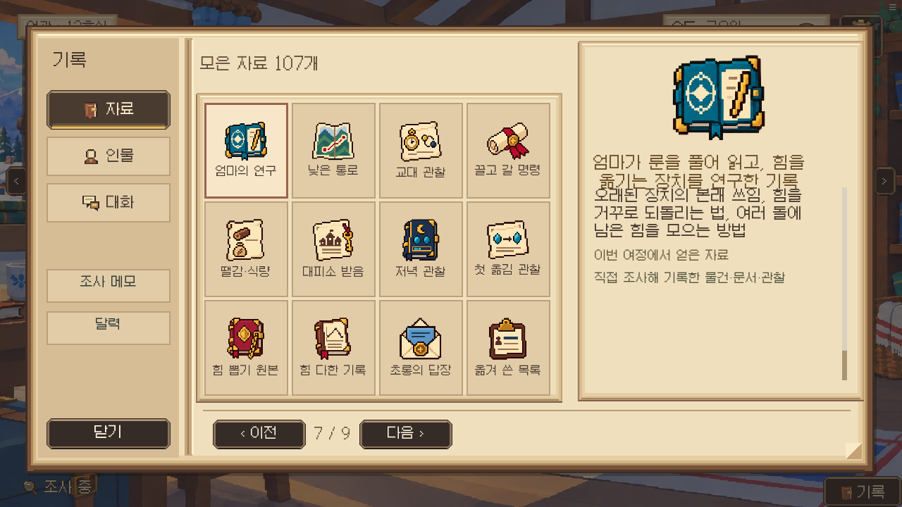
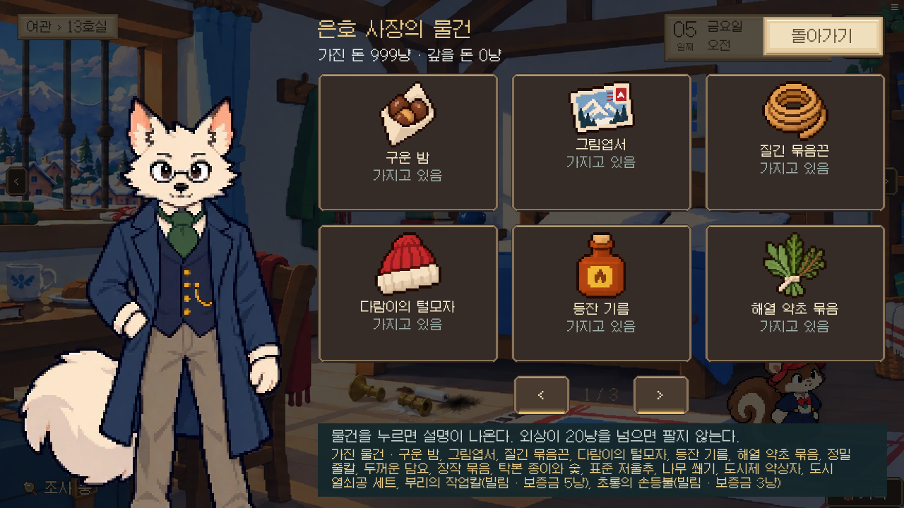
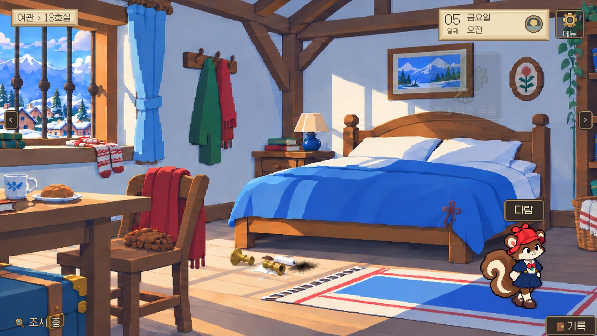
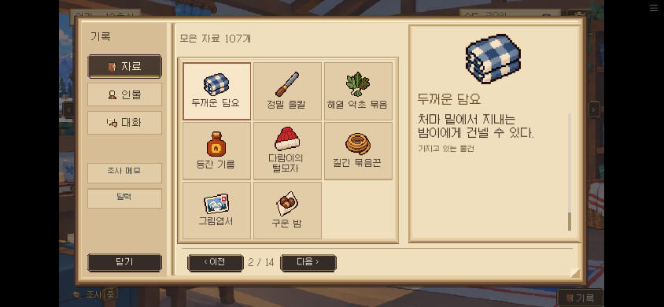

# 단순한 48px 도트 아이콘

고선명 장식과 광택을 덜어내고 자료·물건 82종을 게임 안의 작은 도트 그림으로 정리했다. 인물 초상화는 이번 변경에서 제외했다.

## 이전

## 수정 후 실제 화면

[검수 결과](result.json) · [변경 기록](../../docs/releases/RELEASE_01881.md)

자료를 모두 소지한 명시적 검수 상태다. 실제 획득 경로를 전부 플레이한 검사는 아니다.
