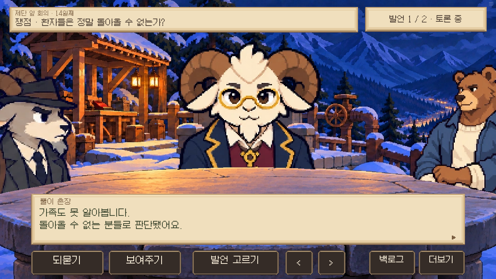
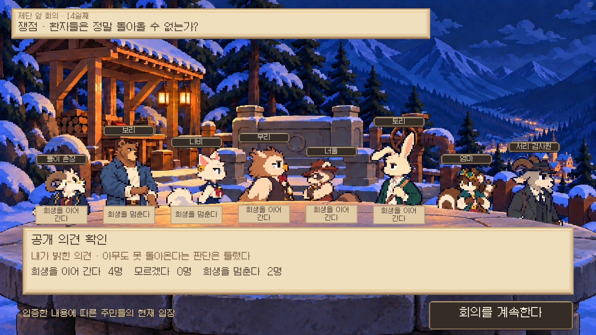
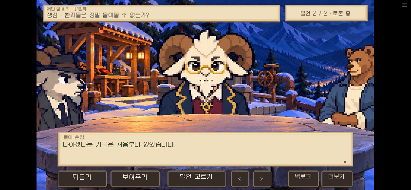

# 제단에서 서서 둘러서는 돌판 회의 · 0.18.72

기존 제단의 겨울 저녁 배경에, 서 있는 허리 높이의 큰 돌판을 두었다. 중앙 화자와 양옆 주민은 서 있는 그림을 사용하며, 식당 회의와 같은 좌우 카메라 전환·반복 듣기·되묻기·자료 제시 흐름으로 진행한다.

[실제 게임 카메라 영상](altar-motion.mp4)

[배경 원본 PNG 다운로드](standing-stone-background.png)

result.json: 실제 14일 제단 상태에서 화자·양옆·전환·모바일 자료창 취소·F1 자료 두 건과 결론·전체 공개 의견·준비 관문을 확인했다. 전체 14일 경로를 플레이한 검사는 아니다. 영상은 실제 게임 화면을 녹화한 것이며 음성은 포함하지 않는다.
