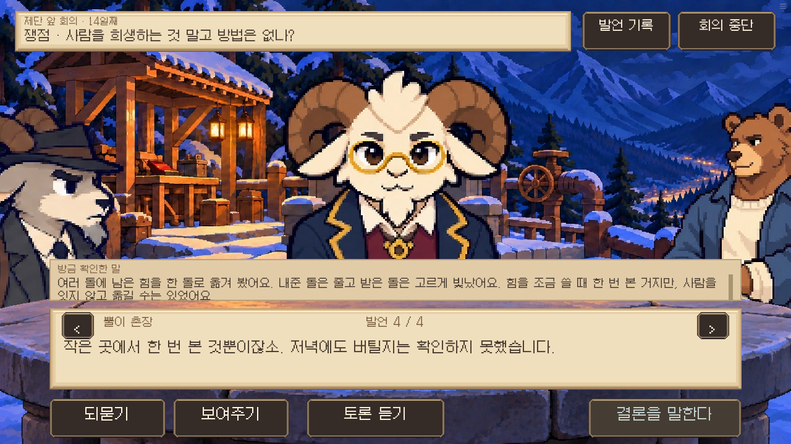
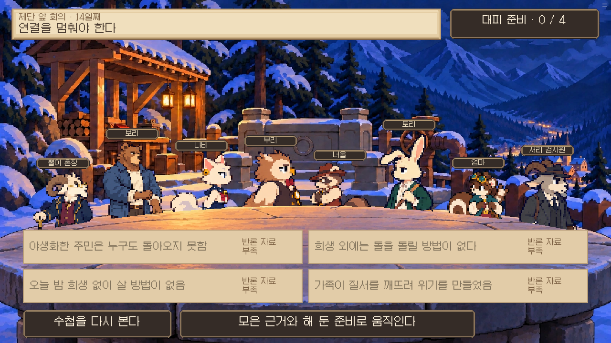
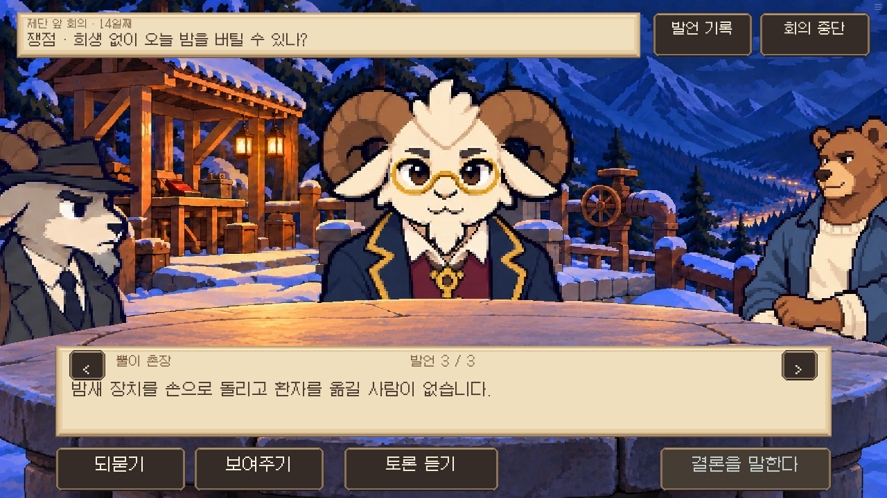

# 제단 회의 내용·로직 점검 · 0.18.73

F1~F4의 자료 범위와 실행 판정, 실제 준비 및 엔딩 조건을 대조했다. 점검 내역은 [릴리스 기록](../../docs/releases/RELEASE_01873.md)에 정리했다.

실제 브라우저 검수는 명시적인 14일 상태에서 수행했으며 전체 14일 경로를 플레이한 검사는 아니다. 아래 화면은 실제 게임이다.

result.json: F2 낮·저녁 실험, 잘못된 결론, F3 실제 준비·되묻기, F4 경고 범위와 정상 입증 결과.
