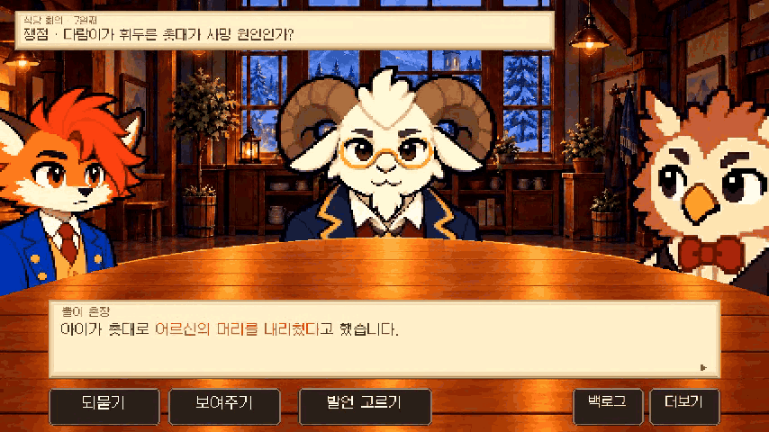
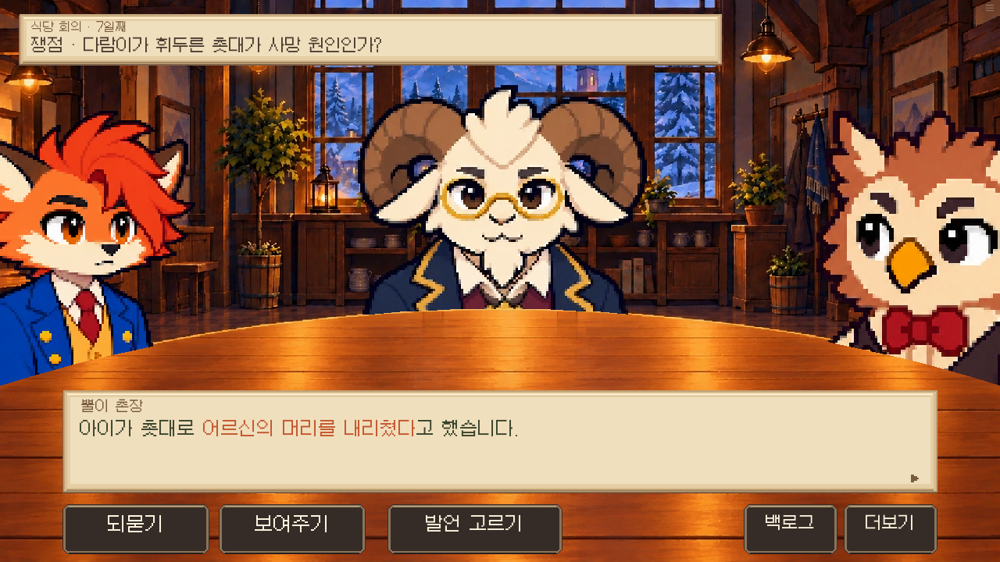
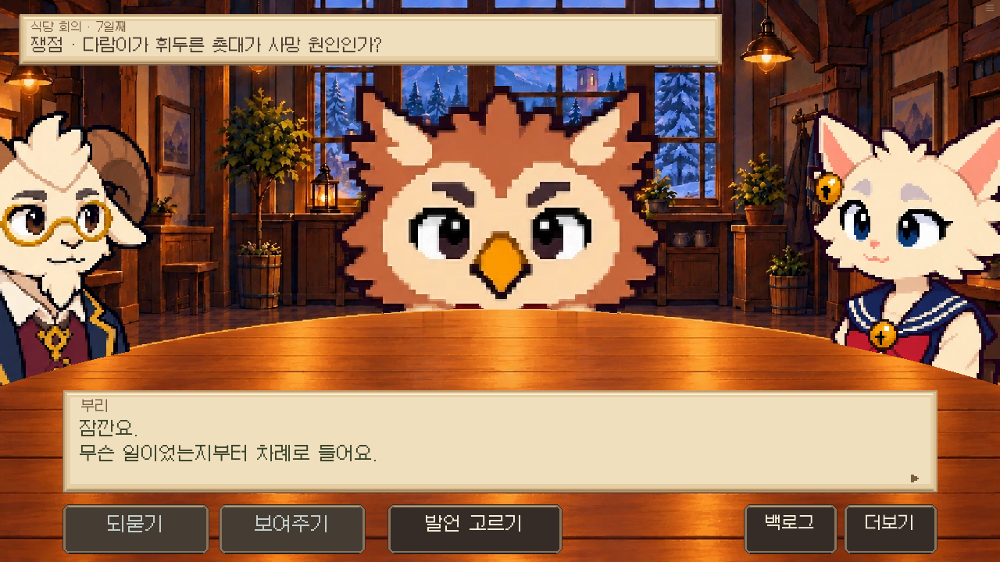
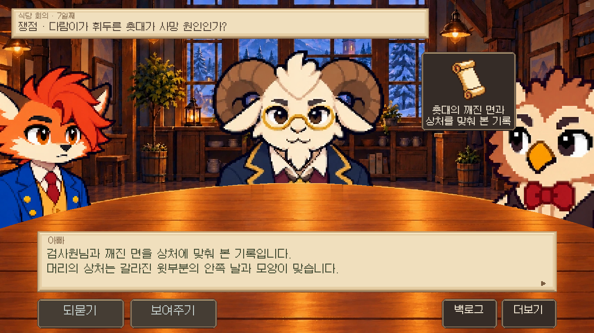
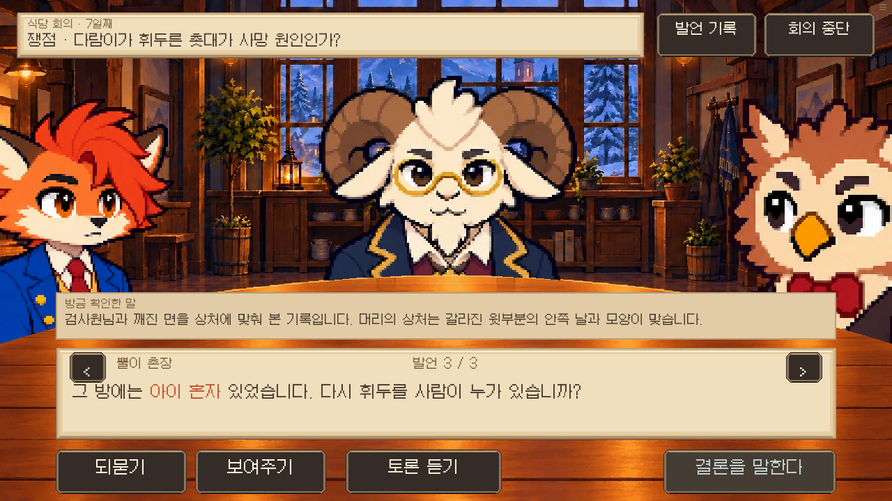
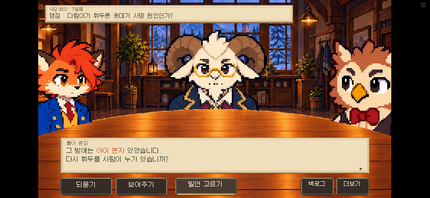

# 회의 토론 리듬 · 0.18.70

실제 Ren’Py 웹 빌드를 Chromium에서 플레이한 녹화. 명시적 7일/14일 회의 상태에서 검토했으며 전체 14일 경로를 플레이한 검사는 아니다. 대사는 검토 중 클릭으로 넘겼으며 실제 게임에 강제 넘김/제한시간을 넣지 않았다.

[토론·끼어들기·제시 전체 동작 영상](meeting-motion.mp4)

rhythm-result.json: 토론·끼어들어 되묻기·다시 듣기·자료 제시/취소/저장복귀·반박 대상 고정·움직임 끄기·모바일·준비/입증 우회 방지.

flow-result.json: 기존 반박/반론 선택/공개 의견/제단 흐름 회귀 확인.
