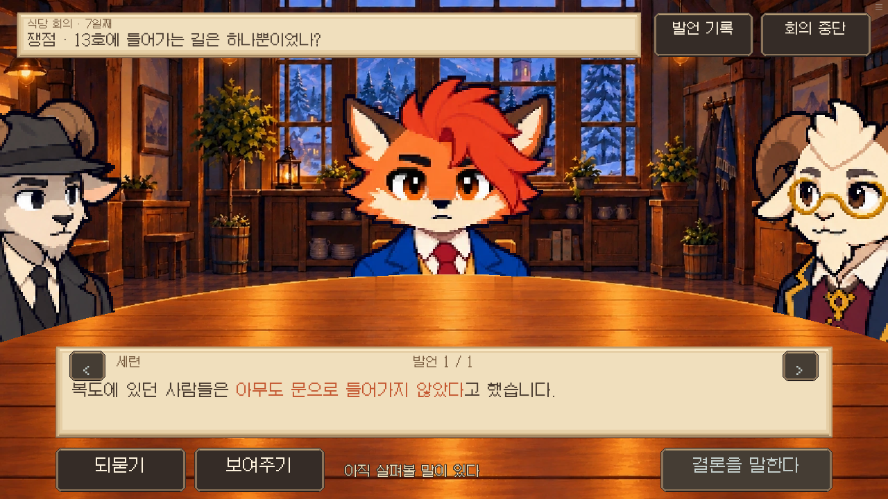
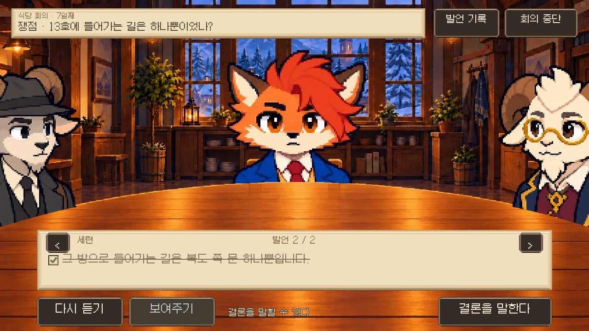
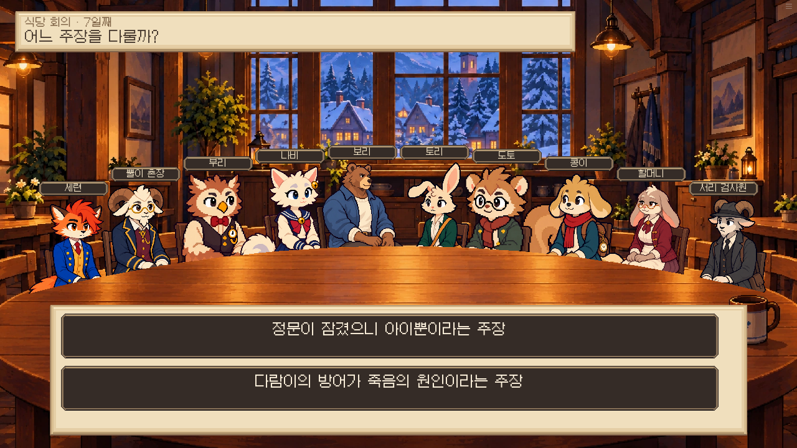
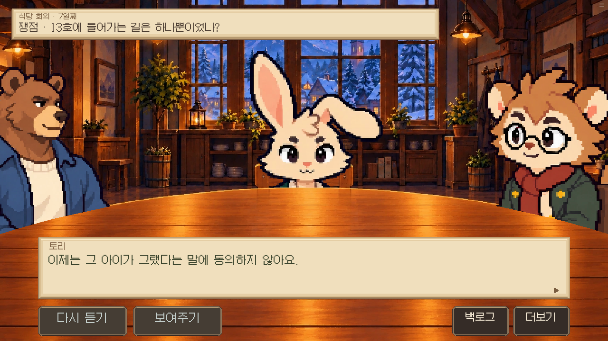
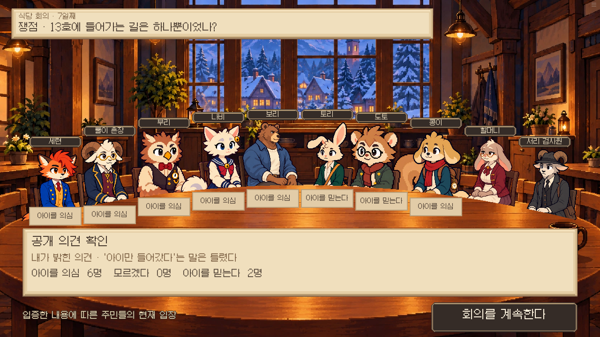
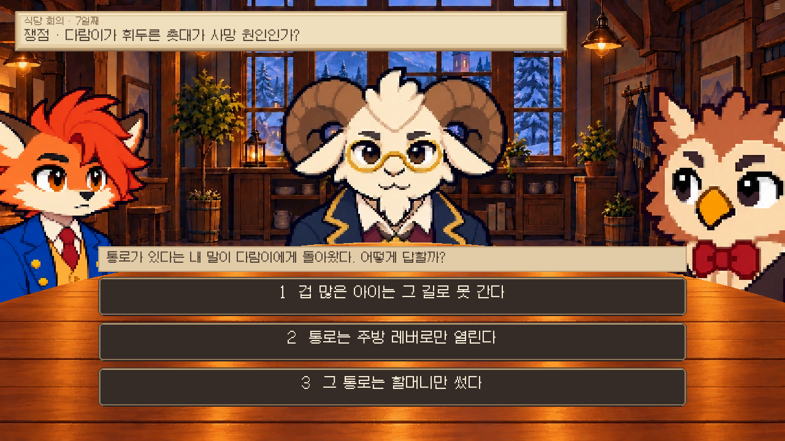

# 회의 UI/UX · 0.18.69

실제 Ren’Py 웹 빌드 Chromium 검토 화면. 명시적 7일/14일 상태에서 회의 흐름을 검증했으며 전체 14일 플레이 검사는 아니다. full flow 결과는 result.json, 최신 병합본의 대사/자료창/재생 복귀 및 주민 의견 반응은 resume-check.txt와 opinion-check.txt를 참고한다.

