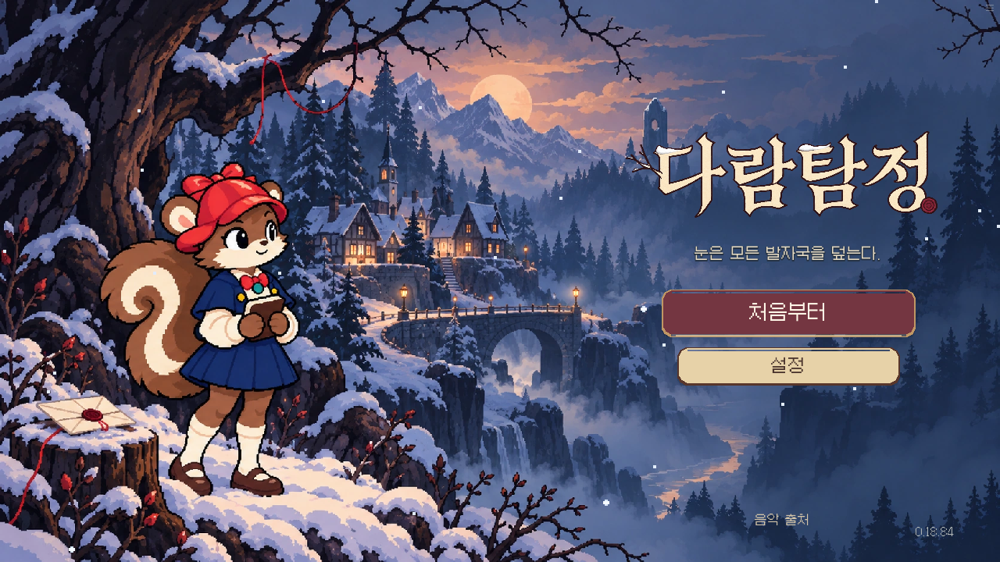
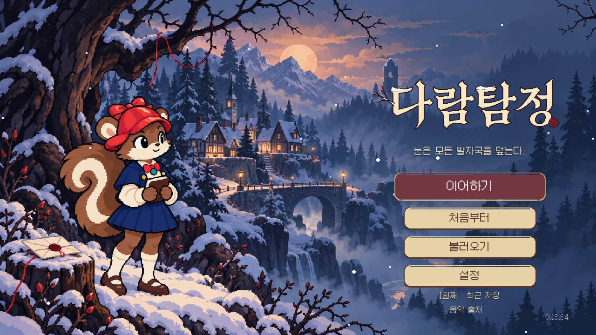
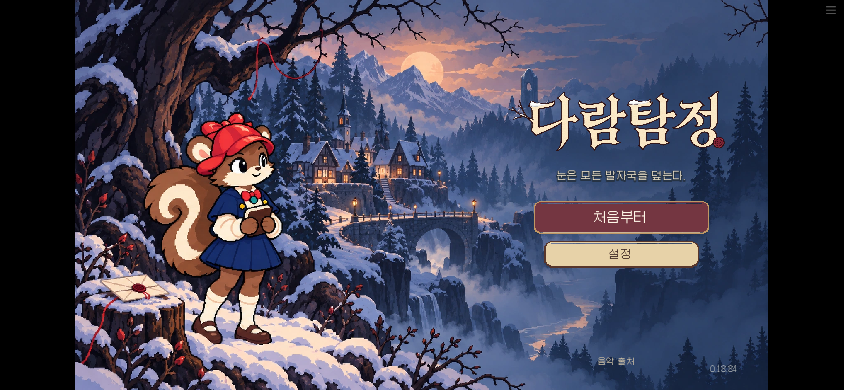

# 전용 원화로 바꾼 메인화면

실제 Chromium에서 게임을 열어 찍은 화면이다. 배경·로고·버튼을 함께 구성했다.

## 이전 화면과 비교

[검수 결과](result.json) · [변경 기록](../../docs/releases/RELEASE_01884.md) · [원화 제작 기록](../../art/title-keyart-20261016/README.md)

새 브라우저에서 실제 클릭·키보드·터치로 설정과 출처를 열고 닫았다. 새 게임에서 입구까지 진행해 저장한 뒤 메인화면으로 돌아와 불러오기와 이어하기를 확인했다. 전체 이야기 플레이 검사는 아니다.
