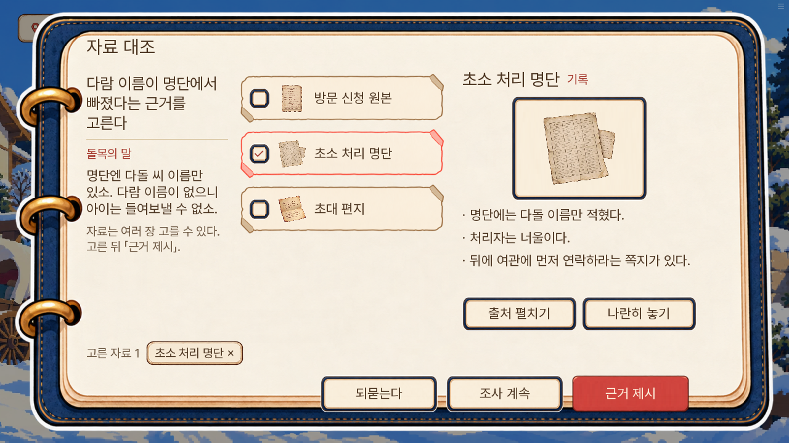
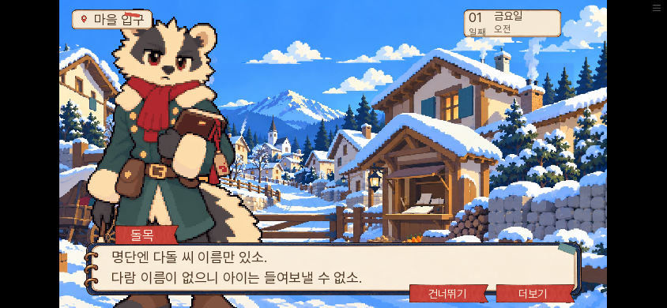
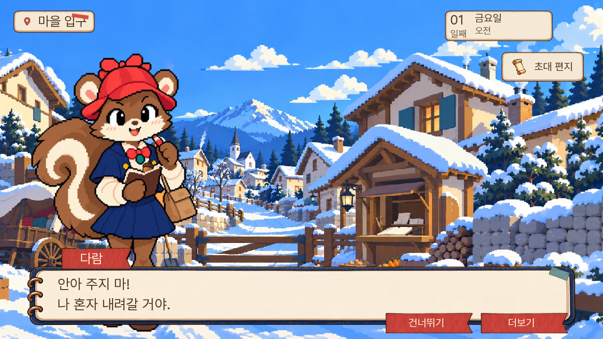

# 대사창·첫 마차 건너뛰기·초소 쟁점 정리

2026-11-04, v2-pilot-5. 소유자의 요청 세 가지를 반영했다. 기준은 마지막으로 선택한 ‘다람 이름 누락’이다.

## 초소에서 해결하는 문제 하나

| 단계 | 유저에게 보이는 내용 |
|---|---|
| 문제 | 돌목의 명단에는 다돌만 있다. 다람 이름이 없어 아이가 들어갈 수 없다. |
| 확인 | 처리 명단 E02에는 다돌만, 신청 원본 E03에는 동행인 다람도 적혀 있다. |
| 제출 | 두 서류로 다람 이름의 누락을 확인한다. |
| 결과 | 다람 이름을 추가하고 E05 정정 기록을 받는다. 부녀가 함께 들어간다. |

일꾼·장작 운반·아동 모집·허가받은 인원 수의 별도 문제는 없다. 원인 질문에서는 너울이 넘긴 명단에 다돌만 있었다는 사실까지만 말한다. 누락이 고의인지 실수인지 새 진상을 정하지 않았다. 초대 편지를 따로 보여 줘도 숙소 확인이라는 두 번째 문제를 요구하지 않는다. 정정 뒤 목표는 여관으로 이동하는 것으로 바뀐다.

정답 E02+E03과 보조 허용 E01/E04는 그대로다. E04는 동행인 등록·원본 확인 후 정정에 관한 일반 규칙만 담았다.

## 대사와 이름표

대사판 원화는 1200×160이고 윗 테두리 앞에 약 19px의 투명 여백이 있다. 창 높이를 원화와 맞추고 글을 세로 가운데로 배치했다. 이름 리본 아래는 종이 테두리와 약 5px 겹쳐 떠 보이지 않게 했다. 그림·가로 정렬·글자 크기 단계·하단 조작은 새로 디자인하지 않았다.

## 마차 건너뛰기

검은 오프닝 카드에서 누르든 마차 안에서 누르든, 마차→입구 장소 전환에서 건너뛰기를 멈춘다. 첫 하차 문장 `MS14_D01_S02_L0002`부터 읽는다. 이 시점에는 명단 E02를 아직 얻지 않고 돌목의 첫 대화도 지나가지 않는다. 하차 뒤 다시 누르는 건너뛰기는 다음 조사 화면에서 멈춘다.

## 검증

- 단위 시험 39개 통과. 이름 누락·원본의 동행인·정정 결과와 E01 반응의 단일 쟁점을 실제 엔진 함수로 확인했다.
- Ren'Py 실제 화면 시험 5개: v2_skip, v2_skip_carriage, v2_continue, v2_day01_right, v2_logic_gate 모두 통과.
- 로컬 Chromium 웹: 하차에서 정지 → 그 문장에서 저장·새로고침·이어하기 → 초소 서류 비교 → 다람 이름 추가 → 여관·13호·편지 비교 → 첫날 종료까지 완주했다.
- PC 1280×720, 모바일 가로 844×390, 보통 글씨·큰 글씨의 한 줄과 두 줄을 캡처하고 확인했다. 긴 두 줄과 하단 조작이 겹치지 않는다.
- 페이지 오류·HTTP 오류 0건. 빌드 lint 오류 없음. 압축 묶음 내부 원문·판 번호와 모든 파일 해시를 대조했다. QA 파일은 공개 묶음에서 제외된다.
- 기존 등록 묶음 89개의 이름·단계 수·ID 및 정답·결과 조건이 유지된다. 첫 건너뛰기 정지는 별도 이야기 단계를 삽입하지 않는다.
- 독립 읽기 검수에서 남아 있던 숙소 추가 요구와 정정 후 미해결 목표를 수정했다. 수정 후 같은 문제 하나로 닫히는지 재확인했다.

[검증 결과](검증결과.json). 실제 휴대폰과 공개 URL의 직접 접속은 확인하지 못했다. 실행 환경의 허용 목록에 GitHub Pages 도메인이 없어, 로컬 공개본 검사와 원격 배포 커밋·Pages 상태 확인을 구분한다.
