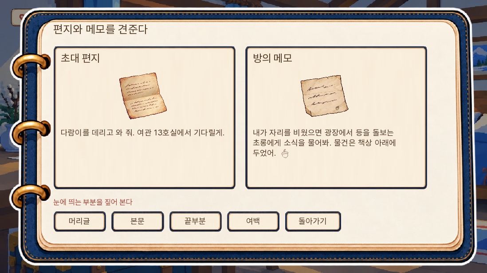
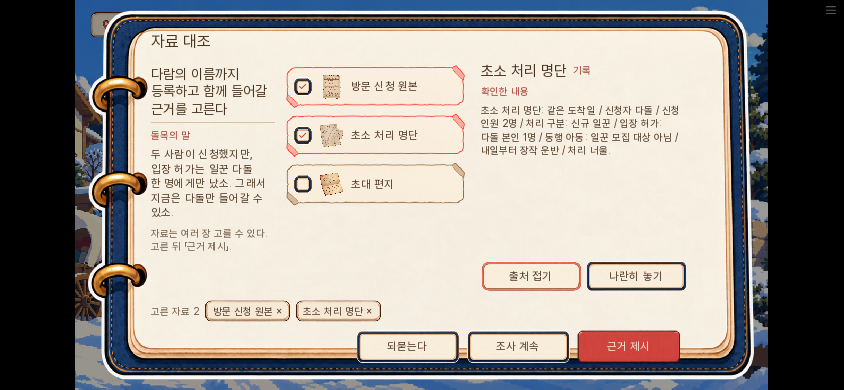

# 1일차 대사 논리 검수안 적용 · v2-pilot-4

2026-11-04. 소유자가 검수 결과 적용을 승인해, 기존 자료·정답·진상을 보존하면서 대사와 진행 상태를 맞췄다. 수정 전 보고서는 [기준 검수](검수.md), 문장별 관찰은 [322개 출현 검수표](대사별_검수.md)에 보관했다.

## 지적 항목별 반영

| 항목 | 반영 |
|---|---|
| L01 신청·모집·입장 혼용 | 신청 2명, 처리 구분 일꾼, 입장 허가 다돌 본인 1명을 구분했다. 동행 아동이 일꾼 모집 대상이 아니라는 말과 입장 허가를 별개로 설명한다. 수첩 원문·요약·돌목 주장·성공 논증도 맞췄다. |
| L02 충분한 증거에도 추가 조사 유도 | 자료 부족 안내는 신청 원본을 아직 읽지 않았을 때만 낸다. E04가 없어도 E03까지 읽은 상태면 제출한 내용과 연결의 문제를 돌아보게 한다. 정답 자료 이름을 알려 주지 않는다. |
| L03 이미 인정한 차이를 재질문 | 차이 인정 상태면 “말한 차이는 알겠소”라고 답하고 이번 제출로 확인할 수 없다는 절차 문제를 말한다. 미설명 상태와 문구를 나눴다. |
| L04 다람 이름 확인 순서 | “원본 아래에 다람이라고 썼다 → 처리 명단에도 옮겨 달라”로 대상을 명확히 했다. ‘나 외야?’ 농담은 남겼다. |
| L05 의도적 분류와 전사 실수 혼용 | 성공 뒤 “옮기다가 잘못 적혔다”라는 원인 단정 대신, 방문 신청을 일꾼으로 처리한 차이를 확인하고 고친다고 말한다. 너울 지시와 그 진상은 바꾸지 않았다. |
| L06 생략된 종이 붙잡기 | 앞에 없던 행동을 꾸짖지 않고 이름을 적을 동안 기다려 달라고 한다. |
| L07 편지와 메모 명칭 | 비교 제목·쟁점·도움말·오답 문구를 편지와 메모로 통일했다. |
| L08 보이지 않는 날짜·수신인 | 공개 본문에서 찾을 수 없는 이름·서명을 확인하는 관찰로 바꿨다. 새 날짜·서명·진상 정보는 추가하지 않았다. |
| L09 습관이 성공 뒤에만 나옴 | 메모를 처음 읽을 때 도토리 습관을 알려 준다. 비교 직전에는 같은 사람이 쓴 글인지 살펴볼 이유를 다람이 묻는다. 관찰을 건너뛴 성공 경로도 이미 들은 습관을 돌아본다. 위조를 확정하지 않는 말은 유지했다. |
| L10 정정 뒤 이전 반응 | E01·E02·E03은 정정 전후 문구를 구분하고, E05에는 발급자가 확인했다는 전용 반응을 붙였다. |
| L11 오래된 후속 질문 | F002를 실제 선택 전에 읽음 처리하지 않는다. 원인을 들었거나 정정이 끝나면 목록에서 빼고, 원본을 읽은 상태에서는 다시 찾으라고 말하지 않는다. |
| L12 할머니의 진행 기억 | 방을 이미 살폈으면 그 상태를 인정한다. 메모 제시는 이미 들은 초롱 위치를 재확인하는 말로 이어진다. |
| L13 난방 상태 | 꺼진 난로가 있는 찬 방에서 양말에 김이 나거나 불로 말렸다고 하지 않는다. 젖은 양말과 냄새 농담으로 바꿨다. |
| L14 미완성 지문 | 입장 뒤 기록을 재확인하는 완결 문장으로 마무리했다. |
| L15 발판 공간 | 마차가 아니라 초소 앞 발판이라고 명시한다. |
| L16 제출 조작 연결 | 이미 말한 차이를 서류로 확인하겠다는 요구를 분명히 하고, 제출 화면 기존 안내 칸에 여러 장 선택이 가능하다고 적었다. 배치·디자인은 바꾸지 않았다. |
| L17 입실 시점 | 실내에서도 자연스럽게 신발에 붙은 눈을 털자는 말로 바꿨다. |
| H01 숨은 종이·기록 카드 | 진행 오류가 아닌 보조 검토 사항으로 유지했다. 새 증거 ID나 사용처는 만들지 않았다. |
| H02 편지·메모 배치 | 메모가 계속 책상에 있고 가져온 편지도 이미 펼쳐져 있다고 단정하는 문장을 없앴다. |

## 저장·판정 호환

- 기존 등록 묶음 89개 전부의 이름·단계 수·대사 ID 배열이 수정 전과 같다. 메뉴·선택지의 인덱스를 바꾸지 않았다.
- 상태별 문구는 같은 대사 자리의 `variants`에서 처음 맞는 조건의 텍스트만 사본으로 읽는다. 원본 데이터·화자·ID·저장 위치를 바꾸지 않는다. 조건과 허용 필드도 단위 검사한다.
- 이전 문구로 만든 대사 쪽 캐시는 새 텍스트와 키가 다르면 그 문장 첫 쪽부터 다시 읽는다. 바뀐 문구의 앞부분이 누락되지 않는다.
- 이전 판의 즉석 제시 대화는 문장 목록 자체가 저장될 수 있다. 그 경우 그 반응에는 이전 문장이 남고, 다음 제시부터 새 문구를 읽는다. 현재 수정은 이전 저장의 임의 문장을 추측해 바꾸지 않는다.
- 두 증명의 정답·추가 허용 자료·결과 조건, 모든 자료 ID는 수정 전과 동일하다. E02+E03은 E04 없이도 성공한다.

## 실행 검증

단위 38개 통과. 새 회귀 시험은 실제 엔진 함수를 실행한다. E04 소지 유무 각각의 15개 판정 조합과 실제 소지 자료로 제출 가능한 22개 경로, 반복 오답, 차이 인정, 정정 뒤 개별 제시, 후속 질문 종료, 도토리 선행 정보, 관찰 유무와 야간 두 경로, 이전 저장 주소를 확인했다.

Ren'Py 화면 시험 9개 전부 통과:

| 시험 | 확인 |
|---|---|
| v2_logic_gate | 규칙 없는 세 자료, 기인정 오답, 남긴 원본에 명단을 더해 성공, 완료 질문 숨김, 정정 기록과 명단 개별 제시 |
| v2_logic_letters | 메모에서 습관 선행, 머리글 관찰, 관찰 일부를 건너뛰어도 진행, 야간 초롱 대화 재확인 |
| v2_day01_right | 새 게임부터 1일 끝까지 정답 경로 |
| v2_day01_partial | 부분 제출·오답·보조 자료·정답 제출·저장 복원 |
| v2_day01_detours | 틀린 선반·틀린 비교 짝·방 추가 조사·접수대 왕복 |
| v2_proof_save | 고른 두 자료를 저장·불러와 정정까지 진행 |
| v2_continue | 저장 뒤 메인화면 이어하기로 같은 진행 복원 |
| v2_topic_portrait | 대화 뒤 질문 복귀·다음 대화의 인물 표시 |
| v2_present_portrait | 제시 반응 뒤 질문 복귀·다음 제시의 인물 표시 |

웹 빌드 lint 오류 없음. 공개 묶음 내부의 day01/common/engine/proof/options 원문을 소스와 바이트 대조했고, 모든 manifest 파일 해시·압축 묶음 해시·판 번호 일치를 확인했다. 시험 폴더는 웹 묶음에 들어가지 않는다.

로컬 웹 공개본을 Chromium에서 실제 조작해 1일 끝까지 완주했다. PC 1280×720과 모바일 가로 844×390에서 확인했으며, 브라우저 페이지 오류·HTTP 오류는 0개다. [검증 결과](pilot4-검증결과.json).

## 수정 화면

### 앞에서 인정한 차이를 기억하는 오답

### 비교 전에 알려 주는 엄마의 습관

### 자료 이름과 같은 비교 제목

## 최종 확인

- 웹에서 현장 저장 → 새로고침 → 이어하기, 회의 선택 저장 → 새로고침 → 두 자료 복원을 확인했다.
- 규칙 없이 세 자료만 가진 상태에서 기인정 오답을 거친 뒤, 남긴 원본에 명단을 추가해 정정했다.
- 정정 후 오래된 질문이 사라지고, E05를 보여 주면 발급자가 두 사람의 등록을 인정했다.
- 편지·메모의 머리글 관찰이 표시된 정보만 말하는지 확인했다. 비교·밤·시범 종료까지 진행했다.
- 공개용 압축 내부 버전은 v2-pilot-4이고 원문·해시가 검사한 소스와 같다. 원격 배포 커밋과 Pages 상태는 저장소 Actions 기록으로 확인한다.
- 실제 휴대폰과 공개 주소의 직접 접속은 확인하지 못했다. 현재 실행 환경의 허용 목록에 GitHub Pages 도메인이 없어 직접 접속이 제한된다. 로컬 공개본 검증과 원격 배포 상태 확인을 구분한다.

