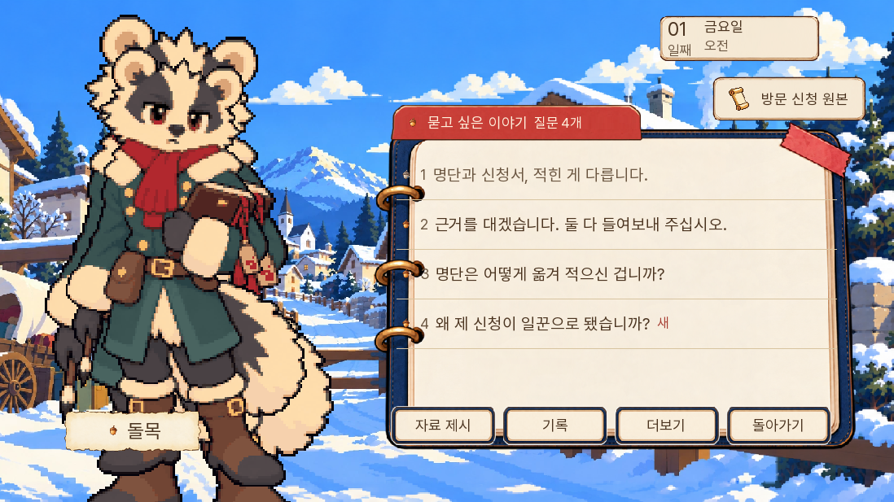
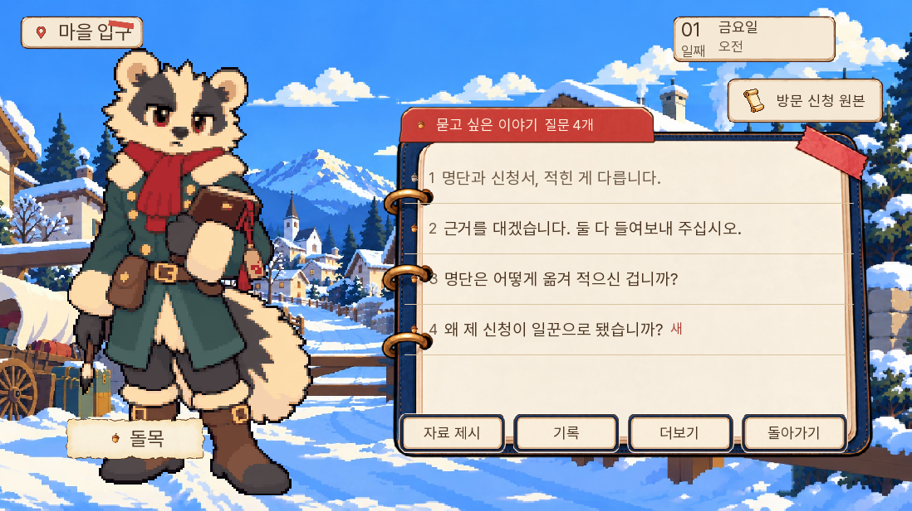
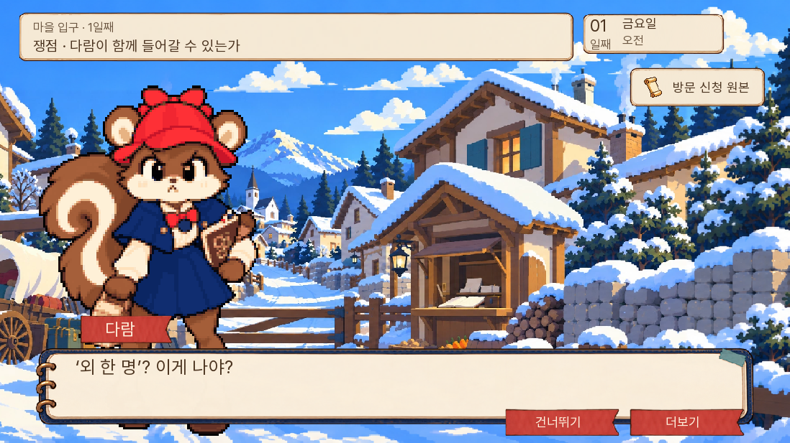
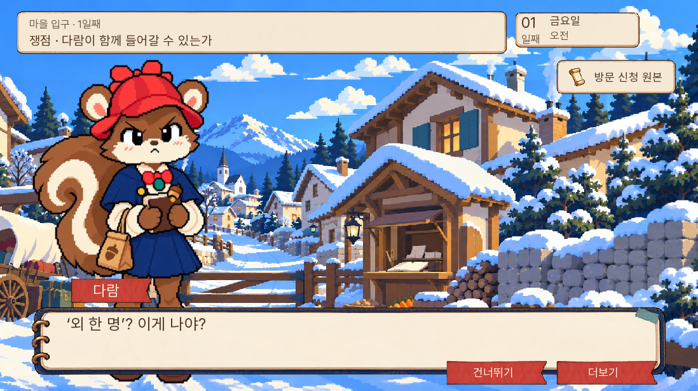
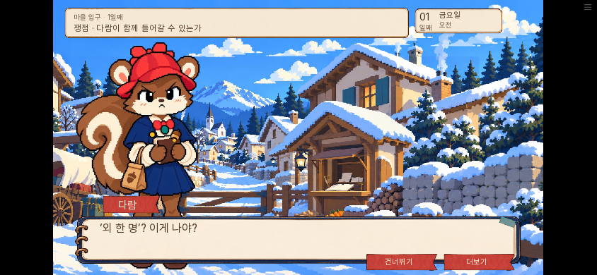

# 캐릭터 중복과 다람 근접 그림 검수

2026-11-04. 소유자가 캐릭터 중복 표시와 다람의 도트 품질 저하를 보고했다. v2-pilot-2에서 두 현상을 재현했다. 기능 검사를 통과한 것으로 화면 완성도까지 확인했다고 보아서는 안 된다. 다음 날짜 확장에 앞서 실제 화면 비교를 확인 항목으로 둔다.

## 질문으로 돌아온 뒤의 중복

돌목에게 「명단과 신청서, 적힌 게 다릅니다」를 말한 뒤 질문으로 자동 복귀하면, 대화용 큰 그림이 master 레이어에 남고 질문 화면이 다른 크기의 그림을 추가했다. 자료를 보여 준 뒤의 복귀도 같았다. 질문·자료 화면 진입 시 이전 큰 그림·자료 컷·관련 상태를 함께 정리했다. 이전 판에서 겹친 채 저장한 질문 화면도 불러오기 직후 정리한다. 다음 대화에서는 인물 그림이 다시 표시된다.

| 수정 전 | 수정 후 |
| --- | --- |
|  |  |

## 다람 근접 그림의 원본 연결

기존 본편은 `systems/room13_dialogue_beats.rpy`의 `R13_CLOSEUP_SMOOTH=True`와 `assets/room13-closeup-smooth.json`으로 승인 원본을 사용한다. v2는 그 연결을 옮기지 않고 `dialogue-dot-v2`의 거친 파생 그림을 직접 확대했다.

다람의 여섯 표정을 기존 승인 원본 `dialogue-source-master-v2/daram/760/`으로 연결했다. 원본 파일은 바이트 그대로 복사했으며, 본편의 대응표에 있는 표시 크기 336×504로 맞춰 현재 배치 규칙을 유지했다. 현장 인물 도트와 마차의 별도 앉은 그림은 이 근접 대화 연결과 구분한다.

| 수정 전 | 승인 원본 복구 후 |
| --- | --- |
|  |  |

## 검증과 남은 범위

단위시험 27개와 화면시험 11개 통과. 새 화면시험은 대화 후 질문 복귀, 제시 반응 후 복귀, 이전 중복 저장의 복원, 다람 근접 캡처다. 기존 1일 정답·부분 정답·우회·저장 시험도 다시 실행했다. 승인 원본 여섯 파일의 해시와 표시 크기를 본편 대응표와 대조했다.

Chromium 웹에서 자연 진행으로 두 중복 경로를 다시 확인하고, 질문 화면 저장→브라우저 새로고침→이어하기→다음 대화까지 확인했다. 다람은 PC 1280×720와 모바일 가로 844×390에서 캡처했다. 자바스크립트 예외·HTTP 오류 없음. 실행 기록은 [검수 결과](검수결과.json)에 있다.

모바일은 브라우저 터치 시험이며 실제 휴대폰 검사는 아니다. 모든 인물·모든 장면의 시각 품질을 완료했다고 표시하지 않는다. v2는 1일 검토용으로 유지하며 다음 날짜 확장은 보류한다.
