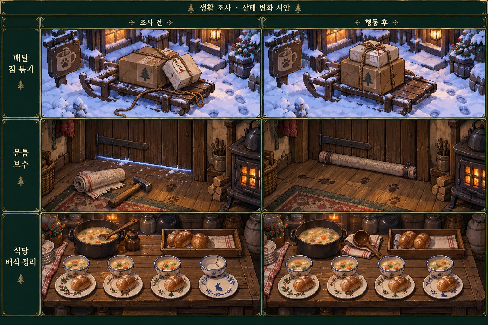

# 다람탐정 — 생활 조사와 이미지 상태 변화 제작 기획서

작성: 2026-10-15
용도: 클로드 구현 전달용. 기존 본편 보강이며 전면 리뉴얼이 아니다.
구현 현황 근거: 0.18.18, commit 1761e3b의 초반 실제 실행 및 소스 리뷰. 구현 시작 시 최신 상태를 다시 확인한다.

## 1. 이번에 만들 경험

플레이어가 사건 밖에서도 생활 속 문제를 관찰하고, 물건을 사용하고, 그 결과로 공간이 달라지는 경험을 만든다.

관찰 → 원인 또는 관계 추론 → 직접 행동 → 이미지 변화 → 생활상의 결과.

단순한 대화 선택지를 늘리거나, 기존 선택지 사이에 확인 클릭을 추가하는 작업이 아니다. 모든 활동이 증거를 지급할 필요는 없다. 생활을 도운 만족, 기존 품삯, 주민의 작은 반응도 보상이다.

대표 예시:
- 짐이 미끄러지는 것을 보고 끈으로 묶는다. 실제로 묶인 짐이 보인다.
- 난로는 타는데 집이 춥다. 문틈을 찾아 막는다. 설치한 물건이 남는다.
- 배식표와 그릇 상태를 보고 식사를 나눈다. 음식과 그릇 상태가 변한다.

## 2. 먼저 읽을 문서와 유지할 것

ROOM13_GUIDE.md, 최신 CURRENT_STORY_DECISIONS.txt, CASE13_CANON_SYNC.md 및 관련 시스템 문서를 먼저 읽는다. 원본과 공개본의 위치·빌드 방법은 최신 가이드를 따른다.

유지:
- 가족·엄마 찾기·다람이 사건·첫 재판·둘째 주 위기와 기존 결말.
- 회차 초기화. 물건·돈·관계·활동 결과는 새 회차로 넘기지 않는다.
- 이전 회차를 본 플레이어 전용 선택지나 해금은 없다.
- 기존 증언·재판 논증·증거 증명력은 이번에 변경하지 않는다.
- 일반 조사와 물건 시험은 무료. 노동으로 확정한 활동에만 기존 한나절 비용을 적용한다.
- 날짜 변경은 숙소에서 직접 잠자는 기존 규칙을 따른다.

개발 시작 전에 구현 여부를 확인한다. 아래 기능이 최신판에 있으면 새로 만들지 말고 차이만 보강한다.

## 3. 콘셉트 시안

왼쪽은 조사 전, 오른쪽은 행동 후다. 생성한 방향 검토용 이미지이며 실제 게임 화면·확정 자산이 아니다. 시안에서 물건 수·형태·문 고정 방식이 조금 달라진 부분은 그대로 구현하지 않는다. 특히 음식 이동 전후 수량을 실제 상태와 맞춘다.

현재 게임의 픽셀 크기·색감·캐릭터 비율·장소 배치에 맞춰 재제작한다. 시안의 장식 프레임과 표는 게임 UI로 넣지 않는다.

## 4. 기믹 A — 배달 짐 묶기

### 기존 구현과 차이

두 짐표 읽기, 적재 시도, 끈 사용과 대여 조건, 추가 품삯 분기는 이미 존재한다. 새 경제·새 정답을 만들지 않는다. 기존 메뉴형 배달 조사 부분을 물건 중심의 가까운 화면으로 표현한다.

### 진입

기존 배달 일을 선택하고 기존 시간·품삯 확인을 확정하면 진입한다. 다른 장소를 불필요하게 여러 번 왕복하지 않는다.

### 화면

수레, 큰 상자, 작은 상자, 각각의 짐표. 끈은 실제 소유 또는 기존 대여 조건일 때만 사용 가능하다. 소유하지 않은 끈을 장면에 무조건 놓지 않는다.

### 진행

1. 큰 상자의 짐표 클릭: 현재 주소를 읽는다.
2. 작은 상자의 짐표 클릭: 같은 주소를 읽는다.
3. 작은 상자를 적재 위치에 놓는다: 기울어 미끄러지는 짧은 변화가 보인다.
4. 가진 끈을 선택해 상자에 사용한다: 묶인 상태로 바뀐다.
5. 배달 출발: 현재 조건에 맞는 기존 일반/추가 배달 처리로 연결한다.

짐표를 읽은 상태를 정답 해금 조건으로 새로 추가하지 않는다. 방법을 아는 플레이어는 첫 회차에도 바로 끈을 시험할 수 있다. 보너스는 시각 상태만 보고 지급하지 말고 기존 모델의 유효 조건을 만족해야 한다.

### 조작

클릭으로 상자를 선택하고 적재 위치를 누르는 방식이 기본이다. 드래그는 동일 동작을 수행하는 선택 지원이다. 작은 영역에 정확히 내려놓기·균형 유지·시간 제한·물리 엔진은 사용하지 않는다.

### 실패와 보상

- 잘못된 물건을 사용하면 짧은 반응. 물건 소모·벌점 없음.
- 끈이 없어도 일반 배달 완료 가능.
- 올바르게 묶으면 기존 추가 품삯 조건에 연결.
- 기존 1회 보너스 지급 제한을 유지. 화면 재진입으로 중복 지급 금지.
- 활동 전체 시간은 기존 노동 한 번. 짐표·적재·끈 사용마다 추가 차감 금지.

### 이미지

고정 수레 배경 + 상자 분리 상태 + 적재/미끄러짐 상태 + 묶인 상태 + 짐표 확대 이미지. 같은 카메라·광원·물건 모양 유지. 끈의 매듭은 상자 형태에 맞게 그린다.

## 5. 기믹 B — 문틈 보수

### 역할

비사건 생활 기믹의 첫 사례다. 따뜻한 난로와 추운 방의 원인이 다를 수 있음을 공간 관찰로 알아낸다. 새 난방 수치·주거 관리 시스템을 만들지 않는다.

### 배치

기존 방문 가능한 주민 집 한 곳에만 배치한다. 가장 적합한 기존 장소와 주민을 선정하고 문서에 이유를 적는다. 누비의 장작 부족처럼 현재 갈등의 원인이 명확히 다른 집을 임의로 문틈 문제로 바꾸지 않는다. 적합한 장소가 없으면 임의의 집·주민을 신설하지 말고 이 항목을 보류한다.

기본 노출은 둘째 날 이후, 입장 가능한 낮 시간의 선택 조사로 한다. 기존 사건·기믹과 충돌하면 현재 날짜·출입 조건을 우선한다.

### 진입과 관찰

입장만으로 대화·수리 선택을 강제하지 않는다. 문과 난로를 조사할 수 있다.

- 난로: “안에서는 불이 타고 있다.”
- 문: “아래쪽 틈으로 바람이 들어온다.”
- 바닥: 틈 근처의 작은 눈 알갱이나 천 끝의 흔들림으로 시각적 근거를 보인다.

“천을 사용해서 해결하자”라는 독백은 넣지 않는다.

### 행동

주민 소유의 낡은 천을 기본 해결 재료로 둔다. 먼저 주민의 사용 허락을 받으면 쓸 수 있다. 처음부터 플레이어 소유품처럼 가져가지 않는다. 물건 설명은 천의 크기·낡음 정도만 알려준다.

천 선택 → 문 아래에 사용 → 고정 위치에 설치됨.

설치 방식은 실제로 문을 여닫을 수 있는 형태로 그린다. 출입문을 막아 가두는 장치처럼 만들지 않는다. 시안의 망치 때문에 못·망치 조합 퍼즐을 추가할 필요는 없다. 기존 도구 체계에 맞는 가장 단순한 설치 방식으로 만든다.

### 결과

- 바닥에 있던 천이 사라지고 문 아래에 설치된 상태가 남는다.
- 틈의 밝은 선과 들어오는 바람 표현이 줄어든다.
- 난로 불이 갑자기 커지거나 방 전체가 완전히 따뜻해지는 효과는 없다.
- 짧은 감사 반응을 제공한다.
- 첫 제작에서는 돈·필수 증거·재판 협조·새 해금 보상을 붙이지 않는다. 도움의 결과가 눈에 남는 경험을 먼저 완성한다.

### 회복·재진입

실패 사용은 천을 소모하지 않는다. 설치 이후 반복 설치와 보상은 없다. 같은 회차에서 재방문하면 설치 상태가 유지된다. 새 회차에는 초기화한다. 일회성 사건의 시간을 되감거나 기회를 복원하는 기능은 아니다.

### 이미지

같은 실내 배경 + 문 아래 틈/작은 눈 + 바닥 천 + 설치된 천. 실제 설치 부위가 보일 정도로 가까운 조사 화면을 제공한다. 전체 방 배경을 새로 여러 장 만들지 않는다.

## 6. 기믹 C — 식당 배식 정리

### 기존 구현과 차이

식사 준비 일자리와 초롱의 따로 챙긴 그릇이 이미 있다. 기존 사실을 삭제하거나 새 미등록 주민 사건으로 교체하지 않는다. 이 작업은 배식의 물리적인 과정과 시각 변화를 보강한다.

### 진입

기존 식사 준비 일을 시작한 뒤 1회 진행한다. 식당을 방문할 때마다 의무적으로 반복하지 않는다.

### 정보

현재 식사의 배식표와 그릇을 가까운 화면에 둔다. 네 자리 내외의 작은 구성으로 제한한다. 실제 원래 대본의 인원과 식사 내용을 확인한 뒤 확정한다.

배식표에는 순번이나 그릇의 무늬처럼 눈으로 대응할 수 있는 표식을 사용한다. 새 주민 이름·고유명사 암기를 요구하지 않는다. 별도 식사는 기존 초롱 몫이라는 설정과 맞춘다.

### 진행

1. 배식표를 읽는다.
2. 그릇과 접시의 준비 상태를 확인한다.
3. 빵 또는 국자를 선택한다.
4. 해당 그릇·접시에 배분한다.
5. 준비를 마치고 기존 노동 완료/관찰 질문으로 연결한다.

내용 없는 전체 채우기 과제가 되지 않게 한다. 기존 별도 식사와 일반 배식의 구분을 눈으로 볼 수 있게 하고, 그 이유를 묻는 현재 대화를 유지한다. 이미 첫날부터 이야기를 아는 플레이어에게 질문을 강요하지 않는다.

### 관대한 수정

- 내보내기 전에는 선택한 빵을 되돌리거나 위치를 바꿀 수 있다.
- 사용하지 못하는 대상에 국자를 쓰면 반응만 주고 양을 잃지 않는다.
- 정확한 드래그·국 흘리기·조리 시간·식당 경영 점수는 없다.
- 고의적 오배식이나 관계 처벌의 새 분기는 만들지 않는다.
- 별도의 ‘모든 그림을 클릭했다’ 조건을 두지 않는다.

### 완료와 반복

현재 노동의 돈·시간·관계 조건을 유지한다. 반나절은 한 번만 쓴다. 현재 발견·질문 보상을 배식 클릭 완료만으로 자동 지급하지 않는다.

한 번 익힌 뒤에도 매번 같은 클릭을 요구하면 노동 반복 부담이 커진다. 같은 회차에서 이미 마친 동일 배식은 ‘같은 방식으로 준비’로 처리할 수 있다. 처음 회차부터도 실제 관찰 이후 이용할 수 있는 작업 편의로 구현하고, 이전 회차 기록으로 해금하지 않는다. 새 상황이 있으면 그 부분만 별도 관찰한다. 기존 노동 비용은 생략되지 않는다.

### 이미지

고정 식탁 + 빈/찬 그릇 + 접시의 빵 + 공급 쟁반 + 국자 위치. 빵을 옮기면 원래 쟁반에서 줄고 해당 접시에 나타난다. 다시 돌려놓으면 양쪽 상태가 복원된다. 국은 실제 계량 미니게임 없이 정해진 1회분 상태로 표현한다.

## 7. 이미지 제작 계약

필수:
- 행동 전후 카메라·광원·물건의 형태는 고정.
- 새 상태는 기존 배경 위 물건 레이어 교체로 우선 제작.
- 투명 배경 물건 레이어와 넉넉한 클릭 영역을 일치시킨다.
- 마우스 오버 없이도 물건 구분이 가능해야 한다.
- 도구를 선택했는지 명확히 표시하고 동일한 조작으로 해제한다.
- 결과 상태는 저장·불러오기 후 재현한다.
- 새 회차에는 초기 상태.
- 수량은 상태 데이터에서 일관되게 그린다. 그림과 소지품을 따로 갱신하지 않는다.
- 전후 차이를 과장하기 위해 무관한 물건·날씨·밝기를 변경하지 않는다.

시안에 있는 금색 테두리·표 형식은 기획 설명용이다. 실제 게임에는 기존 가벼운 조사 UI를 사용한다.

그림 목록은 현재 자산 명명·가져오기 규칙에 맞춰 별도 기록한다. 임의의 새 빌드 도구나 아카이브 방식은 만들지 않는다.

## 8. 소리와 피드백

종이·끈·목재·그릇 등 실제 행동에 맞는 기존 효과음을 우선 재사용한다. 성공 때마다 증거 획득 효과음을 쓰지 않는다.

- 묶기: 끈이 조여지는 짧은 반응.
- 문틈: 천 설치와 실제 상태 교체.
- 배식: 물건을 놓는 소리와 음식 이동.
- 새 자료를 얻었을 때만 기존 자료 획득 카드.

설명창은 한 번에 짧게 표시한다. 같은 실패를 반복할 때 긴 대사를 재생하지 않는다.

## 9. 하지 말 것

- 기존 증언 연결·재판 정답의 전면 수정.
- 새 미니게임 점수·반사신경·제한 시간·정밀 물리.
- 모든 주민 집에 비슷한 수리 과제 복제.
- 일반 조작마다 반나절 차감.
- 생활 활동을 필수 수집 체크리스트로 만들기.
- 도움을 줬다는 이유만으로 즉시 증언 동의·핵심 증거·전면 용서 지급.
- 전체 배경을 매번 생성하여 불필요한 자산 증가.
- 콘셉트 시안을 잘라 실제 게임에 그대로 적용.

## 10. 제작 순서

A 배달을 먼저 완성한다. 기존 정답과 보상이 있으므로 시각·조작 개선의 효과를 비교하기 쉽다.

B 문틈 보수는 적합한 기존 장소가 확인되면 한 곳에 구현한다. ‘보상이 없어도 돕는 행동이 만족스러운가’를 본다.

C 식당은 마지막에 붙인다. 일의 반복 클릭이 늘어날 위험이 있어 기존 노동 루프와 편의 처리를 함께 정리한다.

세 기믹에 서로 다른 전용 입력 시스템을 만들지 않는다. 가능한 한 같은 ‘대상 관찰 → 물건 선택 → 대상 사용’ 구조를 재사용한다. 단, 모든 상태를 위한 거대한 범용 퍼즐 엔진으로 확장하지 않는다.

## 11. 완료 기준과 재미 검증 기준

기능 완료:
- A: 짐표·적재·묶기 상태가 그림에 보이고 기존 품삯/시간이 정확히 한 번 반영됨.
- B: 바닥 천과 설치 천이 동시에 존재하지 않고 재방문·로드 때 상태 유지.
- C: 음식 이동 전후 수량이 맞고 수정 가능하며 기존 질문·보상 흐름 유지.
- 세 곳 모두 취소·복귀·잘못된 물건 사용으로 소지품이나 진행을 잃지 않음.

기획상 재미 가설:
- A는 짐의 상태를 보고 도구를 적용하는 만족.
- B는 원인을 찾아 공간을 개선한 만족.
- C는 기존 일과 관찰을 같은 장면에서 수행하는 만족.

실패 기준:
- 설명에 적힌 순서대로 누르기만 함.
- 해결 이유를 모르고 모든 물건을 무작위 사용함.
- 이전보다 메뉴 전환·반복 클릭만 많아짐.
- 이미지가 바뀌어도 문제와 해결의 관계가 보이지 않음.

현재 시안은 사람 플레이로 재미를 검증한 결과가 아니다. 구현과 재미 검증을 구분해 보고한다.

## 12. 검사와 전달

소유자는 반복 검증 비용을 줄이기를 요청했다. 이번 구현에서는 문법·컴파일·빌드 등 기본 확인을 진행하고 개별 브라우저·14일 전체 플레이를 작업마다 반복하지 않는다. 후속 통합 검증 때 세 기믹의 저장·소비·취소·노동 비용을 묶어 확인한다. 최신 소유자 지시가 있으면 그 지시를 우선한다.

완료 보고에는 변경 파일, 전후 이미지, 기존 기능에서 재사용한 것, 새 상태와 저장 처리, 실제 검사 범위와 미검증 항목을 기록한다. 코드 기본 확인만으로 재미 검증 완료라고 쓰지 않는다.

## 전달용 짧은 지시

기존 본편과 대사 논증을 유지하면서 배달 짐 묶기·문틈 보수·식당 배식을 물건 중심 생활 조사로 구현해 주세요. 각 행동은 실제 이미지 변화와 같은 회차의 저장 상태로 남아야 합니다. 배달은 이미 있는 아이템·임금·시간 모델을 재사용하고, 문틈은 적합한 기존 집 한 곳에만, 식당은 기존 노동·초롱 그릇 설정에 연결해 주세요. 새 사건·새 호감도·새 경제 수치를 만들지 말고, 불필요한 클릭을 늘리지 마세요. 첨부 시안은 방향 참고용이며 실제 상태·수량·픽셀 스타일에 맞춰 자산을 제작해 주세요.
