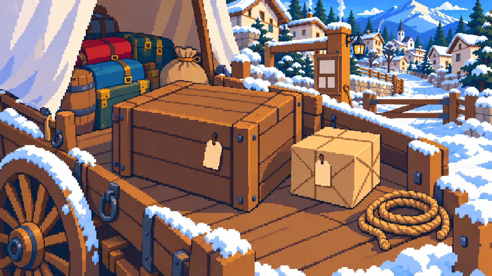
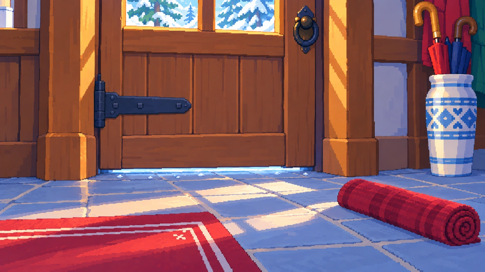
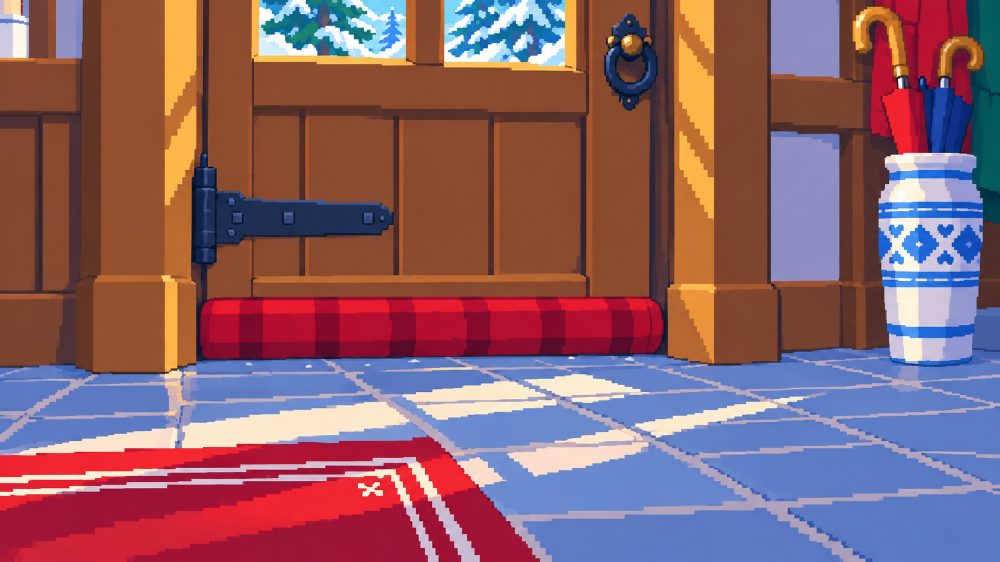
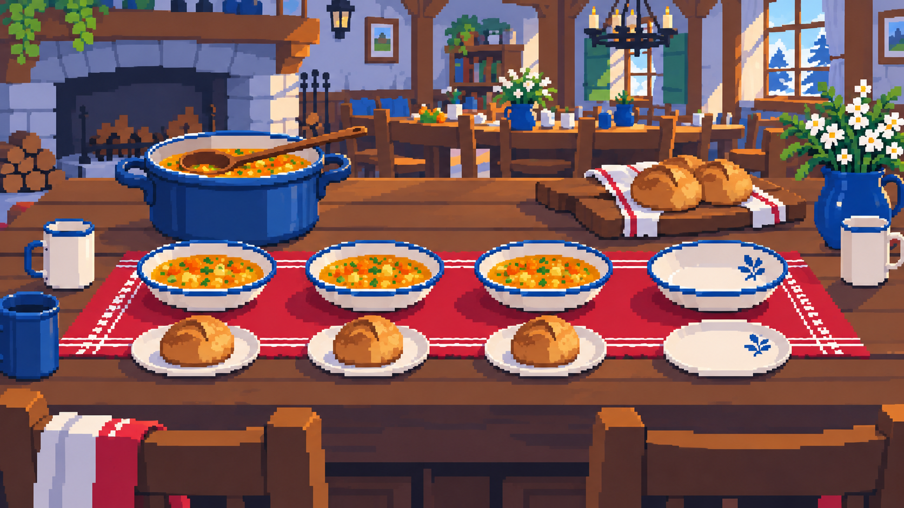
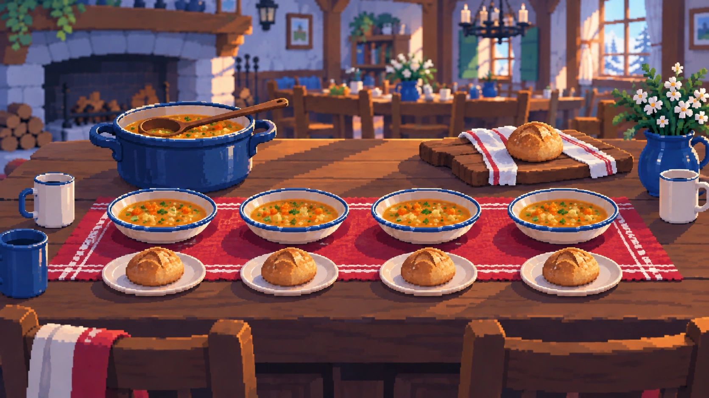

# 실제 맵 기준 생활 조사 적용용 이미지

2026-10-15 · clean-pixel-v2 · 여섯 장의 독립 WebP 배경. 자글거리는 질감의 이전 이미지와 비교표 시안을 대체한다. 큰 색면·계단형 경계·단순 명암으로 다시 그렸다.

현재 게임의 입구 마차, 여관 입구 문, 식당 배경을 직접 보고 참조 이미지로 사용해 제작했다. 원래 맵을 덮어쓰는 자산이 아니라, 해당 물건을 클릭했을 때 여는 가까운 조사 화면이다. 아빠·NPC·텍스트·게임 UI가 그림에 포함되지 않는다.

## 전후 이미지

| 대상 | 조사 전 | 행동 후 |
|---|---|---|
| 입구 마차 배달 짐 |  |  |
| 여관 입구 문틈 |  |  |
| 여관 식당 배식 |  |  |

## 자산 규격

- 모든 파일 1672×941. 각 전후 쌍은 동일 해상도.
- 기존 dev/import_art.py의 encode(lossless=True)를 사용한 무손실 WebP. 도트 경계에 손실 압축 잡음이 생기지 않게 했다. 여섯 장 합계 7,709,450바이트.
- 게임에서는 같은 Transform 규격으로 1280×720 조사 화면에 표시한다. 문서의 클릭 범위는 0~1 정규화 좌표이며 논리 좌표로 변환한다.
- 사진 합성·그림 자르기 대신 각각 독립적인 전후 이미지를 제작했다. 생성 편집 특성상 두 상태의 모든 비대상 픽셀이 동일한 것은 아니다. 투명 오버레이처럼 합성하지 말고 전체 조사 배경을 교체한다.
- JSON의 사각형은 실제 완성 이미지를 보고 잡은 초기 적용 좌표다. 게임에 연결한 뒤 포인터·터치 판정은 통합 확인한다. 이미 인터랙션 검증된 좌표라고 보고하지 않는다.

## 기존 기획서와 달라진 부분

문틈 보수의 배치는 신규 주민 집이 아니라 **기존 여관 접수대 쪽 외부 출입문**으로 확정한다. 기존 맵에 없는 집과 난로를 신설하지 않는다. 조리실·세탁실 문이나 통로 장치와 섞지 않는다.

천 사용은 여관 소유 천에 대한 허락을 포함한 선택 생활 조사로 한다. 주방 일·숙박비·할머니의 범행 판단과 연결하지 않는다. 새로운 NPC 대사가 필요하면 짧은 허락·반응 정도로 제한한다. 반나절이나 돈을 소비하지 않고 필수 진행도 아니다.

## 연결 방법

1. 여섯 WebP를 game/assets에 동일 이름으로 복사한다. 이미 최종 무손실 WebP이므로 재압축할 필요 없다. 도트 이미지를 JPEG나 손실 WebP로 다시 압축하지 않는다.
2. asset-manifest.json의 scenes를 조사 화면 데이터로 옮긴다. 이미지 key와 플레이 상태를 분리한다.
3. 원래 맵의 클릭 지점은 유지하고 대상 조사 흐름에서 가까운 화면으로 진입한다.
4. 배달은 기존 r13_delivery_inspect와 지갑의 품삯/결합 배달 조건을 재사용한다. 그림 교체로 별도 품삯을 지급하지 않는다.
5. 배식은 기존 식사 준비 일의 시각 표현으로 연결한다. 모든 그릇을 새로 채우는 노동을 매번 추가하지 않는다.
6. 문틈은 이번 회차의 독립 optional state로 저장한다. 원래 방문 조건·여관 스토리 진행을 바꾸지 않는다.
7. 다음 날·재진입·불러오기에도 상태에 맞는 이미지 표시. 새 게임에서 초기화한다.

### 배달

before: 작은 상자는 큰 나무 상자 옆에 있고 굵은 공동 고정용 끈은 바닥에 놓였다. 작은 상자 자체의 얇은 포장끈은 고정용 아이템이 아니다.

after: 같은 작은 상자가 큰 상자 위로 올라가 굵은 끈으로 함께 고정된다. 바닥의 굵은 끈은 사라진다. 큰 상자 한 개와 작은 상자 한 개를 유지한다. 짐표는 빈 종이로 그렸으므로 주소는 기존 게임 데이터에서 텍스트로 보여준다. 그림에서 주소를 읽는 OCR 퍼즐은 만들지 않는다.

전체 배경 교체는 실제 묶기 완료 순간에 한다. 묶을 수 없는 상태·끈 미소유 상태는 before를 유지한다. 보너스 제한·시간·대여 조건은 기존 모델을 따른다.

### 문틈

before: 문 밑으로 푸른 틈이 보이고 붉은 천은 오른쪽 바닥에 있다.

after: 그 천이 문 아래를 덮고 원래 바닥 자리에서는 사라진다. 방 전체 조명이나 난로 상태를 바꾸지 않는다. 천은 부드러운 이동식 문풍 방지용이며 문을 봉쇄한 것으로 처리하지 않는다.

### 배식

before: 세 자리 준비 완료, 오른쪽 파란 잎 무늬 자리만 비어 있다. 쟁반의 빵은 두 개다.

after: 오른쪽 국·빵이 준비됐고 쟁반에는 하나가 남는다. 접시 네 개+국그릇 네 개, 총 빵 다섯 개를 보존한다. 기존 초롱의 별도 몫이라는 대본에 맞춰 오른쪽 자리를 사용할 수 있지만 이 그림으로 새 인원·새 증언을 만들지는 않는다.

현재 납품은 시작/완료 두 상태다. 국만 담거나 빵만 옮긴 중간 상태 이미지는 포함하지 않는다. 두 동작을 별도 즉시 실행으로 구현하려면 중간 상태 자산을 먼저 추가해야 한다. 완료 이미지를 먼저 보여 주면서 국/빵 일부만 사용한 것으로 저장하지 않는다. 가벼운 첫 적용에서는 기존 배식 준비 동작 하나의 완료 시점에 전체 상태를 교체한다. 이는 세밀한 배식 미니게임 완성이 아니라 실제 결과가 보이는 첫 적용이다.

## 사용 예시

Ren'Py screen 내부에서는 기존 화면 구조에 맞춰 다음처럼 참조한다.

```renpy
add Transform("assets/room13-pixel-life-delivery-after.webp" if tied else "assets/room13-pixel-life-delivery-before.webp", xysize=(1280,720), nearest=True)
```

이 문서의 tied는 예시다. 현재 배달 모델과 저장 상태에 매핑한다. 새 전역 변수로 기존 지급 조건을 대체하지 않는다.

## 납품과 검증 범위

이미지와 JSON·적용 문서만 제작했다. 실행 파일·스토리·현재 공개 게임은 변경하지 않았다. 생성 결과를 눈으로 확인하고 파일 해상도·WebP 인코딩·해시·묶음 내용을 확인했다. 실제 게임 연결·클릭·저장·모바일 검증은 아직 하지 않았다.

배달 → 문틈 → 배식 순서로 기존 구조에 연결한다. 기존 CLAUDE_IMPLEMENTATION_BRIEF.md와 충돌하면 이 문서의 **실제 맵 배치·자산 범위**를 우선한다. 새로운 분기나 경제 규칙은 자동 승인된 것으로 해석하지 않는다.
