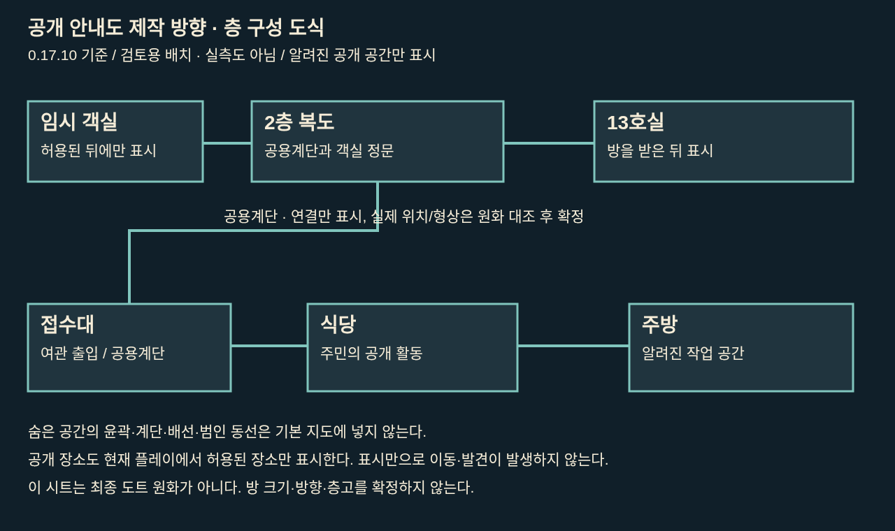
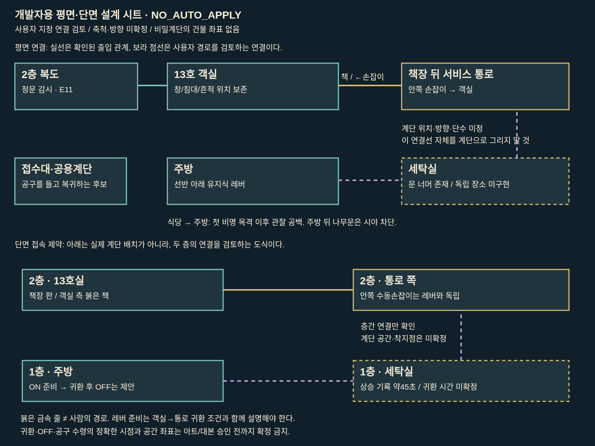

# 여관 평면·단면 제작 설계 검토 — 미승인 구조는 적용 금지

**후속 사용자 결정:** 회차·도면 소지로 물리 장치를 잠그지 않는 방향과 호출종 아이디어를 승인했다. 최신 [호출종 조작 후보 검토](CALL_BELL_REVIEW_KO.md)가 기존 회차 제한의 설계 권고를 대체한다. 아래의 회차 제한 설명은 당시/현재 코드 사실이지 앞으로 유지하라는 제안이 아니다. 예방은 이미 있는 분기이며 새로 만들지 않는다.

기준: 최초 검토 `d4342aea902d657d729df06cfcf5ba93ce54f562`(0.17.10), 최종 최신 main `bced09c56352e79a77a119adf3f3d5417d0168e4`(0.17.11) 재대조. 이번 공간·대본·장치·도면 근거 파일은 두 커밋에서 바이트 동일하다. 최신 질문 화면 변경은 보존한다. `preview/room13-source/ROOM13_SOURCE_HANDOFF.zip`의 소스와 동일 배포 아카이브의 이미지를 읽었다. 게임·대본·시간·증거ID·판정 엔진은 수정하지 않았다. 이 문서는 개발자용으로 범행 관련 내용이 포함된다.

**핵심 판단:** 주방 → 세탁실 → 서비스 통로 → 책장 뒤 → 2층 13호실의 연결은 현 대본과 양립한다. 그러나 세탁실의 독립 공간/이동 버튼, 계단의 정확한 자리·방향·단수·층고, 귀환 및 레버 복구의 실제 수행 시점은 구현·설정으로 확정되지 않았다. 그림에 새 계단을 완성해 넣기 전에 이를 결정해야 한다.

## 1. 사실·사용자 결정·제안의 구분

| 항목 | 코드·대본에서 확인 | 이번 설계에서의 처리 |
|---|---|---|
| 사용자 지정 경로 | 주방 유지식 스위치 준비 → 세탁실 통로 → 2층13호 책장 뒤 → 객실로 설계 요청 | 설계 제약으로 유지. NPC가 실제로 이 전 과정을 실행하는 코드가 있다고 주장하지 않음 |
| 공개 동선 | 접수대↔식당/주방/2층복도, 복도↔13호/허용된 임시객실 | 공개 안내도에 표시 가능. 노드 좌표는 안내도 좌표이지 실제 건물 치수 아님 |
| 세탁실 | 주방 뒤 창 없는 나무문 너머. 서비스 계단은 아래층 세탁실로 이어진다는 관찰문 | 독립 `laundry` 장소와 클릭 이동은 없음. 현재 `rear`는 관찰 대상이며 이동 액션이 아님 |
| 서비스 통로 | `passage`는 13호 뒤 서비스 통로. 이동 목록은 객실↔통로만 구현 | 주방→세탁실→통로를 실제 걷는 인터랙션은 별도 설계 필요. 지금 있다고 표시하지 않음 |
| 유지식 레버 | 주방 선반 덮개 안, 금속 줄, 전선 없음. 손을 떼도 걸림턱에 고정 | 버튼을 계속 누르는 압력판/전기 장치로 그리지 않음 |
| 객실 쪽 조작 | 책장 오른쪽 아래 붉은 책의 아래쪽을 누르고 옆으로 젖힘. 레버 ON일 때 열림 | 책을 뽑거나 전체 책장을 회전시키는 장치로 임의 변경 금지 |
| 통로 쪽 조작 | 안쪽 손잡이는 주방 잠금과 독립해 객실로 열림 | 잠겨 갇히는 구조를 새로 만들지 않음. 방향별 차이를 도면에 표시 |
| 닫힘/해제 | 손을 떼면 판은 닫히지만 풀린 걸쇠는 유지. 레버 OFF는 `passage_open=False` | ‘열림’ 플래그를 문짝이 계속 벌어진 그림으로 해석하지 않음 |
| 계단 | 대본에 계단과 2개 층 연결이 있음. 기존 통로 그림에 계단/경사 공간 일부가 보임 | 건물 전체에 대한 정확한 좌표·접속 방향·단수는 도출 불가. 완성된 비밀계단 신설 금지 |
| 방 | 외벽의 창은 고정 철망으로 사람이 통과할 수 없음. 침대 아래는 아이 은신처 | 창/침대 밑을 새로운 성인 범행 출입구로 쓰지 않음 |

근거: [원문 발췌](source-excerpts.md)의 `room13_revision.rpy:13–70`, `room13_navigation.rpy:19–36`, `room13_life.rpy:97–113`, `room13-content.json`의 kitchen.rear / passage.steps / room13.window. 원본 파일 해시는 [source-hashes.json](source-hashes.json).

## 2. 아트에서 실제로 확인한 것

[현 배포 여관 4분할 아틀라스](room13-pixel-inn-afternoon.webp)는 왼쪽 위 접수대, 오른쪽 위 주방, 왼쪽 아래 통로, 오른쪽 아래 식당이다. 이 2×2 배열은 **텍스처 배치**이며 실제 건물 평면이 아니다. 주방 왼쪽 나무문과 선반, 통로 오른쪽 안쪽 손잡이, 통로의 계단/경사 일부는 보인다. 세탁실 전체 평면과 아래층 출입구는 보이지 않는다.

[13호 원본](room13-pixel-room-before-afternoon.webp)은 화면 왼쪽 외벽 창/책상, 가운데·오른쪽 침대, 맨 오른쪽 책장을 보여준다. 화면 오른쪽을 곧바로 건물 동쪽으로 확정할 수 없다. 복도 정문은 이 구도에서 보이지 않아 객실 내부 정문 좌표는 미정이다. 책장 하단이라는 대본과 현 핫스폿·그림의 선반 높이 관계는 최종 원화에서 다시 맞춰야 하며 이번에는 좌표를 옮기지 않는다.

[복도 원본](room13-pixel-hall-before-afternoon.webp)은 왼쪽 공용계단 난간과 끝의13호 정문을 보여준다. 이것이 숨은 서비스 계단이라는 근거는 없다. 문짝은 오른쪽 경첩을 유지한다. 객실 회수 후 흔적 연속성이 보류된 원화, 새 와이드 주방/통로 초안, 미검증 Library 이미지는 이번의 확정 구조 근거로 채택하지 않았다.

기존 `R13PlanDrawing`은 700×360 벡터 도식이다. stage1의 외곽 `(45,40,600,265)`, 층 구분 y175, 오른쪽 빈 공간 경계 x530, 붉은 선 `[(200,272),(579,272),(579,108),(220,108)]`, 회색 배관 `[(455,278),(455,68),(300,68)]`가 있다. **붉은 선은 금속 줄**이라는 부리의 설명이 있으므로 사람의 이동 경로나 계단 중심선으로 베끼면 안 된다. 오른쪽 빈 공간은 서비스 공간의 도식적 근거이며 실측 폭이 아니다.

## 3. 입장·귀환·스위치 상태표

| 현재 상태/방향 | 코드상 결과 | 범행 설계 영향 |
|---|---|---|
| 객실 → 통로, 레버 OFF / 잠김 | 붉은 책 조작만으로 열리지 않음 | 진입 전 레버 준비가 필요한 방향은 기본적으로 객실→통로 |
| 객실 → 통로, 레버 ON / 아직 미해제 | 붉은 책 조작 후 해제, E37 획득 | ON만으로 자동 개방되지 않음 |
| 객실 → 통로, 이미 해제 | 판을 밀고 들어갈 수 있음 | 판은 닫혔어도 재개방 가능 |
| 통로 → 객실 | 안쪽 손잡이로 개방, 레버 OFF여도 가능 | 사용자 경로의 첫 진입을 ‘레버 없이는 불가능’이라고 설명하면 모순 |
| 주방 레버 OFF | 금속 줄 느슨, 걸쇠 소리, `kitchen_switch=False`, `passage_open=False` | 누가 언제 내렸는지는 별도의 사건 기록이 필요 |

**유지 가능한 제안(미확정):** 할머니가 주방에서 ON을 준비하고 세탁실·통로로 올라가 안쪽 손잡이로 객실에 들어간다. 귀환 때 객실 쪽 붉은 책을 조작/재개방하고 같은 통로를 내려온 뒤 주방에서 OFF로 복구한다. 이렇게 하면 레버 준비는 귀환 가능성을 위한 준비로 이해할 수 있다. 다만 이것이 기존 대본에 실제 수행 장면으로 확정돼 있지는 않다. 안쪽 손잡이를 사용한 뒤 걸쇠 상태가 유지되는지에 대한 물리 설명과 `passage_exit`가 해제 플래그를 바꾸지 않는 점도 함께 정리해야 한다.

현재 사건 스크립트는 공구를 받은 뒤 정문을 부수는 장면에서 스위치/통로 상태를 일괄 False로 바꾼다. 이는 **사건 이후 상태 설정**이지 할머니가 주방으로 돌아가 레버를 내리는 행동이 실행·관찰됐다는 증거가 아니다.

## 4. 사건 순서·목격·공구

| 순서 | 확인된 사실 | 미확정·설계에서 금지할 단정 |
|---|---|---|
| 첫 비명 | 할머니는 식당에서 나비와 함께 있었다(C3 s1은 참). 직후 나비가 핀을 여며 줌(E15/C4) | 첫 비명 이전부터 객실에 있었다고 그리면 충돌 |
| 공구를 가지러 감 | 주방으로 가겠다고 함. 이후 계속 곁에 있었다는 주장은 E12/E11로 반박 | 주방 내 공구 선반의 정확한 자리, 공구를 먼저 들었는지 나중에 챙겼는지는 불명 |
| 보이지 않는 구간 | 주방 뒤 문 너머/그 이후는 식당에서 보이지 않음. 세탁실→13호 올라오는 조사 기록 있음 | 불투명 벽을 ‘모든 목격자가 완전히 없는 구역’과 등치 금지. 다른 직원/세탁 작업자의 존재 여부 미정 |
| 객실 내부 | 촛대 낙하 뒤 통로 쪽 발자국과 그 위로 번진 피(E09), 아이는 침대 밑(E10). 핀/촛대 증거는 별도 C4 입증 | 안내도만으로 가해자·타격·전 동선을 자동 공개 금지 |
| 귀환 | 복도 정문으로는 공구 도착 전 출입하지 못함(E11) | 같은 서비스 통로 귀환은 정합적인 후보이나 직접 목격 기록 아님. 정문으로 몰래 나왔다는 새 경로 금지 |
| 공구 도착 | 아버지 귀환/닫힌 문 앞 장면에서 할머니가 공구를 가져옴. 도토가 지렛대를 받아 너울과 문틀 고정부를 부숨 | 공구를 문을 부순 뒤 가져오는 순서로 변경 금지. 공구 휴대 상태·보관 좌표를 새 증거로 확정 금지 |
| 구조 | 바닥 작은 불, 침대는 타지 않음. 침대 아래 아이 발견·구조 | 계단 설계로 침대/불/흔적 위치를 이동시키지 않음 |

공용계단과 복도 정문은 공구를 가지고 구하러 가는 **공개 복귀 후보 경로**다. 정확히 어느 시점부터 누가 이 이동을 보았는지는 대본에 추가 확인이 필요하다. 사각 영역은 식당→주방 안쪽 시야 기준으로만 표시한다.

## 5. 실제 소요와 게임 시간의 구분

`passage_measure` 문장은 ‘세탁실에서 13호까지 오가며 계단과 걸쇠를 확인’, **‘걸어 올라오는 데 약45초’**라고 한다. 45초는 상승 구간의 조사 서술이며 주방 출발부터 귀환·범행·공구 운반까지의 총시간이 아니다. 해당 조사 행동의 게임 비용은 `cost:1`; 일반 이동은 시간 소모가 없다. 실제 초와 한나절 행동 슬롯을 환산하지 않는다.

검증식만 제안한다:

`총 부재시간 = 주방 준비 + 세탁실까지 + 상승(기록 약45초) + 문 조작 + 객실 내 행동 + 귀환 조작 + 하강 + 레버 복구 + 공구 챙김 + 공용계단/복도 운반`

하강도45초라는 보장은 없고, ‘왕복90초면 전부 가능’이라고 확정할 수 없다. 부재 총시간·구간 길이·보행속도·층고·공구 중량의 값은 코드에 없다. 위치와 연출이 승인된 다음 동작별 실측표로 양립 가능성을 검증해야 한다. 특히 C3 엔진은 E37도 허용하므로 ‘45초 실측 E05 없이는 절대 입증 불가’라는 새 UI 규칙을 만들지 않는다.

## 6. 플레이어 개입과 현재 엔진의 차이

- 선행 발견 자체는 범행을 자동 방지하지 않는다. E37은 장치 작동, E05는 통로 조사로 얻는다. 보고만으로 새로운 방지 플래그를 만들면 안 된다.
- 사건 선택에서 **E05 AND E18**일 때만 ‘통로에 사람을 세우고 나비에게 동행’이 표시되고 `route_watched`로 예방 분기에 간다. E37만으로 대체되지 않는다.
- 아버지가 짐을 미루고 아이와 남으면 `father_accompanied`로 예방된다. 예방 결과도 ‘누군가의 범행을 막았다는 증거를 얻은 것은 아니다’라고 명시한다.
- 방지 전에 플레이어가 레버를 내렸는지, 주방/통로에 서 있는지, 문을 연 채인지 등을 분 단위 감시로 시뮬레이션하는 코드는 없다. 범행 경로 그림을 근거로 새로운 감시·봉쇄 효과가 이미 구현된 것처럼 안내하지 않는다.
- 신규 게임의 통로 접근은 기존 `secret_route_unlocked`(기본적으로 이전 엔딩 이력)로 제한된다. 초회차 공개 안내도에서 비밀공간을 보여 주면 기존 재플레이 지식 분리와 충돌한다. 기존 저장의 발견은 별도 마이그레이션 규칙으로 보존된다.

## 7. 플레이어 안내도 공개 단계 제안 — 새 증거ID 없음

| 단계 | 표시 가능한 것 | 표시하지 않을 것 |
|---|---|---|
| 공개 기본 | 현재 알고 들어갈 수 있는 접수대/식당/주방/공용계단/복도/13호. 임시객실은 기존 허용 조건 이후 | 세탁실·빈 벽 틈·숨은 계단·금속 줄·범인 화살표. 초회차에 내부 구조를 슬쩍 비워 암시하는 것도 피함 |
| E04 도면 검토 | ‘옛 도면의 미확인 공간’과 장치 양끝을 별도 자료 보기에서 표시 | 현재 실제 통과 가능한 길이라고 확정하지 않음 |
| E37 작동 확인 | 확인한 책장 문과 장치의 방향별 작동. 발견한 공간만 표시 | 건물 전체 계단 경로·45초·할머니 사용 여부를 자동 완성하지 않음 |
| E05 연결 조사 | 실제 확인한 세탁실↔13호 연결과 약45초 상승 메모. 정확한 계단 도면은 승인·확인된 범위만 | 진범의 실제 이동·귀환 시각, 모르는 주민 위치 |
| E11/E12 등 진술 | ‘첫 비명 때 식당에 있었음’과 ‘그 뒤 관찰 공백’을 출처와 함께 별도 주석 | 보이지 않았다는 사실을 유죄 표시로 바꾸지 않음 |
| C3/C4 입증 이후 | 입증된 결론과 선택한 자료를 연결해 ‘확인/추정/미확인’ 구분 | C4 이후라도 입증하지 않은 귀환·스위치 복구 세부를 확정 영상으로 자동 재생하지 않음 |

이는 표시 정책 제안이다. 실제 상태명·새 플래그·해금 판정 변경은 구현하지 않았다. 증거로 쓰는 도면은 기존 E04/E37/E05의 범위를 넘지 않으며 C2/C4를 여론 표결로 대체하지 않는다.

## 8. 아트 제작 파일과 좌표 사용법

- [공개 구조용 도식](public-section.svg): 플레이어 공개판 제작 방향. 예시에는 알려진 공간만 있으며 숨은 공간의 빈 폭도 그리지 않음.
- [개발자용 평면·단면 설계 시트](developer-plan-section.svg): 사용자 지정 연결을 별도 층 밴드에 놓은 **배치안**. 계단은 위치 미정 주석 연결선으로만 표시. 실제 계단 원화나 완성된 건물 실측도가 아님.
- [제작 시트 좌표](art-layout-proposal.json): 도식 캔버스의 박스/연결점. `physical_position_confirmed:false`. 화면 구획 좌표를 건물 좌표로 사용 금지.
- [현재 클릭 좌표 JSON](existing-hotspots.json), [CSV](existing-hotspots.csv): **기존** 1280×720 장면 좌표. 임의 새 비밀계단 좌표 없음. 아틀라스 원본 변환식 포함.

단면/평면의 동서 방향, 절단선, 방 크기, 층고는 미정이다. ‘책장이 화면 오른쪽’은 객실 시점 정보이지 대지 동쪽이라는 의미가 아니다. 각 장면 이미지를 실제 건물처럼 이어 붙이지 않는다. 아트 담당자는 공개 출입구·숨은 출입구·금속 줄·회색 배관·증거/은신 지점을 분리 레이어로 만들고, 범행 재구성 레이어는 플레이어 기본 안내도에서 완전히 제외한다. 도트 배율·팔레트는 현재 원화와 맞추되 이 설계 시트를 최종 도트 원화로 간주하지 않는다.

## 9. 확정 전에 필요한 결정

1. 세탁실의 실제 외곽과 주방 뒤 문에서 서비스 계단까지의 연결. 독립 장면을 만들지, 통로 장면의 하단으로 표현할지.
2. 두 층 사이 계단의 정확한 자리·방향·단수·층고·상하 착지점. 공용계단과 별개임을 어떻게 보일지. 이번 도식의 연결선을 그대로 계단으로 제작하지 말 것.
3. 통로 안쪽 손잡이 이후 걸쇠의 기계적 상태, 객실에서 귀환할 때 붉은 책 조작 여부. 유지식 레버 준비의 역할을 귀환과 일치시킬지.
4. 공구를 먼저 챙기는지 귀환 뒤 챙기는지, 보관 위치와 휴대 동작, 언제 레버를 OFF로 복구하는지.
5. 목격자별 위치·시야·부재 구간의 상한과 사건 행동 소요. 총 부재시간 없이45초만으로 범행 가능성을 단정하지 말 것.
6. 발견/감시/레버 OFF에 대한 사건 반응을 기존 선택 분기만으로 표현할지. 확장한다면 별도의 서사·판정 승인 필요.

검증 범위: 최신 소스 정적 대조, 배포 이미지 육안 검토, 기존 도면 좌표/장치/증거/예방 조건 비교. 이번 작업에서 실제 범행 NPC 이동·분 단위 시간 시뮬레이션을 실행한 것은 아니다. 완성 원화 적용, 대본 수정, 새 증거 등록, main 병합·배포는 하지 않았다.

기존 이동 그래프와 지도 핀 좌표는 [existing-navigation.json](existing-navigation.json)에 별도 보존했다. 도식에는 대표 연결을 그렸으며 이 JSON이 현재 인접 이동 목록의 원본이다.

증거와45초/행동 비용의 원문은 [evidence-and-time-excerpts.json](evidence-and-time-excerpts.json)에 기존ID 그대로 모았다.
