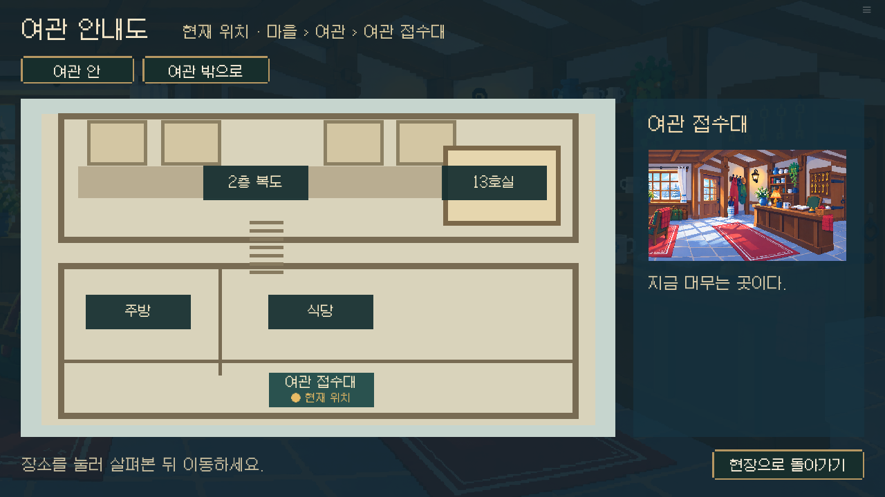
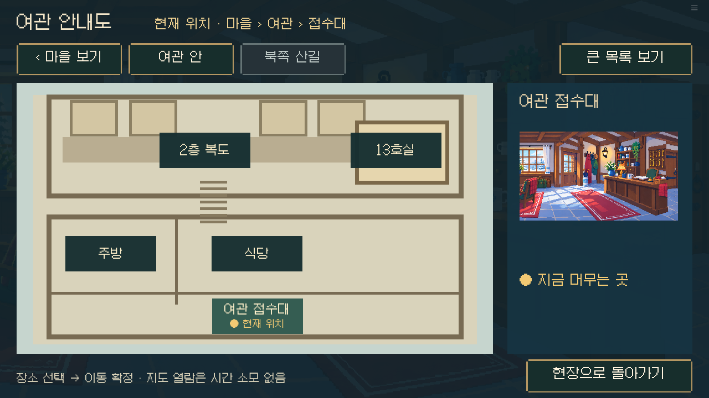
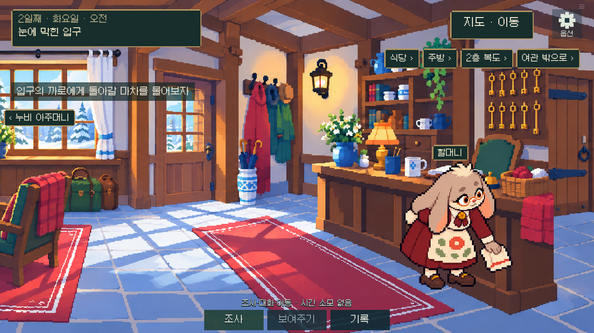
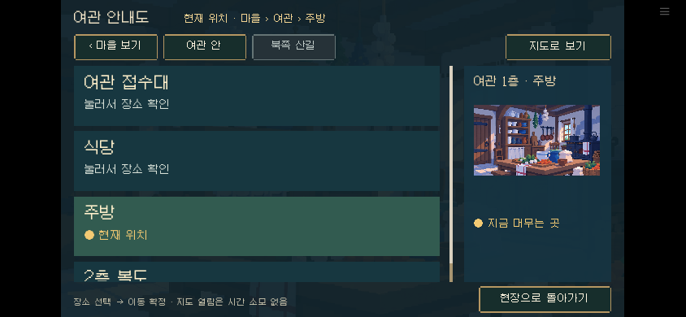
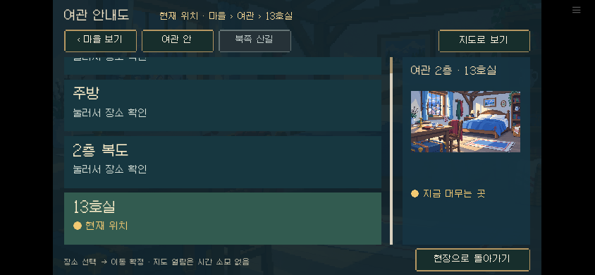

# 0.17.10-dev · 지도와 장소 선택

기준 main `7868ee71c70eb0181b1ab847cf01ca205ed5a5d7` (Claude 0.17.9). 기존 지도/현장 이동 엔진을 유지하는 표시층 개선이다.

Claude가 먼저 0.17.9를 main에 배포했으므로 충돌 없이 3-way 통합한 이 지도 묶음은 0.17.10으로 구분한다. 주민 역할·학습 비용 안내·기록 분류·정산 설명·회의 표시 변경을 모두 보존했다.

## 검토와 변경

기준 0.17.9에는 현재 위치, 여관 내부 보기, 직접 이동 버튼, 시간 소모 없음 안내가 이미 있었다. 중복 개편하지 않고 다음을 보완했다.

- 현장 HUD에도 `현재 · 여관 › 접수대/2층 복도/13호실` 경로를 표시한다. 북쪽 장소는 `마을 › 북쪽 산길 › 장소`로 바로잡았다.
- 지도 상단 영역 전환과 `마을 보기`, 내부 보기, 현장 복귀를 같은 위치에서 찾을 수 있게 했다. 목록과 지도 모두 기존 허용 장소 집합만 사용한다.
- 지도 핀 64px, 이동 확정 72px, 복귀 60px, 현장 인접 이동 64px로 확대했다(1280×720 논리 좌표). 큰 목록은 136px 행/36px 제목을 사용하며 스크롤할 수 있다. 보기 선택은 persistent 설정에만 저장한다.
- 지도 열람·장소 선택·이동 확정을 구분하고, 이동 확정 버튼 위에 기존 `시간 소모 없음` 규칙을 명시한다. Claude가 추가한 현장 하단 조사·대화·이동 시간 안내를 그대로 보존하고 초안의 중복 안내는 제거했다. 시간/여정/일정/조사/판결 코드는 변경하지 않았다.
- 주민의 위치·일정 표시는 추가하지 않았다. 기존 지도에는 확인한 주민 일정 자료가 없으므로 실제 스케줄 함수로 현재 주민 위치를 계산해 노출하지 않는다. 미발견 통로/온실/제단도 기존 해금 조건 그대로다.

## 실제 실행 결과

동일 최종 웹 아카이브 `1291178d95cb42c6409ac5a76ee4bb97136b5c4443336fccfc770593d862d5f3`를 Chromium에서 실행했다. 날짜 2/8일 진입 상태는 fixture로 명시적으로 설정했으며, 아래 조작은 실제 UI로 수행했다.

- 마을 → 여관 내부 → 목적지 선택 → 취소: 전체 room13 상태 동일.
- 접수대 → 복도 → 객실 → 복도 → 접수대 직접 이동: 날짜/시간 유지.
- 접수대 저장 → 식당 이동 → 불러오기: 저장 상태 전체 동일.
- 큰 목록 선택/이동 및 지도 복귀, 모바일 844×390 터치·큰 글씨·저장/불러오기 통과.
- 목록 하단 객실까지 PC wheel 스크롤 후 이동, 모바일 CDP touchStart/touchMove/touchEnd 드래그 후 실제 마지막 객실 노출·선택·복귀 확인. 최초 스크롤 검사의 단일 wheel과 잘못된 모바일 letterbox 좌표를 고친 뒤 실제 입력을 검증했다.
- 8일차 아직 모르는 온실/제단이 지도 노드에 없음 확인.
- 기존 매체 327개와 모든 JSON 바이트 동일. SDK 8.5.3 compile/lint, 26개 검사 명령 통과. 이전 초안에서 자산 경로 설정이 빠진 두 검사는 경로를 지정해 통과했고 최종 통합본은 전체 통과했다.

## 남은 한계

390×844 세로 브라우저에서는 기존 16:9 게임 캔버스 전체가 축소된다. 큰 목록은 핀보다 읽고 누르기 쉽지만 세로 전용 반응형 UI를 완성한 것은 아니다. 가로 회전 안내를 유지한다. 실물 휴대폰과 공개 호스트 직접 브라우저 재생은 미검증이며, 배포 API 결과와 동일 빌드 로컬 실행을 구분한다.

생활 동작은 기존 시간대/일정과 승인 자산을 유지했다. 새 Library 자료는 다운로드 실패로 미검수·미적용이다. 신규 사건이나 시간 소모, 미발견 증거/숨은 주민 위치는 추가하지 않았다.

`before/`와 `after/`에 동일 여관 상태 전후 화면, `scroll/`에 실제 스크롤 결과, QA 코드와 JSON에 구체적 범위를 기록했다.

## 전후 캡처

| 기준 main 0.17.9 | 통합 지도 0.17.10 |
|---|---|
|  |  |
|  |  |

